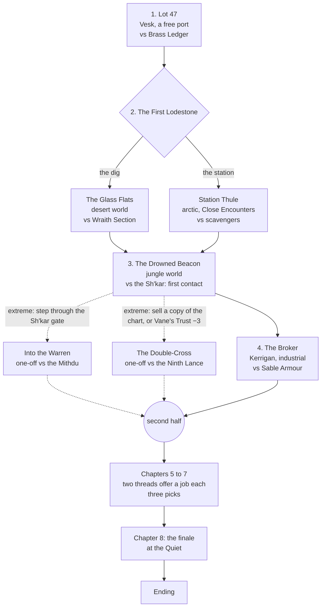

# Story mode: *Dead Reckoning* (plan)

The second story. A treasure hunt across several star systems: the company is
hired to follow a dead surveyor's clues to a lost world, and it is not
the only company on the trail. Every rival PMC is one of the game's six
archetypes with a face and a name, each racing for the same prize for a
different patron. Somewhere at the end of the clues is a civilisation that
nobody has catalogued, and it is not as dead as the charts say.

It is built the way *Deep Contract* was (`docs/story-mode-plan.md`): a story
graph written as data, meters and flags, a fixed first half and a free second
half drawn from threads by pressure, written enemy forces scaled to the company,
story battles that are ordinary two-sided battles, and no battle ever played in
the background. Almost all of the engine carries over. This plan says what the
story is, and what it needs that *Deep Contract* did not.

This is a plan, not a spec. Section 8 records the decisions, settled with the
owner; only the story's length waits on the walk. Every name is a placeholder.

---

## 0. The rework: first contact (settled, and built for the first half)

Asked for by the owner after phase 4, and settled in two rounds: the story
stays **a treasure hunt, with clashes against rival PMC companies** (a war was
"a bit much"), but the Xenotripods are **unknown** until the second half, the
campaign is **first contact**, every **full Xenotripod battle is in the second
half**, and the patron is a **rich, powerful, elusive man**. Where sections 2 to
4 disagree with this section, this section wins.

### What changed

| | Was | Now |
|---|---|---|
| **The patron** | Ottilie Vane, of Vane Antiquities, at the auction in person | **Lucan Vane**: shipping lines, three banks and a moon, and seen by almost nobody. He is a voice on a scrambled line, and his face is drawn half in shadow (`face.shadow`). He comes into the room once, at *The Collector*. The meter, flags and thread keep their names (`vane`, `vane_cut_off`…). |
| **Lot 47's Escort** | Vane across the square | **Halloran**, Vane's chief reader, with the log and an open line to his employer |
| **The stones** | Xenotripod lodestones | Lodestones "no human hand had made". Nobody in the first half says whose. |
| **The Drowned Beacon** | A battle against the Sh'kar | The **Red Reavers** digging at a structure nobody built. Once the lodestone is found, or by turn 4, the Reavers break and run, and **unknown contacts** step out of the air by the objective. |
| **The one-off through the gate** | A battle against the Mithdu | The Reavers went through first, after the hoard. By turn 3 the tunnels' keepers come out of the walls as unknown contacts. |
| **Survey Cover** (side contract against the Mithdu) | From chapter 3 | From chapter 5 |
| **The reveal** | none (named from the first page) | The second half opens on it: Halloran reads the last of the log, and Morrow names them, the three-legged ones who step out of the air. Every newsfeed has the word by the next jump. |

**Who hired the rivals is a secret** (`clients`, settled after the rework).
Every rival's client starts unknown, and the star chart says "client unknown"
beside its name. Something in the story reveals each one
(`{ reveal: 'client_<id>' }`), with a line in the journal:

| Rival | Client | Found out by |
|---|---|---|
| Brass Ledger | the Orrin Mercantile Bank, behind shell companies | paying Kettering's man for what he knows (chapter 1), or buying their catalogue |
| Wraith Section | the Admiralty's Office of Naval Intelligence | reading their orders in the dead drop (the Glass Flats) |
| Sable Armour Group | the Halvorsen Mining Combine | taking the warehouse (its papers), or following Sable |
| Kestrel Air Cavalry | the Meridian newsfeed | Rook Kestrel's call (*The newsfeed*) |
| The Red Reavers | nobody: claim jumpers | Hal says so at the beacon |
| The Ninth Lance | Lucan Vane | Daw says so (*The Double-Cross*) |

**Morrow, his backer, and the proxies** (settled after the dialogue pass).
Morrow flew his first voyage on a backer's money and came home with a hold
of stones, which the backer took. Together, the stones warmed, turned the same
way and began to call: Morrow understood he had been carrying them home, and
that enough of them in one place would wake whatever they belong to. He stole
them back, went out again alone, and put them down one at a time along the
route ("never two in one hold"), each stone pointing to the next, so the log
and the stones are a lock as much as a map. He sold one on Kerrigan for fuel
(*The Broker*'s lot), and died on Pell with one in his hand.

**The backer was Lucan Vane**, and Vane is the **true client** behind most of
the race: through proxies he funds Brass Ledger (the Orrin Mercantile Bank's
shell companies), Sable Armour Group (the Halvorsen Mining Combine) and Kestrel
Air Cavalry (the Meridian newsfeed, bought last year), and seeds them stones
so many hands dig up the rest. **The company is hired by Halloran**, a reader of
old logs, for a client neither of them has met: a voice on a scrambled line
(`client`, Vane's face in shadow) whose money clears through a bank on
Halcyon. So every company on the trail, the player's included, works for a
client it cannot name, and when it comes out that most of them are the same
man, each has reason to question its own contract and, perhaps, to trust the
others. The first half only hints: Brass Ledger's, Sable's and Kestrel's
clients' money also runs through **Halcyon**, and the voice waves off the
question of who paid for Morrow's first trip. The company learns its client's
name when the second half opens (Halloran follows the money), or earlier from
Daw, if the Double-Cross comes. Wraith Section (the Navy)
and the Red Reavers are the only rivals he does not own. The second half
reveals it (*The Vault*'s receipts, *The Wreck*'s last entry).

**Vane's intent, and Morrow's end** (settled after the dialogue pass). Vane
is the only one alive who has seen the stones together: in his vault, forty
years ago, they warmed, turned and began to call. He took the wrong lesson.
To him they are a **key**: whoever brings enough of them to the Quiet opens it
and owns what answers to it, the network, the shields, the towers and the
tribes. Morrow understood they are a **summons**: brought together they wake
the Quiet, and it calls all that serves it home, the Esh-Aven included, and
nobody commands that. Recall proves Morrow right. Only the Navy (Wraith
Section's client) suspects as much.

Vane **hunted Morrow** when he stole the stones back: the Ninth Lance was
founded for it, forty years ago (Daw is too young to have been there). Morrow
ran, scattering the stones, sold one on Kerrigan for fuel, and, damaged and
still followed, came down on Pell and sealed himself in his cabin, where he
died with a stone in his fist that the hunters never got. His last entry
says who was behind him. The first half seeds it: the opening (the backer's
people a jump or two behind), Thule's records ("the same ship, two jumps
behind me now"), and the Lance's founding date.

**The contract, and Morrow's fate** (settled in the last first-half pass).
The contract is open from the start: see Halloran out of the auction alive
with the log, then follow Morrow's road to the end and file the first claim.
The company is following the route, not hunting the man. Morrow is presumed
dead (forty years silent, declared so by a court); only the client is
certain, because his people waited over Pell while Morrow died, and he says
so ("I am"), the first of his tells. The wreck finds him.

**Halloran** is an archaeologist of the library kind (archives, catalogues,
dead men's handwriting; the research half of an adventurer and none of the
action), who has spent years on the scraps of Morrow's writing that have
surfaced and proved better at reading the man than anyone alive. "Reader" is
what people call him for it, not a trade.

**The two companies that are never for hire** (settled after the dialogue
pass). The Ninth Lance and Wraith Section are not hired guns; each fights
beside the company only as a side taken:

- **The Ninth Lance**, only with the company fully Vane's: the client's Trust
  high (3 or more), never suspected, cut off or exposed. Vane sends it to see
  his claim filed (*The Landing*, *The Escort*), and its help seals the claim
  in his name (*Finder's Fee*).
- **Wraith Section**, only with the company against Vane: cut off or his
  receipts published, and the door to Nine opened (a message left in the
  Glass Flats dead drop, `wraith_warned`, or their paymaster turned). The Navy
  wants the Quiet shut, not sold, and sends Nine against the Lance (*The
  Collector*) or to the Spire.

Neither is offered in the first half; the Glass Flats' dead drop is the seed.

**The Esh-Aven and Morrow** (settled in the last first-half pass). Two
Hashamer Esh-Aven, Holds-the-Lamp and First-Over-the-Water, went with Morrow
to carry the stones away from the Quiet, and were killed by the ship hunting
him. He buried them in a glass cairn at his dig on the Glass Flats (seen if
the company goes there, `eshaven_graves`) and thanks them by name in his
Thule records. Seven-Holds-the-Staff remembers them. Either sight opens *The
Mimics* without Understanding.

**More than one road to the Esh-Aven** (for the second-half pass). Today they
are met only in *The Mimics* (about one walk in seven). To build:
- *Teleport Storm* or *Cold Sites* (the Tribes): Hashamer runaways the other
  tribes have come to take back, to shelter or hand over.
- *Claim Jumpers* or *Bounty* (the Race): Brass Ledger's cages on a rival's
  ground, Esh-Aven inside.
- *The Wreck of the Morrow*: a third Esh-Aven's bones in the hold, and a word
  for the Hashamer in Morrow's last entry.
- *Recall*: the Quiet's call names them, met or not.

**Business until somebody loses** (settled after the rework). The rival
companies are confrontational, and they make it business: clients, invoices,
contracts, prices. The first time the company beats one (`grudges`; the flag
`beat_<id>`, set by `story.js` `resolveBattle`), it becomes personal. From
then on the rival comes readier for the company (Readiness +1), and talks
about it. Its side's lines with `if: { flag: 'beat_<id>' }` win over a
battle's own plain ones (`talkFor`). Brass Ledger has not forgotten Vesk,
Sable her warehouse, Nine the Glass Flats, Hal the beacon, and Daw the
docking ring.

**Brass Ledger** is the new name of Coin & Kettle.

**Lot 47 lost** (settled after the rework, from playing it). A defeat at Lot
47 means Brass Ledger have the log (`log_lost`). The company sees their
ship loading on Vesk's landing field and decides at once (*The log is
gone*). It can get the log back now, at a cost, get it back at a later
mission, or, failing both, rebuild it:

- **Hit their ship** before it lifts: *Taking It Back*, Find and secure with
  the relic on Vesk's landing field (`veskfield`), the log as the relic.
  Carried off, it is the company's again; otherwise it leaves with them.
- **Cut Kettering in on the claim**: no money changes hands. Brass Ledger
  become partners (`kettle_partner`), which is paid for at the end of the
  road: they take their share in *Finder's Fee* and come to *The Landing*
  beside the company. Vane's Trust −1.
- **Let them run with it, and follow** (`ledger_has_log`): the rivals' lead
  (`theirs` +1, Lead −1). Halloran has only the eleven pages he photographed
  in the arcade.

While Brass Ledger have it, they sell its pages (the Race's pressure +2,
and the readings already on sale). It comes back in one of two ways:

- **Taken back at the beacon**: Kettering brings the log to Tessaly IV to
  sell it to the Reavers digging there (*The private sale*). The company can
  break up the sale (*The Private Sale*, Find and secure on a mud bank,
  `mudbank`, the log as the relic), or let it go through and wait for
  Kerrigan.
- **Taken back at the Broker**: on Kerrigan, Lot 47 itself is shown beside
  the heading, not for sale at any price. Only the warehouse taken by force
  brings it back with the heading (`theirs` −1).

The log is bigger than money. It cannot be bought back, not by the company
and not by Vane: it comes back by force, by a share of the claim, or
rebuilt.
- **Never lost for good**: still theirs when the second half opens, Halloran
  rebuilds it from the lodestones themselves, which have begun to point. The
  rivals keep the lead it gave them.
- **Rebuilt on the way**, from the company's own finds with Halloran's
  pages: Wraith Section's stolen copy in their dead drop on the Glass Flats,
  or Morrow's records at Station Thule (Lead +1, and a line in the journal).

Vesk itself is now a settlement at a crossroads, with a market square in
the middle and a fountain at its heart that blocks the view across the
square (`fountain`: impassable, blocks sight, cover; a stone pillar with a lamp at each corner). Its map's skin (`skin: 'market'`) draws barricades as market
stalls and crater fields as the market's clutter, and names them so.

The rivals, the race, the Ninth Lance and the second half's threads stand as
written in sections 2 to 4. Only the Tribes are now met for the first time
under a name.

### Unknown contacts (`storybattle.js` `contacts`)

- A battle's `variant.contacts: { turn, found, keys }`. At the End phase of
  `turn`, or the first after the objective is found (`found`), side B's force
  breaks and runs. Its units go off the table as fled, not lost, and they and
  side B's dead leave the side's rout tally (`superseded`; `scenarios.js`
  `routed`).
- In their place come side B's **unknown contacts**: a unit for each key, two
  more than the battle's Tier, as many as there are keys at most. They appear
  near the objective (a carried relic is dropped first). Each is named
  "Unknown contact" and labelled "Unknown contact 1 [B]", and side B is called
  "Unknown contacts" from then on. Its stat panel shows only its models and its
  Suppression, and says that nothing in the company's files matches it.
- The figures are drawn as they are: the company sees them, and has no word
  for them.
- The moment `contact` is said (`TALK_MOMENTS`). Before the reveal they speak
  only as `unknown`, a dark shape with lights in it (`face.shadow: 'full'`), in
  brackets.
- Tests: `storycontacts.js`, and `storydrwords.js` checks that the first half
  never names them.

---

## 1. What it builds on

Everything *Deep Contract* built is reused as it is:

| Need | Already there | Where |
|---|---|---|
| The story engine: nodes, meters, flags, conditions, effects, the pool, the finale, endings, epilogues, checkpoints and ironman | `PMCStory` | `src/story/story.js` |
| Battles from story data: enemy forces by meter, allies, strikes, readiness, roles, edges, variants (target, ambush), fixed maps by seed, intel levels | `PMCStoryLevers` | `src/story/levers.js` |
| The story scenarios: Strike, Convoy, Parley, Hold the Line, Breakout, Hive Heart | `scenarios-story.js` | `src/story/scenarios-story.js`, `engine/storybattle.js` |
| Voices in battle, allies answering orders, chapter conversations | `talkFor`, `allyVoice`, `conversation` | `story.js`, `storybattle.js` |
| Faces and scenes as pixel art | `PMCStoryPortraits`, `PMCStoryScenes` | `src/view/story-portraits.js`, `story-scenes.js` |
| The validator, the whole-story walk, the made-up battle reports | `validate.js`, `storywhole.js` | `src/story/validate.js`, `test/` |
| Choosing a story when one begins | The story picker on the menu | `story-screens.js` |

What the game already has for this story in particular:

| Need | Already there | Where |
|---|---|---|
| **Six themed PMCs** | The rival archetypes: *Bastion* (armour, dug in), *Elite* (few, expensive, good), *Mercenary* (whoever pays), *Special Ops* (snipers, drones, jamming), *Shock* (closes and uses knives), *Cavalry* (armour and fast drops). Each has weights by unit group, doctrines, a temper and names. | `campaign.js` `ARCHETYPES` |
| **Six Xenotripod tribes** | *Tunnellers* (Mithdu: tunnels under everything), *Architects* (Amt: rule a planet from towers), *Mimics* (Hashamer: nine million Esh-Aven copying their absent masters), *Furies* (Ghadon: fight everyone), *Fortress* (Ulvar: shields and guns), *Raiders* (Sh'kar: step out of the air behind you). Each with doctrines and weights. | `campaign.js` `XENO_ARCHETYPES` |
| The Xenotripods on the table | Limited Senses, Mental Projection, Shield Generators, teleports, turrets, Dual-mode Weapons, the X doctrines (Underground Advance, Fortify and Strike!, Low-spectrum Cloaking…) | `rules/xeno.js`, `data.js`, `engine/*` |
| Star systems, worlds and conditions | A star, four to seven planets, each a kind of world (desert, arctic, temperate, colonised, industrial, jungle, mountain, unstable) with Other Worlds conditions, and sites on each | `camp-system.js`, `rules.js` `rollWorld` |

---

## 2. The story: *Dead Reckoning*

### The setting

**The Morrow log.** Forty years ago the surveyor **Elias Morrow** flew a
one-man survey ship past the edge of the charts and came back with a hold full
of Xenotripod artefacts and a log nobody could read. He died before he could
sell it. The log turns up in the catalogue of a free-port auction house as
*Lot 47*. Morrow wrote it in his own dead reckoning: no star fixes, only
headings, times and the things he saw. Read with the **lodestones**, the
palm-sized Xenotripod relics he left at each stop, it is a route.

**The prize.** At the end of the route is a world Morrow called **the Quiet**,
the home of a Xenotripod tribe older than any on record. Its teleport network,
its shields, its cities: whoever files the first claim under the **Finder's
Charter** owns the salvage rights, and the right to sell them.

**The patron.** **Ottilie Vane**, of Vane Antiquities, buys Lot 47 and hires the
company to follow it. She pays well, and she means to own whatever is at the
end. She has her own company, *the Ninth Lance*, and she has not told the player
about it.

**The race.** Vane is not the only buyer who saw the catalogue. Every rival on
the trail is a PMC company built on one of the game's archetypes:

| Rival | Archetype | Hired by | How it races |
|---|---|---|---|
| **Brass Ledger** | Mercenary (`swarm`) | Whoever pays this week | Shadows the others and sells what it learns. Can be bought. |
| **Wraith Section** | Special Ops (`marksmen`) | A naval intelligence office | Steals the clues instead of finding them. Always one jump behind, listening. |
| **Sable Armour Group** | Bastion (`armour`) | A mining combine | Slow. Digs in at every site it reaches and dares anyone to take it. |
| **Kestrel Air Cavalry** | Cavalry (`aircav`) | A newsfeed that wants the first pictures | Fast. First to every site, not always the best at holding it. |
| **The Red Reavers** | Shock (`shock`) | Nobody: claim jumpers | Turns up where the others have done the work. |
| **The Ninth Lance** | Elite (`elite`) | Ottilie Vane | Not a rival at first. The patron's own, waiting for the end of the trail. |

**The Xenotripods.** The tribes the company meets are the Quiet's
descendants, or its servants, or its jailers. Each chapter meets one of them,
and the story reveals them in turn:

| Tribe | Archetype | In the story |
|---|---|---|
| **The Sh'kar** | Raiders (`shkar`) | Guard the drowned beacon; the first contact. They take relics back. |
| **The Mithdu** | Tunnellers (`mithdu`) | Live under the old sites. Met by those who go down. |
| **The Hashamer Esh-Aven** | Mimics (`hashamer`), **every unit an Esh-Aven** | A servant people left behind, still keeping their masters' war in their masters' absence: nine million Esh-Aven and not a Crock among them. Every unit they field is a Xenotripod unit with its own profile and rules, drawn, named and counted as Esh-Aven (section 5). They can be allies. |
| **The Ulvar** | Fortress (`ulvar`) | The shieldwall around the Quiet. |
| **The Amt** | Architects (`amt`) | The Quiet itself: the towers, asleep. The finale. |

**The Esh-Aven of Hashamer.** Every Xenotripod tribe is two peoples: the
Crocks, who fill the castes from Alpha to Delta and give the orders, and the
Esh-Aven, the servant race who fill the Epsilon squads and do as they are told,
reached through the Crocks' Mental Projection. On Hashamer I the Crocks are
gone. When the Quiet called its tribes home, a long time ago, the Crocks of
Hashamer went, and left their Esh-Aven behind: nine million of them, with their
masters' armour, their masters' weapons and their masters' war, and nobody to
give the orders. They have kept the war going ever since by copying it. Some
Esh-Aven wear an Alpha's crest and give the orders now; others carry a Gamma's
guns. They project to one another the way their masters projected to them. That
is why every unit they field is a Xenotripod unit, and every one of them is an
Esh-Aven. What they don't have says the same thing: **no craft and no teleport
turrets.** The Crocks flew their craft home when they left, and the teleport
network answers only to a Crock's mind. The Hashamer fight on foot, behind a few
defensive turrets they can still keep running.

**They have names.** Everywhere else an Esh-Aven is one of a squad and nothing
more: the game counts their dead and does not name them. The Hashamer named
themselves when their masters left, in the masters' manner, as a thing done and
a place held: *Seven-Holds-the-Staff*, *Keeps-the-Ridge*, *Last-Down-the-Road*.
It is the first thing they will tell the company about themselves, and the
reason they ask that their dead be counted by name. So every Hashamer Esh-Aven
is named, and every one lost is remembered by name, in the battle and after it.

**Why they will work with a PMC.** Three reasons, and the story tells all three:

- **They know what the company is.** The Esh-Aven have only ever fought other
  people's wars, and so has the company. To them a PMC is the one human thing
  that makes sense: soldiers who serve, and who chose whom. They call the
  company *the other hands*. It is the first time in their history they have
  been asked to fight for someone rather than told.
- **The other tribes want them back.** To the Sh'kar, the Ulvar and the rest,
  the Hashamer are runaways, property to be returned to the Quiet. Brass Ledger
  have found a buyer for them too. Nobody else on the trail will fight beside
  them.
- **They remember the way, and they fear it.** The Hashamer carry the doctrine
  of Enhanced Genetic Memory: what one generation knew, the next inherits. They
  remember the road their masters took to the Quiet. They know that if the Quiet
  wakes, it will call every Esh-Aven home to serve again. They will guide the
  company there for one price: a promise that the Quiet stays asleep, or that
  someone speaks for them when it wakes.

| Force | Army | Role in the story |
|---|---|---|
| The player's company | PMC | Hired to follow the log |
| The rivals | PMC (archetypes) | The race: met on the trail, a thread in the second half |
| The tribes | Xenotripods (archetypes) | The trail's guardians: a thread in the second half, a possible ally |
| The Ninth Lance | PMC (Elite) | The patron's company: met only after an extreme choice in the first half, a thread in the second |
| Ottilie Vane | none on the table | The employer: pays, steers, and keeps her own counsel |

**Enemy forces are written for each battle**, as in *Deep Contract*. A rival's
battles are written from its archetype (its unit groups, doctrines and temper),
and each rival's meter scales what it fields (section 4).

### The shape

The same shape as *Deep Contract*: eight chapters, a fixed first half that
changes how each chapter plays but not which comes next (with two one-offs
reached by extreme choices), and a free second half drawn from four threads.
What is new is **the trail**: each chapter happens at a different place, a
planet in a star system, and the company jumps between them. Each chapter's card
shows where, and a **star chart** (section 5) shows the route so far, where the
rivals are, and how many lodestones each side holds.



### The first half: The Chart (chapters 1 to 4)

The treasure hunt as Vane describes it: a race between companies, for a dead
world.

- **1. Lot 47.** Vesk, a free port on a colonised world. The auction, and the
  company as Vane's escort. Brass Ledger tries to take the log in the street
  outside. A Tier I *Secure and control* or *Meeting engagement* in the port's
  market square; it teaches the story screens and cannot be lost outright (a
  defeat: the log is held, at a cost, Lead −1). Events: how to handle the
  auction (outbid in the open, let Vane bid while the company watches the room,
  or have Brass Ledger's agent followed); what to do with the agent taken.
- **2. The First Lodestone.** Morrow's first stop could be read two ways. The
  player picks one; the rival who takes the other gets a lodestone (Lead −1,
  that rival +1):
  - **The Glass Flats** (a desert world): Morrow's dig site, half buried. *Find
    and secure* with the **relic** variant (section 5): one of the search sites
    holds the lodestone, and the battle reports who carried it off. Wraith
    Section is already there, having read the company's copy of the log.
  - **Station Thule** (an arctic world): the survey relay Morrow stopped at,
    derelict. *Critical control* in Close Encounters against a scavenger band
    (rebels: the *Pirates* archetype, `freespace`). Slower, safer, and the station's records
    give Intel +1.
- **3. The Drowned Beacon.** A jungle world, half under water: Morrow's beacon
  is a Xenotripod structure, and it is not abandoned. **First contact**: the
  Sh'kar. The choices are about how to meet them: storm the beacon (*Strike*,
  Alarm +2), watch first (the battle a Tier down, Understanding +1, Intel +1),
  or try to signal (a roll on Understanding: on a pass the Sh'kar let you take a
  rubbing of the beacon and leave; on a fail, the *ambush* variant, sprung by
  them). The lodestone here is in the beacon (the relic variant again).
- **4. The Broker.** Kerrigan, an industrial free port. The next heading is in
  the hands of Brass Ledger's broker, who is auctioning it again, to everyone.
  Sable Armour Group has already bought the warehouse it sits in. Buy it (kUC),
  take it (*Hostile takeover* against Sable), or let Sable have it and follow
  Sable (Lead −1, Intel +2: where Sable goes next is the clue; and Sable owes
  the company, `sable_owed`, which buys one hire for free later).

**The two one-offs**, each in place of chapter 4, each only after an
**extreme** choice (`extreme: true`, as in *Deep Contract*), each leaving a mark
on the second half:

| One-off | The extreme choice | The battle | What it leaves |
|---|---|---|---|
| **Into the Warren** (the tribes) | At the beacon, the Sh'kar step back into the air through a teleport turret, and it stays open behind them. **Step through after them** (flag `warren_entered`, Alarm +2). | *Clearing out* in Close Encounters, against the Mithdu, underground on a world nobody has charted | Alarm +3 (and known), Understanding +1, and **a lodestone the rivals cannot know about** (Lead +1). The tribes thread is open from chapter 5. |
| **The Double-Cross** (the patron) | **Sell a copy of the chart** to a rival at The Broker's table (flag `chart_sold`) while Vane's Trust is −1 or lower; or Vane's Trust has fallen to −3 or lower by the end of chapter 3 | Vane sends the Ninth Lance to take the log back. *Meeting engagement* or *Hostile takeover*. | Vane has cut you off (`vane_cut_off`). The patron thread is open from chapter 5. The rivals see a company without a patron, and some of them make offers. |

If both are triggered, **Into the Warren** wins, and the Double-Cross's trigger
sets `vane_suspects` instead (as *Into the Sump* and *The Relief* do).

### The second half: The Long Jump (chapters 5 to 8)

Built from **threads**, chosen as *Deep Contract*'s are: at each of three picks
the two threads under the most pressure offer their next chapter, the one passed
up applies its cost, and the finale goes to the enemy thread under the most
pressure that has had a chapter played.

| Thread | Rises with | Chapters (first release) | Finale |
|---|---|---|---|
| **The Race** (the rivals) | Low Lead, the rivals' lodestones, a rival wronged (`kestrel_burned`, `wraith_robbed`…) | *Claim Jumpers* (Kestrel reaches a site first: *Convoy* or *Meeting*), *The Wreck of the Morrow* (Morrow's ship, found and fought over with Sable: *Clearing out*), fallback *Bounty* (Wraith Section has been paid to stop you: the *ambush* variant) | **The Landing**: at the Quiet, the leading rival is dug in on the only landing field. *Hostile takeover* with the target variant (their commander). |
| **The Tribes** (hostile) | Alarm, the Warren entered, relics taken by force | *The Watchers* (the Ulvar shieldwall: *Strike* on its shield turrets), *Teleport Storm* (the Sh'kar raid the company's camp: *Invasion*, defending), fallback *Cold Sites* (the Mithdu in old ruins: *Clearing out*) | **The Spire**: into an Amt tower, Close Encounters, shield generators as chambers to burn out (*Hive Heart*'s machinery, with turrets for brood chambers). |
| **First Contact** (allies, no finale) | Understanding, relics returned, the Esh-Aven helped | *The Mimics* (the Hashamer Esh-Aven ask for help against Brass Ledger's slavers, and fight beside you: **Xenotripod allies**), *The Speaker* (a *Parley* with an Alpha, through Mental Projection), fallback *Signal Fires* | none: it changes the finales instead, as the truce does |
| **The Patron** (Vane and the Ninth Lance) | Low Vane's Trust, `vane_suspects`, `vane_cut_off`, the Lance's strength | *The Vault* (Vane's store of relics, and what she has been selling: *Strike*), *The Escort* (Vane's relics across a contested world: *Convoy*), fallback *Debts* (Vane's creditors come for the company: *Meeting*) | **The Collector**: the Ninth Lance at the Quiet's landing. *Hostile takeover* with the target variant (the Lance's commander). |

- **First Contact has no finale**, as the truce had none. With `contact` set,
  the finales change: *The Spire* is fought against the Ulvar hardliners with
  Esh-Aven beside you, and *The Landing* and *The Collector* bring Xenotripod
  allies.
- **The override: Recall.** If **Alarm reaches 8** when the finale begins, the
  Quiet wakes: every teleport turret on the world opens at once, and the finale
  is **Recall**, a *Breakout* across the landing field while the tribes come out
  of the air, whatever else was due.
- **Picks.** Three, in the story's data, as before (`picks: 3`).

### Endings

Checked in order; the first that holds is the story's. The last has no condition.

| Ending | Roughly |
|---|---|
| **Broken Company** | The company can no longer field an army at its own Tier. |
| **Lost Signal** | Recall was the finale: the company escapes the Quiet with what it can carry, and nobody will ever find the route again. |
| **Claim Jumped** | *The Landing* was lost, or the rivals hold more lodestones than the company at the end (`theirs` above `stones`). Another company's name is on the claim. |
| **Repossessed** | *The Collector* was lost, or Vane cut you off and the finale was lost. Vane has the Quiet, and the company has nothing. |
| **First Contact** | `contact` or `relics_returned`, the finale won, Alarm under 8, and neither `child_taken` nor `promise_broken`. The company is the first to speak with the Amt and walks away with no salvage at all, and every newsfeed in the sector wants the story. |
| **Finder's Fee** | Stayed with Vane (no `contact`, not cut off, not `vane_exposed`), the finale won (not the Collector), the client's Trust 1 or more (shared with Brass Ledger with `kettle_partner`). The claim is filed in Vane's name. The company is rich, and the Quiet will be stripped. |
| **Dead Reckoning** | Anything else: the company reaches the end of the log, and what it does with it decides nothing. |

Each has an epilogue, as in *Deep Contract*: the Quiet, the tribes, each rival
(who is still in business, who is not), Vane, and the units that stayed.

---

## 3. Events and choices

Everything in *Deep Contract*'s section 3 carries over: every decision is an
event written for its place in the story, two to four options each written as a
thing to do and saying plainly what it risks; options closed by `if` or `cost`
say why; before-battle events change the battle (battle levers) and after-battle
events change the long term (state levers); no event is used twice; extreme
choices are marked; every flag set is read later by something that changes the
table, the choices or the route.

What is particular to a treasure hunt:

- **Lodestones.** Each chapter has one to find (the relic variant, or an event).
  The company holds some (`stones`), the rivals the rest (`theirs`). **Five**
  open the Quiet. With fewer the finale is fought anyway, harder (section 4),
  and *Lost Signal* and *Claim Jumped* come closer. A lodestone can be bought,
  stolen, traded to the tribes (`relics_returned`), or lost in a defeat.
- **Rivals are people.** Each rival company has a commander with a face and a
  voice: they talk in the conversations, taunt in battle, and can be dealt with
  off the table (bought, outbid, warned, wronged). How the player treats each one
  is a flag its later chapters and its epilogue read.
- **The tribes can be met three ways.** Force (Alarm up, relics taken),
  watching (Intel and Understanding up, slower: Lead down), or a signal (a roll
  on Understanding). The choice comes at every Xenotripod battle, so how the
  company deals with them is built up across the story, not chosen once.
- **Time is the race.** The slow road, a side contract or a detour costs Lead in
  the second half, as Hive Growth was the cost of time in *Deep Contract*.

### The trail

Every chapter happens somewhere. A battle there is fought on that kind of world,
with that world's conditions (Other Worlds, pp. 164-165), whatever the
campaign's options say. The conditions are chosen to matter to the battle written
there.

| Chapter | Place | System | World | Conditions | Why there |
|---|---|---|---|---|---|
| 1. Lot 47 | Vesk Free Port: the auction house and the market square | Hadley | Colonised (`dense`) | standard | The tutorial: nothing strange |
| 2. The Glass Flats | Morrow's dig, half buried | Vantor III | Desert | low gravity | Long jumps across open glass, and Wraith's snipers love it |
| 2. Station Thule | The survey relay, derelict | Okoro II | Arctic | no atmosphere (sealed suits) | Close Encounters in a dead station |
| 3. The Drowned Beacon | The beacon in the flooded forest | Tessaly IV, "the Mire" | Jungle | foggy | Fog cuts Mental Projection to 18": the Sh'kar can be surprised, and so can you |
| 4. The Broker | The warehouse on the docks | Kerrigan, Marrick system | Industrial | standard | Sable dug in among the cranes |
| Into the Warren | Under a world nobody has charted | (no fix) | Unstable | radiation | The Mithdu's tunnels; nothing about it is safe |
| The Double-Cross | Kerrigan's orbital dock | Marrick | Industrial | high gravity | The Ninth Lance's heavy kit, and nowhere to run |
| *Claim Jumpers* | The Hollin Shelf | Corvin | Mountain | low gravity | Kestrel's drops come in fast |
| *The Wreck of the Morrow* | Morrow's ship, where it came down | Pell | Unstable | toxic | Close Encounters inside the wreck |
| *Bounty* | A refuelling stop | Ilya | Temperate (`sparse`) | standard | Wherever the company is when Wraith catches up |
| *The Watchers* | The shieldwall | Brannock VI | Mountain | foggy | The Ulvar behind their domes |
| *Teleport Storm* | The company's camp | Sedra II | Temperate | time anomaly | The Sh'kar step out of the air |
| *Cold Sites* | Old ruins | Kasimir | Desert | weakness | The Mithdu under the sand |
| *The Mimics* | An Esh-Aven village | Hashamer I | Desert | standard | The Arid Host's own world |
| *The Speaker* | A pylon by a lake | Orlo | Temperate | standard | Nothing between the two sides but water |
| *Signal Fires* | The beacon again | Tessaly IV | Jungle | foggy | Back where contact began |
| *The Vault* | Vane's vault | Halcyon | Colonised | standard | Close Encounters in a vault (`compound: 'Vault'`) |
| *The Escort* | The haul road to the field | Umber | Industrial | toxic | Long road, bad air |
| *Debts* | A creditor's dock | Tarn | Industrial | standard | Wherever the bailiffs find the company |
| Finales | **The Quiet**: the landing field, and the spires | (the end of the log) | Colonised (towers) | low gravity, foggy | One world, two battles: the field, or inside a spire |

Places are written as data on each chapter (section 5), and the star chart draws
the systems in the order the company reaches them.

### Before the battle: the first half

| Chapter | The event | Options (and the levers under them) |
|---|---|---|
| 1. Lot 47 | *The bidding.* Lot 47 comes up, and half the room is bidding for somebody else. | Outbid in the open (kUC −1, Vane's Trust +1, every rival sees who has it: their Readiness +1). Let Vane bid while the company watches the room (Intel +1: an outline of the enemy). Have Brass Ledger's agent followed out of the room (the company chooses its role; `kettle_marked`). |
| 2. (the choice) | *Two readings.* Morrow's first heading could mean the Glass Flats or Station Thule. | The Glass Flats (Find and secure + relic, vs Wraith Section). Station Thule (Critical control, vs scavengers). The other site goes to a rival: `theirs` +1, Lead −1, and that rival's strength +1. |
| 2. The Glass Flats | *The dig.* Wraith Section's camp is already on the flats. | Dig at night (one Battle Tier down, enemy Readiness 0). Jam their comms first (`cost: { intel: 1 }`: Wraith's drones start Suppressed). Go straight for the dig (you attack; `glassflats_rushed`: the lodestone is easier to find, one search site fewer). |
| 2. Station Thule | *The airlock.* The scavengers have welded the station shut. | Cut through the main lock (you attack, the role is set). Find Morrow's maintenance hatch in the log (a roll on Intel: success, you choose where to come in; failure, enemy Readiness +1). Pay them to leave (kUC −2, no battle: Lead −1, and the records are half burned: no Intel). |
| 3. The Drowned Beacon | *First contact.* The beacon is a Xenotripod structure, and it has guards. | Storm it (the Strike scenario: Alarm +2, `beacon_stormed`). Watch first (one Battle Tier down, Understanding +1, Intel +1, Lead −1). Try a signal (a roll on Understanding, +1 with `thule_records`: success, no battle, `beacon_rubbing`, the lodestone given; failure, the ambush variant, sprung by them). |
| 4. The Broker | *Lot 47, again.* Brass Ledger's broker is selling the next heading to everyone, from inside Sable's warehouse. | Buy it (kUC −3, no battle: Lead −1, `theirs` +1, the broker sells copies). Take it (Hostile takeover against Sable). Let Sable have it and follow Sable (no battle: Lead −1, Intel +2, `sable_owed`). With `kettle_contact`: hire Brass Ledger for the takeover (allies, `cost` their Price). **Extreme**, with Vane's Trust −1 or lower: sell a copy of the chart to the broker (kUC +4, `chart_sold`: the Double-Cross). |
| Into the Warren (one-off) | *The other side.* The company is through, and the turret is closing behind it. | Hold the gate open with charges (strikes before turn 1, Alarm +1: the way back stays open). Let it close (no way back but forward: your units start with 1 SP; Understanding +1). Follow the voices (a roll on Understanding: success, the Mithdu let you pass a chamber, one objective fewer; failure, the ambush variant). |
| The Double-Cross (one-off) | *The repossession.* Vane's own company, the Ninth Lance, docks beside yours with a court order. | Hand back the log (no battle: `vane_cut_off`, Lead −2, the trail goes on from memory: Intel −2). Refuse (you choose the role). Fire first (strikes before turn 1, Vane's Trust −2, `lance_burned`). |

### After the battle: the first half

| After | The event | Options |
|---|---|---|
| 1. Lot 47 | *The agent.* Brass Ledger's man is in the company's hands. | Let him go with a message (`kettle_contact`: Brass Ledger can be hired from chapter 4). Pay him for what he knows (kUC −1, Intel +1, `kettle_contact`). Hand him to the port police (Vane's Trust +1, Brass Ledger strength −1, `kettle_burned`: they won't deal with you). |
| 2. The Glass Flats, won | *Wraith's dead drop.* Their camp holds a copy of their own orders. | Read it (Intel +2, `wraith_orders`: Wraith's patron is a navy, and the navy wants the teleports). Leave a message in it (Wraith strength −1, `wraith_warned`). Take their stolen copy of the log back (Lead +1, `wraith_robbed`: Wraith will come for it). |
| 2. The Glass Flats, lost | *Second best.* Wraith carried the lodestone off. | Follow their dropship (Lead +1, Loyalty −1: a forced march). Let it go and dig on (the dig's notes: Intel +1; `theirs` stays +1). |
| 2. Station Thule, won | *Morrow's records.* The relay kept his log entries, his voice and his fear. | Listen to all of it (Understanding +1, `thule_records`: he heard them talk). Send the records to Vane (Vane's Trust +1). Sell a copy to a newsfeed (kUC +2, `kestrel_deal`: Kestrel's patron, and Kestrel can be hired). |
| 2. Station Thule, lost | *Burned.* The scavengers fired the archive. | Sift the ashes (Lead −1, a roll on Intel: success, the lodestone after all). Take what's left and go (nothing). |
| 3. The Drowned Beacon | *What the Sh'kar left.* A wounded Alpha, and the lodestone still in its socket. | Take the lodestone (`stones` +1, Alarm +1). Leave it, and the Alpha, where they are (Understanding +2, Lead −1, `relics_returned`: the tribes remember). Take both (`stones` +1, Alarm +3, Vane's Trust +2, `alpha_taken`: Vane wants it alive). After a storming or a signal failure only: *the gate stays open*: **extreme**, step through after them (`warren_entered`, Alarm +2: Into the Warren). |
| 4. The Broker | *The broker's copies.* Everybody bought one. | Burn his stock (Lead +1, Brass Ledger strength −1). Buy them all (kUC −2, `theirs` −1: one rival goes the wrong way). Let them go (nothing, `theirs` +1). |
| Into the Warren | *The Mithdu's hoard.* A chamber of relics, and a lodestone among them that no rival will ever know about. | Take the lodestone only (`stones` +1, Lead +1). Take everything you can carry (kUC +4, `stones` +1, Alarm +2, `hoard_taken`). Take nothing, and mark the way (Understanding +2, `mithdu_marked`: a route the tribes thread can use). |
| The Double-Cross | *Vane's terms.* Her lawyer calls before the smoke clears. | Pay her for the log (kUC −4, Vane's Trust back to 0, `vane_cut_off` cleared, `vane_suspects`). Tell her where to put it (`vane_cut_off`, the patron thread). Offer her the next lodestone (`vane_suspects`, Vane's Trust −1, `owed_vane`: she will collect). |

### The second half's events

| Chapter (thread) | Before the battle | After the battle | Passed up |
|---|---|---|---|
| *Claim Jumpers* (Race) | *The scoop.* Kestrel's dropships are already down. Race them in (you attack, Readiness 0). Offer them the pictures (`kestrel_scooped`, no allies yet; Lead −1, Kestrel can be hired). With `kestrel_deal`: hire them against whoever else is there. | *The footage.* Let Kestrel run it (Vane's Trust −1, `kestrel_filmed`: every rival knows where the company is). Buy it from them (kUC −2). | `theirs` +1 |
| *The Wreck of the Morrow* (Race) | *The hatch.* Sable is already cutting in. Cut a second way in (strikes, Alarm +1: the wreck's own systems wake). Wait for Sable to open it (enemy Readiness −1, Lead −1). With `sable_owed`: hire Sable for free. | *Morrow.* His body, his last entry, and a lodestone in his fist. Take it (`stones` +1, `morrow_found`). Bury him with it (Understanding +1, Loyalty +1, `relics_returned`: the last stone is given back). | Sable strength +1, `theirs` +1 |
| *Bounty* (Race, fallback) | *The tip.* Wraith Section has been paid to stop the company. Lay a trap for the trap (the ambush variant, yours). Run (Lead −1, Readiness 0). With `wraith_warned`: Wraith's commander offers to call it off for a lodestone (`stones` −1, no battle). | *The bounty hunters' paymaster.* Hand them in (Vane's Trust +1). Turn them (Intel +2, `wraith_turned`: an outline of every rival force). | Wraith strength +1 |
| **The Landing** (Race finale) | *The field.* The leading rival holds the only landing field on the Quiet. With `wraith_turned`: their full list. With `kettle_partner`: Brass Ledger beside you, at their price. | The ending. | — |
| *The Watchers* (Tribes) | *The shieldwall.* The Ulvar's domes cover the only pass. Strike the shield turrets (the Strike scenario). Go round (Lead −2, no battle, Alarm +1). With `mithdu_marked`: under it (one Battle Tier down, you choose the role). | *The dome falls.* Its keepers ask for their dead. Give them back (Understanding +1, Alarm −1). Keep the turret cores (kUC +3, Alarm +2, Vane's Trust +1). | Alarm +1 |
| *Teleport Storm* (Tribes) | *The air goes wrong.* The camp's sensors scream. Dig in (barricades for you: the Invasion as defender). Move the stones away from the camp (`stones` held off the table: the Sh'kar's target is gone; enemy Readiness −1, Lead −1). | *What they came for.* Return a lodestone (`stones` −1, Alarm −2, `relics_returned`). Keep them all (Alarm +1). | Alarm +1, `theirs` +1 (the Sh'kar take one from a rival instead) |
| *Cold Sites* (Tribes, fallback) | *The sand moves.* Clear the ruins (Clearing out). Seal them (no battle: Alarm +1, Lead +1). | *A Mithdu child.* Let it go (Understanding +1). Take it to Vane (Vane's Trust +2, Alarm +2, `child_taken`). | Alarm +1 |
| **The Spire** (Tribes finale) | *The door.* With `contact`: the Esh-Aven open it, and the battle is against the Ulvar hardliners only. With `hoard_taken`: the Amt know the company, Readiness +2. | The ending. | — |
| *The Mimics* (First Contact) | *A village asks.* Brass Ledger are taking Esh-Aven for a buyer. Help them (Xenotripod allies; against Brass Ledger). With `kettle_contact`: pay Brass Ledger to leave (kUC −Price, no battle, Understanding +1). | *The Esh-Aven's thanks.* Their crested leader offers a guide who remembers the road to the Quiet, and names the price. Make the promise (`eshaven_freed`, `eshaven_promise`, Understanding +2, Lead +1: the guide knows a shorter way). Take the guide and promise nothing (`eshaven_freed`, Understanding +1). Ask for a lodestone instead (`stones` +1, Understanding −1: they give it, and stop talking). | Understanding −1, Brass Ledger strength +1 |
| *The Speaker* (First Contact) | *The pylon.* An Alpha waits on the far shore. Meet it (the Parley scenario). Bring Vane's people (Vane's Trust +2, the Parley with enemy Readiness +1: the Alpha sees them). | Held: `contact`, `speaker_met`; Alarm −2. Broken: Alarm +2. | Understanding −1 |
| *Signal Fires* (First Contact, fallback) | *The beacon again.* Light it (Hold the Line: the Sh'kar test the company, waves of them, nobody meaning to kill). | Held: Understanding +2. | nothing |
| *The Vault* (Patron) | *Vane's vault.* Her store of relics, and receipts for what she has sold. Break in by night (the Strike scenario, a Tier down). Ask to see it (a roll on Vane's Trust: success, no battle, `vault_seen`). | *The receipts.* Vane has been selling stones to the rivals all along. Publish them (`vane_exposed`, Vane's Trust −5, `vane_cut_off`). Use them (`vane_owes`: Vane pays double from now). | Vane's Trust −1, Lance strength +1 |
| *The Escort* (Patron) | *The convoy.* Vane's relics to the field. With `vane_cut_off`, they're yours if you can keep them. The fast road (you attack). The long road (Lead −1, Readiness 0). | *The cargo.* Deliver it (Vane's Trust +2). Keep a stone (`stones` +1, Vane's Trust −2). | Vane's Trust −1 |
| *Debts* (Patron, fallback) | *The bailiffs.* Pay them (kUC −3, no battle). Fight them (the Meeting engagement, against the Ninth Lance). | Lance strength −1 on a win. | Lance strength +1 |
| **The Collector** (Patron finale) | *Vane comes in person.* With `vane_owes`: she offers terms, and the battle can be a Parley. With `lance_burned`: the Lance's commander is Determined. | The ending. | — |
| **Recall** (override) | *The towers wake.* Run for the field with the stones (the Breakout scenario). Run for the field and leave the stones (Breakout, Alarm −3: the tribes let more of you out). | The ending (*Lost Signal*). | — |

### Telling the Esh-Aven's story

The player learns who the Hashamer are a piece at a time, before they ever meet
them, so that when the village asks for help the request makes sense:

| Where | What the player learns | How |
|---|---|---|
| *Morrow's records* (Station Thule) | Morrow met them: "servants with no masters, playing at soldiers in their masters' armour". | His recorded voice, in the event's text (with `thule_records`, the whole entry). |
| *What the Sh'kar left* (the beacon) | The Sh'kar wounded Alpha's projection names the company's kind: "*[hands without a master]*". The tribes think of servants and mercenaries as the same thing. | The bracketed voice, in the event's conversation. |
| *Voices* (an interlude) | The soldier who hears them hears the Esh-Aven too: many small voices, all saying the same thing to each other, nobody answering from above. | The event's text. |
| *The Mimics*, the card | Nine million Esh-Aven, and not a Crock among them. The masters left; the war stayed. | The chapter card. |
| *The Mimics*, the conversation | Why they fight in their masters' castes; why Brass Ledger is taking them; why they asked the company and not anyone else. | The opening conversation (below). |
| *The Esh-Aven's thanks* | The road they remember, and what they fear at the end of it: the price is a promise. | The event, and its options. |
| *The Speaker* | The Amt's Alpha calls them "*[our lost hands]*", and asks the company to return them. | The Parley's conversation; with `eshaven_promise`, the company's answer is written for it. |
| *Recall* | If the Quiet wakes, the Esh-Aven allies stop, mid-battle, and turn towards the towers. | A battle voice (`wave`), and the allies walk (as hired allies do), unless `eshaven_promise` was kept. |
| After every battle they fight in | Who fell, by name. The crested one asks the company to say the names. | The ally losses on the report, by name; a line in the debrief (`{fallen:hashamer}`, the names of the Hashamer lost in the last battle). |
| The epilogue | Whether the Hashamer were called home, or are still on their world, free; and the names of their dead who fell beside the company. | An epilogue line, by `eshaven_promise`, `promise_broken` and the ending, and the Hashamer's roll of the fallen. |

*The Mimics*' opening conversation, as it would be written (`talk` on
`mimics.brief`):

> **Company net:** Contact on the ridge. Xenotripods, a lot of them. They're… waving us down.
>
> **The crested one** *(an Esh-Aven in an Alpha's armour)*: *[You are the other hands. The ones who fight for pay.]*
>
> **The commander:** We're a company, yes. Who are you?
>
> **The crested one:** We are Hashamer. We are Esh-Aven. Our masters went home and did not take us. We kept their war, because no one told us to stop.
>
> **The crested one:** I am Seven-Holds-the-Staff. Our masters had names, and when they went we took names too. If we fall beside you, say them.
>
> **The crested one:** The hunters with the coin come for our young. They will sell them to the towers. No one else will fight beside us. You fight beside anyone. Fight beside us.
>
> **The commander:** And if we do?
>
> **The crested one:** We remember the road to the Quiet. Our blood remembers it. We will show you. There is a price, and it is not coin.

Their words stay halting and a little formal throughout: they learned speech
from their masters' projection, and then from the company.

### Hired guns: PMC allies

Allies are not only the Xenotripods. A rival can be **hired** to fight beside
the company, and the rivals are mercenaries: they cost money, they cost more
each time, they want a share, and they cannot be trusted with the prize.

- **Nobody is for hire at first.** The opening battles (chapters 1 to 3) are
  the company's alone. A rival becomes available only once a decision or an
  event has opened the door, and each one's door is different:

  | Company | What makes them available | Their terms |
  |---|---|---|
  | **Brass Ledger** | *The agent* (after *Lot 47*): let go with a message, or paid (`kettle_contact`). From then on they are always for sale. | Money, and more of it each time. |
  | **Kestrel Air Cavalry** | *Morrow's records* sold to the newsfeed, or *The scoop* (`kestrel_deal`, `kestrel_scooped`). | Pictures, not money: first access to a site (Lead −1), and they want the story told their way. |
  | **The Red Reavers** | *Claim jumpers* (a side contract): their captain spared or bought off (`reavers_spared`). | Cheap, and they leave a mess (Alarm +1 at a Xenotripod battle, Loyalty −1 for what the company watches them do). |
  | **Sable Armour Group** | *Lot 47, again*: left the warehouse (`sable_owed`). | Once, for free. After that, ordinary terms. |

  The earliest hire is at *The Broker* (chapter 4), and only Brass Ledger,
  only with `kettle_contact`. Hiring is then an option at the event before a
  battle (written into that event, with `hire: 'kettle'` on it), with a `cost`
  of that company's **Price**, and an `if` on what opened their door.
- **The Price rises.** Each hired company has a Price in kUC (section 4). It
  goes up by one each time they are hired, when they take losses, and when a
  demand is refused; a decisive win paid in full brings it down.
- **They make demands.** After a battle fought with them, their own event
  (below): a cut of the pay, first look at the next site, a lodestone, or a
  share of the claim. Paying keeps them sweet. Refusing costs their **Trust**.
- **Untrustworthy in battle.** Hired allies take orders as allies do, but with
  their Trust low an order can be answered with a demand ("Attack here? That's
  extra."): the order is refused for the turn unless the player pays on the spot
  (kUC, from the allies' order card). Once they have lost half their units, or
  with Trust at −2 or lower from the start, they **walk**: at the next End phase
  they leave the table, and the battle goes on without them.
- **They sell you out.** With Trust at −3 or lower and a rival bidding more,
  the company they were working for becomes their next job. The next battle
  against that rival has them in it (Readiness +1, the company's Intel −1: they
  know how it fights), or, written for one or two chapters, **the Turn**: the
  event before the battle finds their guns pointing the wrong way, and the
  battle is fought with the *ambush* variant, sprung by them, from inside the
  company's own half.
- **Xenotripod allies are the other way about.** They never ask for money and
  never walk for it. The Esh-Aven's price is the promise (*The Esh-Aven's
  thanks*), and it is the one thing they hold the company to. They are the same
  people from battle to battle, by name, and they remember who the company let
  die. They leave if relics are taken by force in front of them,
  and they do not come back while Alarm is rising.

Their events (one each, after a battle they fought in):

| Event | Company | Options |
|---|---|---|
| *The invoice* | Brass Ledger | Pay the extra (kUC −2, Trust +1). Dispute it (Trust −1, Price +1). Offer them a share of the claim instead (`kettle_partner`, Trust +2: *Finder's Fee* is split; *The Landing* brings them as allies). |
| *The edit* | Kestrel | Let them cut the footage their way (Vane's Trust −1, Trust +1). Demand the raw footage (Trust −1, Intel +1). Give them an interview (Lead −1, Trust +2, `kestrel_filmed`). |
| *The mess* | The Red Reavers | Pay them off and walk away (kUC −1). Make them clean it up (Trust −2, Loyalty +1). Look the other way (Trust +1, Loyalty −1, Alarm +1 if it was near the tribes). |
| *Favour returned* | Sable | (the free hire) Thank them (Sable's Price back to its start). Ask for another (Price +1: no longer free). |
| *A better offer* | any hired company, Trust −3 or lower | They have been offered more. Match it (kUC − their Price ×2, Trust 0). Let them go (`<company>_turned`: they will be in the next battle against their new paymaster, or the Turn). |

### Interlude events

One before each hub, the first that applies:

| Event | When | Options |
|---|---|---|
| *The jump* | Every interlude in the second half, unless something else applies | The drive is failing. Pay for the yard (kUC −1). Jump anyway (a roll: on a 1, Lead −1 and a unit takes a Trauma roll). |
| *The wake* | A unit was wiped out in the last battle | As in *Deep Contract*: pay the death benefits (kUC −, Loyalty +1) or don't (Loyalty −1). |
| *Voices* | Understanding 2 or more, after the beacon | {soldier:veteran} has started hearing them. Listen with them (Understanding +1, Loyalty −1: the company is uneasy). Send them home (the unit leaves, Loyalty +1). |
| *Send one ahead* | Vane's Trust 1 or more, and `stones` 2 or more | Vane wants a lodestone sent to her now. Send it (`stones` −1, Vane's Trust +2). Refuse (Vane's Trust −1, `vane_suspects` if she already suspects). |
| *A warm stone* | `stones` 3 or more | The lodestones are warm, and pointing the same way. Follow them (Lead +1, Alarm +1). Shield them (kUC −1). |
| *The newsfeed* | Kestrel is in the race, and `kestrel_deal` isn't set | A newsfeed wants pictures. Sell them (kUC +2, `kestrel_deal`, Lead −1). Refuse (nothing). |
| *Brass Ledger's catalogue* | `kettle_contact` | They are selling what they know. Buy (kUC −2, Intel +1, an outline of the next battle). Sell them yours (kUC +2, `theirs` +1). |

### Side contracts

Offered at interludes as in *Deep Contract* (one; two when the company is
behind the curve or Vane has cut it off, paid half as much again), taken or
passed up. In the second half each one taken costs Lead −1, unless it is a
catch-up offer.

| Job | Pay | Against | Notes |
|---|---|---|---|
| *Escort to the Yards* | 3 | Red Reavers | A freighter through claim-jumper space. |
| *Claim jumpers* | 3 | Red Reavers | A bounty. Their captain can be spared or bought off at the end (`reavers_spared`: the Reavers can be hired). |
| *Salvage dispute* | 4 | Brass Ledger or Sable | Whoever has the lower strength; the loser's strength −1. |
| *The village* | 2 | Brass Ledger | A Hashamer village; only once the Esh-Aven are known. Understanding +1 if taken, −1 if passed up. |
| *Survey cover* | 3 | The Mithdu | A survey team on a quiet world. Alarm +1 if taken. |
| *Vane's errand* | 4 | Whoever holds a stone she wants | Only while Vane's Trust is 1 or more. Vane's Trust +1. |
| *Any port in a storm* | 4 | The Ninth Lance | Only with `vane_cut_off`: a creditor of Vane's pays you to hit her. Lance strength −1 on a win. |

### What moves each meter, and who reads each flag

Every meter moves both ways in each half, by written events; every flag has a
setter and a reader that changes the table, the choices or the route. The
validator checks both, as for *Deep Contract*.

| Meter | Raised by | Lowered by |
|---|---|---|
| Vane's Trust | *The bidding* (outbid), *The agent* (police), *Morrow's records* (send), *What the Sh'kar left* (take both), *Lot 47, again* (buy), *The Watchers* (keep cores), *Cold Sites* (take the child), *The Speaker* (bring her people), *Bounty* (hand in), *The Escort* (deliver), *Send one ahead*, a decisive win | *The repossession*, *Vane's terms*, *The footage*, *The edit*, *The Escort* (keep a stone), *The receipts*, *Send one ahead* (refuse), questions in conversations that read `vane_suspects` |
| Loyalty | *Morrow* (bury him), *The mess* (clean up), *Voices* (send home), *The wake* (pay), winning | *Second best* (follow), *The mess* (look away), *Voices* (listen), *The wake* (don't), *The jump* (a bad roll), Red Reavers hired |
| Intel | *The bidding* (watch), *Wraith's dead drop*, *Second best* (dig on), *Station Thule*'s records, *Lot 47, again* (follow Sable), *The edit*, *Bounty* (turn), *Brass Ledger's catalogue* | Spent on options (`cost: { intel: 1 }`), *The repossession* (hand back) |
| Lead | *Wraith's dead drop* (take it back), *Second best* (follow), *The broker's copies* (burn), *The Mithdu's hoard*, *Cold Sites* (seal), *A warm stone* | *Two readings* (the other site), *Station Thule* (pay), *First contact* (watch), *Lot 47, again* (buy, follow), *Burned*, *What the Sh'kar left* (leave it), *The repossession*, *The scoop*, *The hatch* (wait), *Bounty* (run), *The Watchers* (go round), *Teleport Storm* (move the stones), *The Escort* (long road), *The edit*, *The newsfeed*, *The jump*, side contracts in the second half |
| `stones` | The relic carried off, *What the Sh'kar left* (take), *The Mithdu's hoard*, *Morrow*, *The Esh-Aven's thanks* (ask), *The Escort* (keep one), *Burned* (a roll) | *Bounty* (Wraith's price), *Teleport Storm* (return one), *Send one ahead*, a relic lost in a defeat |
| `theirs` | *Two readings*, *Second best*, *Lot 47, again* (buy), *The broker's copies* (let go), *Claim Jumpers* passed up, *The Wreck* passed up, *Brass Ledger's catalogue* (sell) | *The broker's copies* (buy them all), a relic taken from a rival in battle, *Teleport Storm* passed up (the Sh'kar take a rival's) |
| Alarm | *First contact* (storm), *What the Sh'kar left* (take), the Warren, *The Mithdu's hoard* (take everything), *The hatch* (cut in), *The Watchers* (keep cores, go round, passed up), *Teleport Storm* (keep them, passed up), *Cold Sites* (seal, take the child), *The Speaker* (broken), *A warm stone*, Red Reavers near the tribes, *Survey cover* | *The dome falls* (give them back), *Teleport Storm* (return one), *The Speaker* (held), *Recall* (leave the stones) |
| Understanding | *First contact* (watch), *What the Sh'kar left* (leave it), *Into the Warren* (let it close, mark the way), *Morrow's records* (listen), *Morrow* (bury), *The dome falls*, *Cold Sites* (let it go), *The Mimics*, *Signal Fires*, *Voices*, *The village* | *The Esh-Aven's thanks* (ask for a stone), *The Mimics* or *The Speaker* passed up, *The village* passed up, massacre (a decisive win against Esh-Aven allies' kin) |
| Rival strength (each) | The other site of *Two readings*, their chapter passed up, *Brass Ledger's catalogue*, a hire refused | *The agent* (police), *Wraith's dead drop* (warn), *The broker's copies* (burn), their defeat in battle (−1), *Salvage dispute* |
| Lance strength | `vane_suspects` or `vane_cut_off` (+1 a chapter in the second half), *The Vault* or *Debts* passed up | *Debts* and *Any port in a storm* won, *The Double-Cross* won |
| Price (each hired company) | Each hire, their losses, *The invoice* (dispute), *Favour returned* (ask again) | A decisive win paid in full, *Favour returned* (thank them) |
| Trust (each hired company) | *The invoice* (pay, share), *The edit* (their way, interview), *The mess* (look away) | *The invoice* (dispute), *The edit* (raw footage), *The mess* (clean up), orders they refused, their losses |

| Flag | Set by | Read by |
|---|---|---|
| `kettle_marked` | *The bidding* (follow the agent) | The Lot 47 battle (Brass Ledger start Suppressed: they were followed) |
| `kettle_contact` | *The agent* (let go, pay) | Hiring Brass Ledger; *The Mimics* (pay them to leave); *Brass Ledger's catalogue* |
| `kettle_burned` | *The agent* (police) | Brass Ledger never hire out; their forces Readiness +1 |
| `kettle_partner` | *The invoice* (a share) | *The Landing* (allies), *Finder's Fee* (split) |
| `glassflats_rushed` | *The dig* | The Glass Flats battle (one search site fewer) |
| `wraith_orders` | *Wraith's dead drop* (read) | *Bounty* (Wraith's commander can be reasoned with), *The Speaker* (the navy's interest: Vane's people are not the only threat; a roll +1) |
| `wraith_warned` | *Wraith's dead drop* (message) | *Bounty* (the offer to call it off) |
| `wraith_robbed` | *Wraith's dead drop* (take it back) | The Race's pressure; *Bounty* (Readiness +1) |
| `wraith_turned` | *Bounty* (turn) | *The Landing* (the full list); an outline of every rival force |
| `thule_records` | *Morrow's records* (listen) | *First contact* (signal roll +1) |
| `kestrel_deal`, `kestrel_scooped` | *Morrow's records* (sell), *The newsfeed*, *The scoop* | Hiring Kestrel |
| `kestrel_filmed` | *The footage*, *The edit* (interview) | Every rival battle after it: enemy Readiness +1 (they've seen how you fight) |
| `beacon_stormed` | *First contact* (storm) | *The gate stays open* (offered); the tribes' Readiness +1 in *Teleport Storm* |
| `beacon_rubbing` | *First contact* (a signal held) | *Signal Fires* (offered without Understanding); *The Speaker* (Readiness −1) |
| `relics_returned` | *What the Sh'kar left* (leave), *Morrow* (bury), *Teleport Storm* (return) | First Contact's pressure; the *First Contact* ending; Xenotripod allies stay |
| `alpha_taken` | *What the Sh'kar left* (take both) | *The Speaker* (it cannot be held: the Parley breaks on a 5 or 6); *The Spire* (Readiness +1) |
| `warren_entered` | *The gate stays open* (extreme) | The end of chapter 3 (Into the Warren); the Tribes' pressure |
| `hoard_taken` | *The Mithdu's hoard* | *The Spire* (Readiness +2) |
| `mithdu_marked` | *The Mithdu's hoard* (mark the way) | *The Watchers* (under it) |
| `sable_owed` | *Lot 47, again* (follow Sable) | Hiring Sable once for free; *The hatch* |
| `chart_sold` | *Lot 47, again* (extreme) | The end of chapter 3 (the Double-Cross); `theirs` +1 for every rival |
| `vane_suspects` | The Double-Cross trigger when the Warren wins, *Vane's terms*, *Send one ahead* (refuse) | Lance strength over time; the Patron's pressure; conversations |
| `vane_cut_off` | The Double-Cross, *Vane's terms*, *The receipts* (publish) | Pay, jump costs (no longer waived), side contracts, the endings |
| `lance_burned` | *The repossession* (fire first) | *The Collector* (the Lance's commander Determined) |
| `owed_vane` | *Vane's terms* (offer a stone) | *Send one ahead* (always applies, and refusing sets `vane_cut_off`) |
| `morrow_found` | *Morrow* (take it) | The epilogue; *The Spire* and *The Landing* briefings (his last heading: an outline of the enemy) |
| `child_taken` | *Cold Sites* | *The Spire* (Readiness +2), the *First Contact* ending can't be reached |
| `eshaven_freed` | *The Esh-Aven's thanks* (guide) | *The Spire* (Esh-Aven allies), *Recall* (the Esh-Aven show a way out: one area fewer burns) |
| `eshaven_promise` | *The Esh-Aven's thanks* (make the promise) | *The Speaker* (the Esh-Aven translate: Readiness −1, and the Parley holds on a 6 only after a shot), *The Spire* (they open the door), *Recall* (the Esh-Aven allies do not walk), the epilogue |
| `promise_broken` | With `eshaven_promise`: *Send one ahead* (send a stone to Vane), *The Watchers* (keep the cores), *Cold Sites* (take the child), Alarm reaching 8 | Esh-Aven allies no longer offered; *The Speaker* (the Alpha knows: Readiness +1); the *First Contact* ending can't be reached |
| `contact`, `speaker_met` | *The Speaker* (held) | The finales (Xenotripod allies), the *First Contact* ending |
| `vault_seen`, `vane_exposed`, `vane_owes` | *The Vault* | *The Collector* (terms), pay (`vane_owes`: double), the endings (`vane_exposed`: *Finder's Fee* can't be reached) |
| `reavers_spared` | *Claim jumpers* (a side contract) | Hiring the Reavers |
| `<company>_turned` | *A better offer* (let them go) | The next battle against their new paymaster (them in it), or the Turn |

**Chapter-local flags** (`local: true`) are cleared when the chapter ends:
`glassflats_rushed`, `kettle_marked`.

---

## 4. The long-term state

### Meters

Each an integer from −5 to +5 unless noted. Shown meters are in the journal and
the briefings; hidden ones only in the writing until an event reveals them, as in
*Deep Contract*.

| Meter | Start | Shown | On the table | In the story |
|---|---|---|---|---|
| **Vane's Trust** | 1 | yes | At 2 or more, Vane's supply drop each half (a free unit or upgrade). At −3 or lower, the Ninth Lance's forces get her best kit (an honour on each core unit). | Pay (×0.5 to ×1.5, as HTX Standing). Jumps free while 1 or more. The Double-Cross at −3 by chapter 3. The Patron's pressure. *Finder's Fee* at 2 or more. |
| **Loyalty** | 1 | yes | As in *Deep Contract*: a Morale re-roll at 2, Suppression at −2. | *The wake*, *Voices*; who stays in the epilogue. |
| **Intel** (0 to 6) | 1 | yes | What is known of each enemy (as before); spent on options. | Rolls (*The airlock*); options that need it. |
| **Lead** | 0 | yes | At −3 or lower, the leading rival is already dug in wherever the company arrives: their Readiness +1. At 3 or more, the company chooses its role in every Race battle. | The Race's pressure (low Lead raises it). *The Landing*'s force (the rival's optional units by −Lead). |
| **`stones`** (0 to 7) | 0 | yes, as a count | Each stone short of five: the finale's enemy Readiness +1. | *A warm stone*, *Send one ahead*; the endings. |
| **`theirs`** (0 to 7) | 0 | as a count, from Intel 4 | The leading rival's optional units in *The Landing*. | The Race's pressure; *Claim Jumped* when it is more than `stones`. |
| **Alarm** (0 to 10) | 0 | once a tribe is met | How many optional units a tribe fields and its Readiness; at 5 or more, a teleport turret in every Xenotripod force but the Hashamer's. | The Tribes' pressure; **Recall at 8**; *The village* and *Survey cover*. |
| **Understanding** (0 to 6) | 0 | once a tribe is met | Signal rolls; Xenotripod allies' size (one unit more at 4 or more). | First Contact's pressure; *Voices* at 2; *The Speaker* offered at 3 (or `beacon_rubbing`); the *First Contact* ending. |
| **Rival strength** (one per rival: `kettle`, `wraith`, `sable`, `kestrel`, `reavers`; 0 to 10) | 2 | no; from Intel 4 | Their optional units and filler, as Rebel Strength. | Which rivals the second half brings (the two strongest met, plus Kestrel). A rival at 0 is out of the race. |
| **Lance strength** (0 to 10) | 2 | no; from `lance_known` | The Ninth Lance's optional units. | The Patron's pressure; at 7, *The Collector* comes on a draw as a loss. |
| **Price** (one per company that can be hired; kUC) | Brass Ledger 2, Kestrel 0 (they want pictures), Reavers 1, Sable 0 once | on the hiring option | The `cost` of hiring them. | *A better offer* doubles it. |
| **Trust** (one per company that can be hired) | 0 | no | Orders refused at −1 or lower (on a 4+ at −1, always at −3); walking off at −2 from the start. | *A better offer* at −3. |

Time alone: Lance strength +1 a chapter while Vane suspects, and **each jump in
the second half moves the leading rival on** (`theirs` +1 on a 5 or 6). Alarm
does not rise with time: it is only what the company does.

### Flags

Section 3 lists every flag, with what sets it and what reads it.

### Enemy forces

Written per battle, as in *Deep Contract*: a core, optional units by a meter,
filler to fit the company, changes by flag. What is new:

- **A rival's force comes from its archetype.** `rival('wraith', {...})` writes
  the force from the archetype's unit groups (its `weights`), takes its
  doctrines and its temper, and scales by that rival's strength. So Wraith
  Section always fields snipers, drones and jamming, and Sable always armour,
  and the same rival met twice is recognisably the same company.
- **A tribe's force comes from its archetype the same way**, with the X
  doctrines on side B (`cfg.doctrines.B`), which *Deep Contract* never set.
  Alarm scales them, Readiness prepares them.
- **The leading rival.** A Race chapter's enemy is not fixed: `rival: 'leading'`
  takes the strongest rival the company has met (its strength, then `theirs`),
  so the Race is always against whoever is ahead, with that rival's archetype.
- **Named units.** Each rival's commander's unit carries the commander's name,
  so a rival's leader can be a finale's target, and can survive one battle to
  come back in another (flags).
- **The Esh-Aven field Xenotripod units, all of them Esh-Aven.** The Hashamer's
  force is built from the ordinary Xenotripod profiles (their Alphas, Betas,
  Gammas, Deltas and Epsilons, at the battle's Tier) with `skin: 'eshaven'` on
  the force: the same numbers and the same rules, Mental Projection included,
  but every trooper drawn as an Esh-Aven, named as one ("Esh-Aven Alpha
  troopers"), and in the `eshaven` pool (not `crocks`) when losses are counted.
  **Unlike every other Esh-Aven, they are named, one by one** (below). **No aviation and no teleport turrets**: their force draws only
  on the trooper castes and defensive turrets (and at most one turret,
  as the archetype already has it), and no change, filler or Alarm rule may add
  a craft or a teleport turret to it. The defensive turrets are machines and keep
  their own art. The same skin and the same limits hold when they fight beside
  the company in *The Mimics* and the finales.

```js
// the Hashamer: Xenotripod units, every one of them an Esh-Aven
tribe('hashamer', { skin: 'eshaven', without: ['Strike Aviation', 'Support Aviation', 'Teleport Turrets'] })

// the shapes, not the final keys
function rival(id, extra) {
  return over({
    side: id, faction: 'pmc', archetype: ARCH[id],          // Wraith Section: 'marksmen'
    core: [{ key: CMD[id], name: COMMANDER[id] }],           // the commander, by name
    optional: { meter: id, per: 2, archetype: true },        // the archetype's own picks, a unit a 2 points of strength
    fill: { to: 0.85, archetype: true, meter: id, step: 0.05 },
    changes: [
      { if: { flag: 'kestrel_filmed' }, readiness: 1 },     // they've seen how you fight
      { if: { meter: 'lead', lte: -3 }, readiness: 1 }      // dug in before you got there
    ]
  }, extra);
}
function tribe(id, extra) {
  return over({
    side: id, faction: 'xeno', archetype: id,                // the Sh'kar: 'shkar'
    core: CORE[id],                                          // an Alpha for the Tier, and what makes the tribe itself
    optional: { meter: 'alarm', per: 2, archetype: true },
    fill: { to: 0.85, archetype: true, meter: 'alarm', step: 0.05 },
    changes: [{ if: { meter: 'alarm', gte: 5 }, add: 'xtturret2' }]   // (not where the force is `without` them)
  }, extra);
}
```

### The rival commanders and the tribes' voices

| Who | Company | Face | Voice |
|---|---|---|---|
| **Moss Kettering** | Brass Ledger | Grey stubble, an earring, a waistcoat over armour | Everything has a price, and he will tell you it. |
| **Nine** | Wraith Section | A visor, never lifted | Says little; what she says, she already knew. |
| **Colonel Agathe Sable** | Sable Armour Group | Helmet, scar, a combine's crest | Patient, polite, immovable. |
| **Rook Kestrel** | Kestrel Air Cavalry | Flight helmet, pushed back; a grin | Talks to the cameras as much as to you. |
| **Big Hal Reaver** | The Red Reavers | Bald, beard, bandana | Loud, cheerful, and not to be left alone with anything valuable. |
| **Commander Iselin Daw** | The Ninth Lance | Armour, a visor, Vane's colours | Courteous until the moment she isn't. |
| **Ottilie Vane** | (the patron) | Suit, glasses, silver hair | Warm on the line, and never quite answers a question. |
| **The Sh'kar**, **the Mithdu**, **the Ulvar**, **the Amt** | the tribes | A Xenotripod face for each (section 5) | Mental Projection: bracketed, in every head at once, until *The Speaker*. |
| **The Esh-Aven** | the Hashamer | An Esh-Aven face | Words, haltingly, after *The Mimics*: they learned them from their masters. |

### Growth

The same target as *Deep Contract* (Company Tier III by the finale), the same
scaling of battles to the company, and side contracts offered to catch a company
up. Jumps cost kUC (a decision, section 8), which side contracts pay for.

---

## 5. The design

### What is new in the engine

| Need | What | Where |
|---|---|---|
| **A place for each chapter** | A chapter's `place`: `{ system, planet, kind, world, site }`. A battle in it is fought on that kind of world (`cfg.planet`) with that world's conditions (`cfg.world`), Other Worlds switched on for the battle whatever the campaign's options say. | `story.js` (the chapter's place in the view), `levers.js` `toCfg` |
| **The leading rival** | `rival: 'leading'` on a chapter and in its forces: resolved once, when the chapter is entered (the strongest rival met: its strength, then `theirs`), and kept on the story's state. | `story.js` `enter`, `levers.js` |
| **Archetype forces** | `optional.archetype` and `fill.archetype`: draw the optional units and the filler from the archetype's own weights, at the battle's Tier, the way `rollArmy` builds a rival. | `levers.js` `buildForce`; `rules.js` `styleFor` and `styleKit` (how a rolled force takes an archetype's personality) |
| **The star chart** | A screen: the systems visited and to come (as far as the log has been read), each rival's last known position, the lodestones held. Drawn from the story's state, not from a campaign star system. | New `view/story-chart.js` |
| **The relic variant** | `variant: { relic: true }` on a *Find and secure* (or any scenario with objective tokens): one objective is the relic. A unit in contact can pick it up (as a unit takes an objective); a unit carrying it that is destroyed drops it; held, or carried off the side's own edge, at the end, it is that side's. The report says who has it (`report.story.relic: 'A' \| 'B' \| null`), and the story reads `{ relic: 'A' }`. | `scenarios.js`, `storybattle.js` (as `targetCheck`), AI goal: reuse the objective-taking goal, then the extraction goal |
| **Forces by archetype** | `enemy.archetype` on a written force: the filler drawn from the archetype's weights, its doctrines on side B, its temper. | `levers.js` `buildForce`; `campaign.js` `archetype()` |
| **Xenotripods in a story** | The leader for the Tier (an Alpha), turrets placed as the engine places them, doctrines on B, and the words for the dossier (`describeForce`: "a tribe, mostly Esh-Aven, with turrets"). | `levers.js` (`KINDS.troops`, `describeForce`), `campaign.js` `commandKey` |
| **Xenotripod allies** | Allies of the `xeno` faction on side A. Mental Projection and Limited Senses follow the units, whichever side; allied turrets are placed in side A's zone. | `storybattle.js` `storyUnits`, `xeno.js` (a check, not a change) |
| **Unit groups left out** | `without: [groups]` on a written force: no core, optional, filler or change may bring in a unit of those groups (a change that would is skipped, and the validator warns). | `levers.js` `buildForce` |
| **A force reskinned: the Esh-Aven** | `skin: 'eshaven'` on a written force (enemy or allies) puts `u.skin` on each unit it makes. Nothing in the rules reads it but the losses: a skinned unit's models go in the `eshaven` pool, and are **named** (below), not counted as Epsilons' are. The view reads it: every trooper art key maps to an Esh-Aven figure in that caste's kit, and the unit's name says Esh-Aven. Machines keep their own art. | `storybattle.js` `storyUnits` (the skin onto the unit); `rules.js` `poolOf` / `campaign.js` (the count); `iso-troops.js` (the art map); `levers.js` (the dossier words: "a host of Esh-Aven") |
| **Named Esh-Aven** | `R.counted(u)` makes the swarm and the Esh-Aven a count, not a roll of names; a unit with `u.named` (set by the Hashamer's skin) is left out of that, so the engine musters its men as it does a company's (`musterMen`) from an Esh-Aven name list (compound names: a deed and a place, *Keeps-the-Ridge*), and the report lists each one lost by name, the turn and how. | `rules.js` `counted`, `musterMen` and a name list; `endphase.js` `casualtyList` (no change: it already names any unit not counted) |
| **The Hashamer's roll** | The Esh-Aven who fight beside the company are the same people each time. The story keeps them: `story.allies.hashamer`, each unit with its named men. The battle is given them (`cfg.story.units.A[i].men`: the names, and who is wounded) instead of fresh ones; after it, the report's ally losses take the dead off the roll, and new Esh-Aven, named, fill the ranks the next time (the Hashamer's Enhanced Genetic Memory: what the fallen knew, the new ones remember). | `story.js` (the roll, read from the report as `resolveBattle` reads grades), `levers.js` `toCfg`, `storybattle.js` `storyUnits` (the names onto the units) |
| **Hired allies who answer back** | An ally order can be refused: with the hired company's Trust low, `giveAllyOrder` puts a demand (a kUC price) in place of the order, and the allies' card offers to pay it. Their answer is a line in their voice (`allyVoice`, a new `demand` set). | `storybattle.js` `giveAllyOrder`, `allyAnswer`; `panels.js` |
| **Allies who walk** | At an End phase, hired allies that have lost half their units (or that came with Trust −2 or lower) leave the table: extraction for allies, which *Deep Contract*'s extraction already does for side A units, with the allies' line said. The report marks them `walked`, and the story reads it (`{ allies: 'walked' }`). | `storybattle.js` (a step in `storyEndPhase`), the report |
| **The Turn** | No side switches sides in the middle of a battle: the engine has no such thing, and it is not built. The betrayal comes before the battle, as the *ambush* variant sprung from inside the company's half (`variant: { ambush: 'inside' }`: side B sets up anywhere in side A's half, more than 6" from its units). | `scenarios.js` `ambushed` |
| **A Xenotripod face** | `face: { tripod: true, … }`: a three-eyed head and a carapace, in the style of the bug face. Rival commanders are ordinary faces. | `story-portraits.js` |
| **Voices for the tribes** | Their lines arrive through Mental Projection: written in brackets and italics, in every head at once ("*[you are carrying something that belongs to us]*"). | Writing only: `talk` lines, as the hive's |
| **The trail's scenes** | New places for `story-scenes.js`: the auction house, the glass flats, Station Thule, the drowned beacon, the Warren, the broker's warehouse, the Ulvar shieldwall, the wreck of the Morrow, the Quiet's landing field, an Amt spire. | `story-scenes.js` |
| **More than one story** | The picker already lists stories. What needs checking: everything that reads `'deep-contract'` by name (the text, maps and talk files are keyed by story id already), the journal, the story's sounds, saves of two stories side by side. | An audit, phase 1 |

### Scenarios

Existing first, as before:

| Chapter | Scenario | Source |
|---|---|---|
| 1. Lot 47 | Secure and control, or Meeting engagement | `secure`, `meeting` |
| 2. The Glass Flats / Station Thule | Find and secure + relic; Critical control | `find` + `relic`, `ce_control` |
| 3. The Drowned Beacon | Strike, or Find and secure + relic, ambush if the signal fails | `strike`, `find`, `meeting` + `ambush` |
| 4. The Broker | Hostile takeover | `takeover` |
| Into the Warren | Clearing out (Close Encounters) | `ce_clear` |
| The Double-Cross | Meeting engagement, Hostile takeover | `meeting`, `takeover` |
| Second half | Convoy, Strike, Parley, Invasion, Clearing out, Hostile takeover + target | as listed in section 2 |
| The Spire | Hive Heart's machinery, with shield turrets for brood chambers and the Esh-Aven for waves | `hive_heart` + a variant, or a copy |
| Recall | Breakout | `breakout` |

One new story scenario is worth building, only if the relic variant on *Find and
secure* plays badly:

- **The Dig.** A site is excavated over the battle: from turn 2 a D6 at each End
  phase per search site held decides whether the relic is found there. Hold the
  ground long enough to dig, then get the relic off the table. For the Glass
  Flats and the Wreck of the Morrow.

### The story as data

Four files, as *Deep Contract* has: `src/story/dead-reckoning.js` (the graph),
`dead-reckoning-text.js` (the words), `dead-reckoning-maps.js` (each open-table
battle's own ground), `dead-reckoning-talk.js` (conversations, battle voices,
allies). New vocabulary:

- **Meters, not new machinery.** The lodestones are two ordinary meters,
  `stones` and `theirs`; each rival's strength is an ordinary meter named for
  it (`wraith`, `sable`…); each hireable company's Price and Trust are meters
  too (`kettle_price`, `kettle_trust`). Nothing new in the engine for them.
- **Conditions:** `{ relic: 'A' | 'B' }` (the last battle's relic, as `grade`
  is), `{ place: 'system-id' }`, and `{ more: ['theirs', 'stones'] }` (one meter
  above another, for *Claim Jumped*).
- **Effects:** `{ jump: 'system-id' }` (the company moves on: the chart updates,
  the jump's kUC cost is paid unless Vane waives it, and the leading rival may
  move on too); `{ walked: … }` is read, not written (the report's
  `allies: 'walked'`, as a condition).
- **Options:** `hire: 'kettle'` on an option that hires a company (allies of its
  archetype, at its Price): the validator lets hire options share their battle
  levers across events, and checks each asks for the flag that opens its door.
- **Chapters:** `place` as above; `rival: 'leading'` on a Race chapter (the
  strongest rival met, resolved when the chapter is entered and kept, so a
  reload meets the same rival).
- **Sides:** one per rival and per tribe, each with its archetype:
  `sides: { wraith: { faction: 'pmc', archetype: 'marksmen', name: 'Wraith Section' }, shkar: { faction: 'xeno', archetype: 'shkar', name: "The Sh'kar" }, … }`.

### Screens

Everything as in *Deep Contract*, plus:

- **The chapter card** shows the place: the system, the planet and its
  conditions ("Glass Flats, Vantor III: desert world, low gravity, dust storms").
- **The star chart** between chapters and in the journal: the route, the rivals,
  the lodestones.
- **The briefing** shows the world's conditions (they matter more here than on
  Kessler's Reach) and, at a Xenotripod battle, what the company understands of
  the tribe.

---

## 6. Testing

The same tests, run on both stories:

- **`storygraph.js`** runs the validator on every registered story, with the new
  checks: every chapter has a `place`; every archetype named exists for its
  faction; every relic battle is a scenario with objectives; the Recall override
  can be reached; First Contact has no finale; no option hires a rival before
  chapter 4, and every hire option asks for the flag that makes that rival
  available.
- **`storywhole.js`** walks each story (seeded, as now), with the same targets
  (Company Tier III by the end in half the walks or more, Broken Company rare),
  and new ones: each ending reached; *Lost Signal* (Recall) under 20%; the
  company holds five lodestones by the finale in roughly 40 to 60% of walks; each
  one-off in 5 to 15%.
- **`storyrelic.js`** (new): the relic variant set up, picked up, dropped, carried
  off, and reported; one battle of it AI against AI.
- **`storyforces.js`** (new): every rival's and tribe's force built at Tiers I to
  IV from its archetype, legal, and recognisably its archetype (the same checks
  the archetype editor's notes describe: Wraith fields snipers, Sable hulls, the
  Sh'kar a teleport turret); and every Hashamer trooper, enemy or ally, skinned
  as an Esh-Aven, with the same profile as the unskinned unit and its losses in
  the `eshaven` pool; and no Hashamer force, at any Tier or Alarm, with a craft
  or a teleport turret in it. Every Hashamer Esh-Aven named, each one lost in a
  battle on the report by name, and the roll carried to the next battle: the
  dead gone from it, the living back with the same names, new ones named.
- **`storyhired.js`** (new): nobody for hire before chapter 4, and each hire
  option behind the flag that opens it; a hired company's Price rising and falling, a
  demand paid and refused, an order refused and paid for, the allies walking at
  half strength, and the Turn set up with its ambush inside the company's half.
- **`storytalk.js`, `storyfaces.js`, `storyscenes.js`** extended to the new story.
- **A browser test**: a new *Dead Reckoning* to the end of chapter 1, the star
  chart, and one Xenotripod battle's briefing.

No test plays a battle in the story's walk; battles are made-up reports, as now.

---

## 7. Plan

### Phase 0: the story bible
The meters, flags, sides, places and every chapter in a line, as data in
`dead-reckoning.js`, with the validator and the walk passing on placeholder text.
The decisions in section 8 settled.

**Where it stands.** The bible is written in this plan: every place on the trail
with its world and conditions (section 3, *The trail*), every event before and
after each first-half battle and its options, the second half's events and what
each chapter costs when passed up, the hired guns' terms and events, the
interludes, the side contracts, and the tables of what moves each meter and who
reads each flag; the meters with what each does on the table and in the story,
the rival and tribe force shapes, and the rival commanders (section 4). The
decisions are settled (section 8).

**The data.** `src/story/dead-reckoning.js` holds the whole story as data, with
one-line placeholder text: every chapter (the four of the contract, both
one-offs, *The Long Jump*, the twelve pool chapters in four threads, Recall),
every event and option with its effects, the battles with their forces, the
hired guns' options and events, the interludes, seven side contracts, seven
endings and a first epilogue. It is not loaded in the browser yet (phase 3), so
the story picker still offers only *Deep Contract*. The validator finds nothing
wrong with it; `test/unit/storydr.js` checks that, the forces (every one names an
existing archetype; every Hashamer force, enemy or ally, is skinned Esh-Aven with
no craft or teleport turret), the hired guns (none before chapter 4, each behind
its door, priced from its meter), and walks it 6,000 times (seeded):

| Measured | Result | Target |
|---|---|---|
| Endings | Claim Jumped 23%, Dead Reckoning 26%, First Contact 18%, Lost Signal 17%, Finder's Fee 9%, Repossessed 7% | each 5 to 30% |
| One-offs | Into the Warren 13%, The Double-Cross 13% | 5 to 15% each |
| Finales | The Spire 42%, The Landing 25%, The Collector 17%, Recall 17%; with the thread's chapters played 97% | every finale reached; with its arc 90%+ |
| Pages | every one reached by some walk, but *The wake* (it needs a unit wiped out, and a walk plays no battle) | all |

The walk is random choices and battles won half the time, so its endings are a
check on the graph, not on how a player will do.

**What the story engine gained.** A cost whose amount is a meter's value
(`cost: { kUC: 'kettle_price' }`: shown and paid as it is now); a condition that
compares two meters (`{ more: ['theirs', 'stones'] }`); interlude events that
come up only once (`once: true`); and a battle's own `place`, where a chapter's
battles are worlds apart (the Glass Flats and Station Thule).

**What changed from the bible, and why.**
- *Selling a copy of the chart* (the Double-Cross's extreme choice) is in chapter
  3, an event after the beacon (*A buyer for a copy*), not at The Broker: the
  Double-Cross takes the place of chapter 4, so the choice has to come before it.
- Vane's Trust starts at 0, not 1, and has ways down in the first half (letting
  Brass Ledger's agent go, selling Morrow's records, leaving the relic, following
  Sable): at 1 it almost never fell far enough for the Double-Cross.
- *Claim Jumped* comes from losing The Landing, or from the rivals holding four
  or more lodestones and more than the company: with "more than the company"
  alone it was most walks' ending.
- Several events stopped handing the rivals lodestones (buying the heading,
  passing up The Wreck or Teleport Storm, selling Brass Ledger your notes), and
  winning against a rival gains Lead.
- Kestrel and Sable never sell the company out; Brass Ledger and the Reavers
  make their *better offer* at Trust −2, and no company takes a hire at −3 or
  lower.
- The rivals' strengths and the hired companies' prices and trust are meters the
  validator does not ask to move both ways in each half: fights and hires move
  them, not written events. Every one of them is read where it changes something.

Next: phase 1, the engine for a second story.

### Phase 1: the engine for a second story
The audit for more than one story. A chapter's `place` and forced worlds. Forces
by archetype (PMC and Xenotripod), doctrines on side B, the Xenotripod dossier
words and leader. `storyforces.js`.

**Where it stands.** Every one of *Dead Reckoning*'s 23 battles is set up from the
story and started in the engine (`test/unit/storyforces.js`), and none played.
- **More than one story.** Nothing outside the story files named *Deep Contract*
  but comments: the text, maps and talk were already keyed by the story's id.
- **The place.** A battle's own `place`, else its chapter's: its kind of world is
  the table (`cfg.planet`), and its conditions are the battle's (`cfg.world`, by
  `R.cleanWorld`, so a place need only name what is out of the ordinary), with
  Other Worlds switched on for that battle only; the campaign's own options are
  left as they were. The briefing gets the system, planet and site
  (`cfg.story.place`). The validator checks each place's kind and conditions.
- **Forces by archetype.** A force's `archetype` gives side B its doctrines (the
  archetype's, one for each Battle Tier). With `fill.archetype`, the filler is
  rolled as a rival of that archetype would field it at this Tier and PL
  (`R.rollArmy` with its style), from the battle's own seed, so the same force
  comes every time it is looked at; the units written in `fill.from` are the
  fallback. Wraith Section fills with observers, sharpshooters, recon and
  electronic warfare; Sable with battle armour and hunters; the Ulvar with
  turrets. The validator checks every archetype exists.
- **Xenotripods.** A Xenotripod force takes an Alpha for the Tier as its leader;
  the briefing tells them as squads of Xenotripods, turrets and craft, and "An
  Alpha leads them".
- **Groups left out.** `without: [groups]`: no core, optional, filler or Readiness
  unit from those groups. The Hashamer field no craft and no teleport turret at
  any Tier, PL or Alarm.
- **The leading rival.** A chapter with `rival: 'leading'` fixes, as it begins,
  the strongest of the story's `leading.from` (Kestrel first on a tie), so a
  reload meets the same rival; a battle's `enemy: { rival: 'leading' }` becomes
  that rival's own force from the story's `rivals`, and a target of `'leading'`
  its commander. *The Landing* is fought this way.
- **The Esh-Aven.** A force with `skin: 'eshaven'` (the Hashamer, enemy or ally)
  puts the skin on each unit: every trooper drawn as an Esh-Aven (the Epsilons'
  figures for now; their own in phase 4) and named one ("Esh-Aven core Delta
  troopers"), with its own profile unchanged. Each one is named (`named`: never
  only a count, `R.counted`), in their manner (`R.eshavenName`: *Keeps-the-Ridge*,
  *Seven-Follows-the-Gate*), and the battle report carries the skin. The story
  keeps their roll (`story.roll.eshaven`: the living, the fallen, the last
  battle's dead) from each report; the next battle they fight in brings the living
  back by name and names new ones to fill the ranks. Text can say the dead:
  `{fallen:eshaven}` (the last battle's), `{dead:eshaven}` (all of them).

Not yet: the hired allies answering back and walking off (phase 5), the relic
(phase 2), the Esh-Aven's own figures (phase 4).

### Phase 2: the relic variant
`variant: { relic: true }`, the report, the condition, the AI's goal.
`storyrelic.js`. The Dig only if the relic variant plays badly.

**Where it stands.** Built (`engine/storybattle.js`, the relic section). On
*Find and secure* with `variant: { relic: true }`, what is found is a relic:

- **Lifting it.** At an End phase, a unit on foot within 2" of the relic, with
  none of the other side's as close, picks it up. Both sides on it, nobody can.
- **Carrying it.** From then on the objective is wherever the relic is, held
  within 4" of it, and Find and secure's own hold counts there. After every
  activation the objective follows its carrier (`relicFollow`), and the view
  draws the lodestone floating over the carrier.
- **Dropping it.** A carrier destroyed or caught Broken drops it where it stands.
- **Carried off.** A carrier in its own entry strip at an End phase takes it off
  the table, and that ends the battle as a win for its side.
- **The report.** It says who has the relic at the end: `story.relic` is `'A'`,
  `'B'` or nobody. The story reads `{ relic: 'A' }` (or `'B'`, or `'none'`), and
  text can say `{if relic}`. A relic battle settled by its grade alone (a walk, a
  forfeit) gives the relic to the side the grade favours, and a draw to nobody.
- **The AI.** A carrier makes for its own table edge (`relicGoal`); everyone else
  goes for the relic, as for any objective.
- **The validator.** A relic battle has to be *Find and secure*.

The Glass Flats and the Drowned Beacon are fought for one. The stone comes from
the relic, not from the grade: a battle won with Wraith carrying the lodestone
off is `theirs`, and one lost with it carried home is yours. Stormed as a
*Strike*, the beacon has no relic, and *What the Sh'kar left* offers the stone
as before.

In AI-against-AI battles the relic is lifted in most of them, and the side
carrying it usually wins on Find and secure's own three turns held, before it
reaches its edge. That plays well enough, so *The Dig* is not built.

### Phase 3: the first half as a vertical slice
Chapters 1 to 4 and both one-offs written in full (text, maps, conversations,
battle voices), playable end to end. Stop and play it, as with *Deep Contract*'s
phase 4.

**Where it stands.** Written, and playable in the browser (index.html loads the
story beside *Deep Contract*, and the new-story form offers both):

- **The words** (`dead-reckoning-text.js`): every chapter's intro, every page,
  option and closed option's reason, every battle's mission name and briefing,
  for chapters 1 to 4 and both one-offs, and the events shared between chapters
  (the interludes' and the hired guns').
- **The maps** (`dead-reckoning-maps.js`): Vesk's market square (the clock, the
  fountain, the arcade), the Glass Flats and the Mire (their three places, for
  the relic), Sable's docks (the middle clear for her warehouse) and the orbital's
  docking ring. Station Thule and the Warren are compounds, laid from their seed.
  The second half's battles are fought on rolled ground until phase 5
  (`mapsPending: [2]`).
- **The voices** (`dead-reckoning-talk.js`): Vane (on the line) and his reader Halloran opening
  Lot 47, Kettering's call about his man, the two readings, Nine on the open
  channel, the Thule scavengers, the fog at the beacon, Colonel Sable at the
  broker's, the Warren, Commander Daw's court order; each battle's lines and
  each enemy side's, the unknown in brackets; the hired companies reporting
  in and answering orders.
- **Shared screens:** each story names its own halves on the chapter cards
  (`halves`) and its own first day (`firstDay`); the side contracts' time cost
  is read from any cost that waits on a chapter; picking a story on the new-story
  form shows its own blurb and difficulties.

Tested by `storydrwords.js` (unit) and `drflow.js` (browser: from the form into
chapter 2). Not yet: the star chart, the Xenotripod faces and the trail's scenes
(phase 4); the second half's words, maps and voices (phase 5).

### Phase 4: the star chart, faces, scenes and the Esh-Aven
`story-chart.js`; the Xenotripod face and the rival commanders' faces; the
trail's scenes; the place on the chapter card and the briefing. The Esh-Aven
skin: an Esh-Aven figure in each caste's kit for `iso-troops.js`, kept apart
from the Epsilons' own figures so a skinned Alpha still reads as the tribe's
leader (a crest and a staff of office) and a skinned Gamma still carries its
heavy weapon; the Esh-Aven face for the conversations.

**Where it stands.** Built:

- **Faces** (`story-portraits.js`):
  - a Xenotripod Crock (`tripod`): a faceted ceramic carapace and a wedged
    helmet with three eyes in its slit, gold at the brow for an Alpha;
  - an Esh-Aven (`eshaven`): a low lizard's head, a horn, five compound eyes,
    and an Alpha's gold crest where it wears one.
  - The Sh'kar, the Mithdu and Seven-Holds-the-Staff wear them.
- **Scenes** (`story-scenes.js`): Vesk's auction night, the Glass Flats under two
  suns, Station Thule under an airless sky, the Drowned Beacon in the fog, the
  Warren, Kerrigan's docks, and the orbital's docking ring. Each is named for
  its map, so a battle's briefing opens on it. A battle can name a scene of its
  own (`scene`: Thule, the Warren), and a compound otherwise shows its chapter's.
- **The star chart** (`story.js` `chart`, `view/story-chart.js`), for a story
  with `chart`:
  - the stops made, in order, each with its kind of world;
  - where the company is, and the next heading as far as the log has given it;
  - each rival where it was last met, and its strength;
  - the lodestones held, and the rivals' once revealed.
  - It shows between chapters and in the journal.
- **The Esh-Aven on the table** (`iso-troops.js`, `iso-xenofig.js`): every caste
  in its own Esh-Aven kit (`xesh_alpha` to `xesh_delta`), not the Epsilons'.
  The Alpha carries a staff of office and a gold crest, the Gamma a heavy
  launcher on the shoulder, the Beta a gauss rifle and plates, the Delta its
  blades. The Hashamer's skin draws them so (`storybattle.js` `skin`).

From playing the first half:

- **Lot 47 is an Escort** (`scenarios-story.js` `escort`): Halloran, Vane's
  reader, with the log, across Vesk's market square to Vane's ship. He comes on
  as side A's own unit to move. Through to the far edge, the battle is won;
  killed, it is lost; the enemy goes for him and nothing else.
- **Outbid them in the open** is Vane's money, not the company's (it had none
  to start with).

Tested by `storydrwords.js` (the chart), `storyforces.js` (the castes' kits)
and `storyescort.js`.

### After phase 4: first contact, the patron, the rivals
Asked for by the owner after playing the first half; section 0 has all of it.

**Where it stands.** Built and merged (PR #316):

- the Xenotripods unknown in the first half (unknown contacts, `storycontacts.js`);
- Lucan Vane, the elusive patron;
- the rivals made confrontational, Brass Ledger renamed, and the secret
  clients and grudges.

Also merged in PR #316: units may stand in a compound's doorway.

### Phase 5: the second half and the endings
The four threads, the finales, Recall, Xenotripod allies, hired allies (Price,
Trust, demands, orders refused, walking, the Turn), the endings and their
epilogues, the side contracts. `storywhole.js` tuned to its targets.

What the rework adds to it: the second half is where the Xenotripods are first
named and first fought in force. The rivals meet the company again knowing who
beat them, so every Race and Patron battle has grudge lines. A client still
secret at the half can be found out in the second.

In parts, each tested and pushed as it is done:

- **5a. The reveal and the second half's words.**
  - *The Long Jump*'s opening conversation: Halloran reads Morrow's last
    pages, the name, and Vane's reaction on the line.
  - Then every pool chapter's intro, pages, options and closed options'
    reasons, each battle's mission name and briefing, and the endings' and
    epilogues' words, in `dead-reckoning-text.js`.
  - `storydrwords.js` extended to the whole story.
- **5b. The second half's maps.** Ground of its own for every open-table battle
  (*Claim Jumpers*, *Bounty*, *The Landing*, *The Watchers*, *Teleport Storm*,
  *The Mimics*, *The Speaker*, *Signal Fires*, *The Escort*, *Debts*, *The
  Collector*, *Recall*). The compounds keep their seeds. `mapsPending` goes.
- **5c. The second half's voices.**
  - Each chapter's opening conversation.
  - Each battle's lines: the tribes in brackets until *The Speaker*, the
    Ulvar, the Amt and the Hashamer given sides.
  - The rivals' grudge lines wherever they come back, and Seven-Holds-the-Staff.
- **5d. Hired allies answering back.**
  - Orders refused at low Trust (on a 4+ at −1, always at −3).
  - Walking off the table at −2.
  - The Turn: a hired company bought out from under the company.
- **5e. The whole walk.** `storywhole.js` over *Dead Reckoning*: every ending
  reachable, the threads reaching their finales, the finales' forces and the
  pay tuned to its targets.

**Where it stands (5a to 5e).** Phase 5 is done:

- **5a.** *The Long Jump* opens on the name: Halloran reads it out of Morrow's
  last pages, Vane reprices everything on the line, and the newsfeeds have
  it. Every page of the second half has its words: each chapter's intro,
  every page, option and reason, and every battle's name and briefing.
  - Rivals met again say whether they have been beaten (`{if beat_<id>}`).
  - Clients still secret stay unnamed.
  - The Hashamer's dead are said by name (`{fallen:eshaven}`).
- **5b.** Every open-table battle has its own ground (`mapsPending` is gone):
  - the Hollin Shelf;
  - Ilya's fuel depot;
  - the Quiet's landing field (*The Landing* and *The Collector*) and its fog
    (*Recall*);
  - the Brannock pass, with the Strike's three shield turrets;
  - the camp on Sedra II;
  - a Hashamer village;
  - the lake shore on Orlo;
  - the beacon lit on Tessaly IV, with Hold the Line's pass at the beacon;
  - Umber's refinery belt;
  - Tarn's yard.

  Each keeps clear what its scenario lays itself. Each new map was played AI
  against AI to an end.
- **5c.** The second half's voices and scenes:
  - Every second-half chapter opens on a conversation, and a rival beaten
    before opens on it (Kestrel "made to look slow").
  - Every battle has its own lines, and every side it fights has a voice:
    Kestrel, the Ulvar and the Amt in brackets.
  - The Hashamer fight beside the company with Seven-Holds-the-Staff's voice.
  - Two parleys are written:
    - *The Speaker*: the Amt, from brackets to words, with the stones going
      home as the agreement.
    - *Last Terms*: Vane in person, a market that bought everything and owns
      very little.
  - Fifteen scenes: each new map's, and the compounds' (the wreck, the cold
    sites, the vault, the spire). Every chapter with a battle has its card's
    picture.
- Tested by `storydrwords.js` (69 checks) and `storyparley.js`.
- **5d.** Hired guns answer back (`storybattle.js`; Trust from `levers.js`
  `story.hired`):
  - **Orders.** With Trust −1 or −2, an order is refused on a D6 of 1 to 3
    (rolled once a turn); at −3 or lower, always. A refused order is a
    demand: the order card offers to pay 1 kUC on the spot, which is billed
    after the battle (`storyOutcome.allyPaid`). Otherwise the order does not
    stand.
  - **Walking.** With Trust −2 or lower from the start, or half their units
    lost, they walk off the table at the next End phase. They leave side A's
    tally rather than counting as lost or as escaped.
  - Each company has its words for both.
  - Being sold out stays as written: the `<company>_turned` flags make *The
    Landing* readier.
  - Tested by `storyhired.js`.
- **5e.** The whole walk (`storydrwhole.js`): *Dead Reckoning* played through
  60 times with made-up results, and 30 times more at each other difficulty.
  - Every walk reaches an ending, and Broken Company is rare.
  - All six other endings come up, none in more than half the walks.
  - All three finales and Recall come up, each finale in a twentieth to two
    thirds of the walks; both one-offs and every second-half chapter are
    reached.
  - The company reaches Tier III in two walks of three, and the finale is
    fought at Tier II or higher.
  - Tuning: the Patron thread was offered in one walk in twenty, so it was
    given a base pressure (a content patron still has designs on the Quiet).
    *The Collector* now comes in about a quarter of walks.
  - Found on the way: the made-up reports could not read a unit rolled with a
    variant of its kit (`lhunter:wheeled`). Fixed in `test/story-report.js`.

### Phase 6: polish
Sounds for the Xenotripod battles (Mental Projection lines, the beacon), the
README's Story mode section, difficulty checked against both stories.

**Where it stands.** Done:

- **Sounds** (`sfx.js`, played by `actions.js` as a battle's voices speak):
  - a radio line is a squelch of static and a click;
  - a line in brackets (Mental Projection, the tribes and the unknown) is a
    cluster of detuned notes swelling up from under hearing;
  - the End phase the unknown contacts step out of the air is the beacon, a
    deep pulse beating against itself.
- **The README** describes both stories, with what is *Dead Reckoning*'s own:
  the trail and its chart, the rivals and their secret clients, grudges, hired
  guns, the log, first contact, the relic, parleys and the endings.
- **Difficulty**, checked in both stories' whole walks (`storywhole.js`,
  `storydrwhole.js`): every walk ends at every difficulty, and a Story walk
  leaves the company better off than a Hard one. A company spends what it has
  on growing between chapters, so better off means richer or higher in Tier,
  and never lower in Tier.
  - *Deep Contract*: kUC 31.6 against 25.5, Tier 2.9 against 2.8.
  - *Dead Reckoning*: Tier 2.9 against 2.5.

---

## 8. Decisions

Settled with the owner:

| Decision | Settled |
|---|---|
| **Rivals: written forces or real companies?** | **Written forces**, scaled by each rival's meter, as *Deep Contract*'s enemies are. No battle in the background, and the tests keep their made-up reports. A rival's commander and one veteran unit are named and carry wounds through flags. |
| **How many rivals in the second half?** | **Three per playthrough**: the two the first half met most, plus Kestrel (who always gets there first). The Race's chapters are written so any rival can take them, with that rival's archetype. |
| **Do jumps cost money?** | **A flat 1 kUC per jump**, waived by Vane while his Trust is 1 or more. |
| **How many lodestones open the Quiet?** | **Five, but never a dead end**: with fewer the finale is fought anyway, harder, and *Lost Signal* and *Claim Jumped* are likelier. |
| **The Xenotripods' voice** | **Bracketed Mental Projection until *The Speaker*, then words.** |
| **The shape of the story** | **A treasure hunt with clashes against rival companies**, not a war (section 0). |
| **The Xenotripods** | **Unknown in the first half**: met only as unknown contacts, never in a full battle, and named when the second half opens. |
| **The patron** | **Lucan Vane**: rich, powerful, elusive, a voice on the line. |
| **The rivals** | **Confrontational, and all business, until beaten**; then it is a grudge. Who hired each is a secret until found out. |
| **Allies** | **Xenotripod allies** in First Contact chapters and, with `contact`, the finales. **PMC allies too, as hired guns** (section 3): they cost money, cost more each time, make demands, refuse orders when their Trust is low, walk off the table, and can sell the company out. |

Still open, to be settled by the walk:

| Decision | Proposed |
|---|---|
| **Story length** | **8 chapters first**, `picks: 3`, as *Deep Contract*; raised to 10 only if the walk shows threads rarely reach their finales. |
