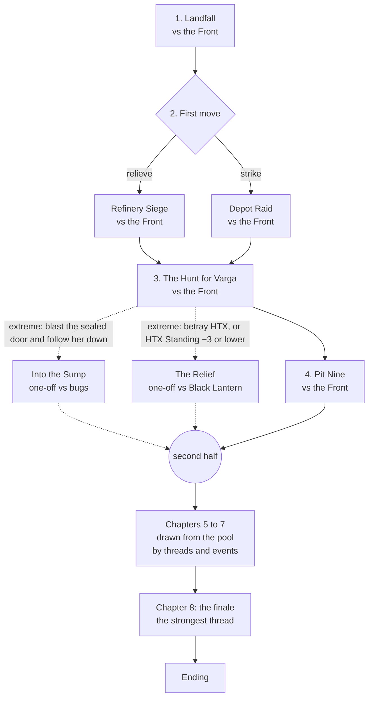

# Story mode: plan

A single-player campaign that tells a story. It is split into chapters, and each
chapter is a briefing, a choice of how to go about the job, a battle, and the
decisions that follow it. Choices and results move the story in two ways. In the
short term they shape the next battle: you scout first, go straight in, or call
an air strike. In the long term they shift standing, loyalty and the strength of
each enemy, and those decide which chapters come next and how the war ends.

It opens against an enemy you already know: the company is hired to put down a
rebellion, and the first half is almost all against the rebels. The second half
is free-form: depending on what the player has done, it carries on against the
rebels, turns to the bugs the war wakes up, or to a rival PMC sent to clean up
after it. The Xenotripods are left out for now.

This is a plan, not a spec. The decisions it needed are settled, and section 8
records them.

---

## 1. What it builds on

Most of what story mode needs already exists. The new work is a story layer on
top of the campaign dossier, plus a few hooks into battle setup.

| Need | Already there | Where |
|---|---|---|
| A company that carries over between battles (roster, EXP, trauma, honours, deaths by name, kUC) | The campaign dossier and its aftermath | `campaign.js`, `camp-aftermath.js`, `camp-company.js` |
| Spending between battles (recruiting, promotions, upgrades, doctrines) | The hub and roster screens | `dossier-hub.js`, `dossier-roster.js` |
| Enemy forces the AI can field and play | Unit profiles, army presets, the composition check | `data.js`, `rules.js` `checkArmy` |
| A battle set up from a contract (scenario, tier, PL, planet, world, roles) | The offer, which becomes `cfg` | `camp-rivals.js` `rollOffers`, `dossier-contract.js` |
| Ideas for small, asymmetric missions (raids, decapitation, VIP escort, evacuation, ambush) | The solitaire scenarios, **as inspiration only**. Story mode never runs a solitaire battle (no `cfg.solo`, no commando, no OpFor table). Their ideas come back as variants and custom scenarios (section 5). | `solitaire.js` |
| Rebel posture (Last Stand, Human Wave, Guerillas) | Rebel Tactics | `rules.js` `TACTICS`, `cfg.tactics` |
| Who attacks and who defends | Scenario roles and `cfg.attacker` | `scenarios.js` `rollRoles` |
| Fighting inside a compound | Close Encounters | `compound.js`, `ce_*` scenarios |
| Planet conditions | Other Worlds, `cfg.planet`, `cfg.world` | `rules.js` `rollWorld` |
| The result of a battle | `E.state.report` (winner, routed, casualties, units, stats) | `endphase.js` `battleReport` |
| What the company can field | `fieldableTier(co, pl)`, `canFieldArmy`, `fullTier` | `camp-contract.js`, `campaign.js` |

What the story layer adds:

1. **A story graph:** chapters and the nodes inside them, written as data.
2. **Story state:** meters, flags, the current node, and a journal of what was chosen.
3. **Conditions and effects:** a small vocabulary that lets the data read and change story state and the dossier.
4. **Battle levers:** the hooks that let a story event change `cfg` and the opening of the battle (how much of the enemy is known, strikes before turn 1, Readiness, allies…).
5. **Outcome grading:** a report turned into a grade (decisive, victory, draw, defeat, rout).
6. **Screens:** the chapter card, the briefing with its choices, the debrief, the journal.

A story campaign is an ordinary solo dossier (`mode: 'solo'`, as now) with a
`story` field. It does not get a new `mode`: `campaign.mode === 'solo'` is
already checked in about 15 places (the hub's Contract button in
`dossier-hub.js`, `dossier-after.js`, offer generation in `camp-rivals.js`), and
a new value would quietly turn all of them off. Instead, a `PMCStory.active(campaign)`
check goes in only where the story behaves differently, and phase 2 audits
every `mode` check to decide which those are (section 5, *Fitting into the
dossier*). The roster, the aftermath, saving and export keep working without
change.

**No battle is ever played in the background.** The only battles in story mode
are the ones the player fights. Everything else, such as a job passed up, the
garrison you left behind, or Black Lantern's war in the next valley, is settled
by rolls, meters, flags and events. The same goes for the tests (section 6):
they feed the story made-up battle results, and they never play the AI against
itself.

---

## 2. The story: *Deep Contract*

The setting is our own. It does not need to fit the PMC 2670 book's
background, only its tone and feel: corporate wars fought for profit, hired
guns, the frontier, rebels and bugs. Every name below is a placeholder.

### The setting

**Kessler's Reach** is a mining moon worked by the **Halvorsen-Tey Extraction
Consortium (HTX)**. Its miners have risen as the **Free Miners' Front**, led by
the former shift boss **Ada Varga**. HTX hires the player's company to restore
order, quickly and quietly.

The miners' grievance is real, and HTX is hiding why. HTX's "Deep Contract"
crews have been sent into a sealed lower level to strip biomass from a dormant
bug hive. Crews came back sick, or did not come back. The war and the heavy
blasting it brings wake the hive.

| Force | Army | Role in the story |
|---|---|---|
| The player's company | PMC | Hired guns, and the one force whose loyalty is not settled |
| Free Miners' Front | Rebels | The opening enemy: dug in, popular, outgunned |
| The Sump Hive | Space Bugs | Asleep in the first half, unless an extreme choice wakes it. A thread in the second half. |
| Black Lantern Security | PMC | HTX's second contractor. Met in the first half only after an extreme choice. A partner or an enemy in the second half. |
| HTX | none on the table | The employer: pays, gives orders, and lies |

**Enemy forces are written for each battle.** They are not campaign rosters
kept from one battle to the next. Each battle has its own enemy force, and the
story's events, flags and meters change what is in it (section 4).

### The shape: a fixed first half, a free second half

**The first release has 8 chapters**, in two halves. A pursuit or two can add a
battle, so a playthrough is 8 to 10 battles, plus any side contracts the player
takes. A later release can grow it to about 12 chapters by adding to the second
half's pool.

- **The first half (chapters 1 to 4)** is a fixed run of chapters, and **almost
  all of it is against the Front**. The choices change how each chapter plays
  and what it leaves behind, but not which chapter comes next. There are only
  two exceptions, and each comes only from an **extreme choice**: one battle
  against an enemy PMC, or one encounter with the bugs.
- **The second half (chapters 5 to 8)** is **free-form**. There are no fixed
  paths. Each chapter is drawn from a pool of written chapters, according to
  what the events of the story have left behind. The enemy, the allies and the
  finale all come out of that. A playthrough where the Front stays strong and
  nobody blasts too deep can stay a war against the rebels to the end.



### The first half: The Contract (chapters 1 to 4)

The rebellion as HTX describes it.
- **1. Landfall.** Secure the starport against a Front strike. It is a scripted
  Secure and control at Tier I and teaches the story screens. It cannot be lost
  outright: a defeat means "the port is held, at a cost", with Loyalty −1.
- **2. First move.** The briefing offers two jobs and the player picks one:
  relieve the besieged refinery (Invasion, defending), or raid the Front's supply
  depot (Demolish, or a smaller night raid: Demolish one Battle Tier down). The job not taken happens anyway,
  off the table, with whatever effect is written for it (section 4). A lost
  refinery puts *Retake the Refinery* in the second half's pool. A depot left
  alone raises Rebel Strength.
- **3. The Hunt.** Find and secure, with a **target variant** (an idea taken
  from the solitaire Decapitation): Varga's unit is named as the target, and
  dealing with her wins the battle as well as the objectives do
  (`variant: { target: "Varga's Own" }`). With `capture: true`, her unit has to
  be Broken and then reached in base contact, and killing her counts as a kill,
  not a capture (section 5). Killing her ends the hunt quickly, but she becomes
  a martyr. Capturing her is harder and opens the way to a truce. Failing
  leaves her free, and she runs for the sealed workings.
- **4. Pit Nine.** A mining town rises. The choices here are about civilians:
  clearing the town house by house in Close Encounters (they are protected),
  storming it after a bombardment (they are not), or
  talking your way in (it needs Sentiment, or Varga held). HTX's site office is
  in the town, and the Deep Contract data core can be found in it.

**The two one-offs.** Each takes the place of chapter 4, so the first half is
always four chapters. Each happens only after an **extreme choice**: an option
written with `extreme: true` on it, so the validator can check that nothing
else leads there. A `branch` node at the end of chapter 3 reads the flags they
set. Each one-off leaves a mark on the second half:

| One-off | The extreme choice that leads to it | The battle | What it leaves |
|---|---|---|---|
| **Into the Sump** (the bugs) | *The sealed door* (after a failed hunt): Varga has escaped into the sealed deep workings. **Blast the door and follow her down**, against HTX's orders (`extreme`, flag `sump_entered`, Hive Growth +2). | Clearing out, in Close Encounters, against bugs | The hive is awake early (Hive Growth +3, revealed), and the data core is in your hands. The bug thread is open from chapter 5. |
| **The Relief** (an enemy PMC) | A betrayal of HTX: in *The cell*, **let Varga go** (`extreme`, flag `varga_released`); or in *The ledger*, **sell it back to the Front** (`extreme`, flag `ledger_sold`) while HTX Standing is −1 or lower. Or HTX Standing has fallen to −3 or lower by the end of chapter 3, the point where HTX turns on you (section 4). | HTX sends Black Lantern to "relieve" you, and they open fire. Meeting engagement or Hostile takeover. | HTX has cut you off (`htx_cut_off`). The Black Lantern thread is open from chapter 5, and the Front may see you as a useful enemy of their enemy. You never reach Pit Nine, so you don't have the data core: the HTX thread's chapters must not need it. |

If both are triggered, **Into the Sump** wins: it was chosen last, at the
sealed door. The Relief's trigger then sets `htx_suspects` instead, which
raises the Black Lantern thread's pressure in the second half. The one-offs
should be uncommon but reachable. The Monte Carlo walk reports how often each
comes up (section 6), and the target is roughly 5 to 15% of walks each.

### The second half: Fault Lines (chapters 5 to 8)

There is no single branch screen. The second half is built from **threads**,
and each thread is a set of written chapters with conditions:

| Thread | Rises with | Chapters in its pool (first release) |
|---|---|---|
| **The Front** (rebels) | Rebel Strength, Varga free or martyred, low Sentiment | *Retake the Refinery*, *Varga's Revenge*, *The Splinter Cell*, *The Last Redoubt* |
| **The truce** (rebels as allies) | Varga held and talked to, high Sentiment, a common enemy | *The Ceasefire*, *Hold the Line* (with rebel allies) |
| **The hive** (bugs) | Hive Growth, the Sump entered, blasting | *Outbreak at Pit Nine*, *The Shafts*, *Hive Heart* |
| **HTX and Black Lantern** (PMC) | Low HTX Standing, Black Lantern Strength, the data core, a cover-up found out | *The Partner* (Black Lantern alongside you, with orders of its own), *Convoy*, *The Leak*, *The Showdown* |

How the chapters are chosen:
- **Each thread has a pressure,** worked out from its meters and flags.
- **Chapters 5 to 7:** the briefing offers the eligible chapters from the two
  threads under the most pressure, as jobs. The player picks one. The one not
  taken is a job passed up (section 4), so a thread you ignore gets worse.
- **Chapter 8, the finale,** belongs to the enemy thread under the most
  pressure: *The Last Redoubt*, *Hive Heart* or *The Showdown*. A thread can
  only take the finale once at least one of its arc chapters has been played,
  so a finale never comes without its setup. If no thread qualifies, it goes to
  the thread under the most pressure anyway, and its briefing's `{if}` text
  covers the missing setup. Who fights beside you depends on the flags (rebels
  after a truce, Black Lantern if they are still your partner). If Hive Growth
  is 8 or more when the finale begins, the finale is a Breakout, whatever else
  is going on.
- **The truce has no finale of its own.** It is a thread of allies, not of
  enemies. Its pressure counts when the pool offers chapters 5 to 7, but not
  when the finale is chosen. Instead, a truce changes the other finales. With
  `truce` set, *The Last Redoubt* is fought against the hardliners who refused
  the truce, with Varga's people beside you. *Hive Heart* and *The Showdown*
  bring rebel allies.
- **Each pool chapter is played at most once.** Every thread has a fallback
  chapter, so there is always something to offer. The validator checks this
  (section 6).
- **Threads are short arcs.** In the first release, each thread is a
  two-chapter arc plus its finale, so any thread can finish in the three picks
  there are. Longer arcs wait for a longer release.
- **The number of picks is in the story data** (`picks: 3`). Play-testing, and
  how often the Monte Carlo walk sees each thread reach its finale, decide
  whether to raise it to 5. That makes the story 10 chapters, with no engine
  work.

Where the company stands is not one choice either. It comes from events, as
flags: `truce` (from *The Ceasefire*), `leaked` (from *The Leak*), and
`htx_cut_off` (from *The Relief*, or HTX finding out about a cover-up). Staying
with HTX is simply never setting any of them.

**Endings** are chosen by meters and flags once the last battle is over. They
are checked in this order, and the first that fits is the one you get. The
last ending has no conditions, so every path has an ending:

| Ending | Roughly |
|---|---|
| **Broken Company** | Any time the company cannot field a Tier I army after its hub turn. |
| **Scorched Earth** | Hive Growth gets away from everyone (the Breakout finale). HTX orders the moon sterilised from orbit, and the last battle is an evacuation. |
| **Contract Terminated** | Black Lantern wins the showdown, or HTX turns on you and you lose the finale. The company is betrayed and runs. |
| **Liberators** | `truce` or `leaked`, the finale won, hive contained, and not `miners_sealed`. The Front holds the moon. The company is poor, and loyal to its own. |
| **Company Man** | Stayed with HTX (no `truce`, `leaked` or `htx_cut_off`), hive contained, HTX Standing 2 or more (1 or more with `core_sold`). The company is rich and the moon is broken. |
| **Paid Off** | Anything else: the war ends without you deciding it. HTX pays what it owes, or doesn't, and the company ships out. The epilogue is written from the meters, so it still tells the story you made. |

Each ending has a short epilogue: what happened to the moon, to Varga, and to
each named unit that survived.

---

## 3. Events and choices

### Every decision is a story event

The player never sees a standard menu of approaches or a standard debrief
checklist. **Every decision is a story event written for its place in the
story:** a situation, the people in it, and two to four things to do about it.
The air strike in chapter 3 is a particular strike on a particular target, with
a pilot who has an opinion. The prisoners in chapter 4 are particular prisoners,
and one of them has a name you will hear again.

Under the writing, each option is made from a small, shared **kit of effects**.
The kit is mechanical and reused. The events are not:

| Kit | Effects | Used by events such as |
|---|---|---|
| **Battle levers** (this battle only) | Show the enemy's list or tactic before mustering. Set the player's role or deployment edge. Strikes before turn 1 (Suppression, with a chance of a hit). Starting Suppression on your own units. Enemy Readiness. Swap the scenario (among the standard, Close Encounters and story scenarios) or apply a variant. Shrink the battle (a lower Battle Tier, for a raid by a small team). Add allies. Turn limit, terrain, planet, world. Skip the battle. | Scouting, bribes, bombardments, sabotage, a guide who knows the tunnels, a traitor in the convoy |
| **State levers** (long term) | Meters, flags, kUC, EXP or Trauma for some or all units, recruit or lose a unit, a free upgrade, a flag that changes a later enemy force, a job settled off the table, a journal line | Prisoners, salvage, the fallen, reports to HTX, promises made to people |
| **Rolls** | A roll against a meter, Intel or a flag, with an effect on each result | A bluff, an interrogation, a plan that might not work |

**Readiness** is how prepared the enemy is for one battle. It starts at 0. Each
point gives the enemy something the event names, or something from a default
table: barricades, one extra unit, a forced Last Stand, or defender's choice of
deployment.

The rules for writing them:
- **No event is used twice.** Each one has its own id, and the validator refuses
  an id it has seen before. Within a half, no two events may offer the same set
  of **battle** levers. State levers alone don't count, because nearly every
  event moves a meter and sets a flag. A repeated set of state levers is only a
  warning (section 6).
- **Extreme choices are marked.** An option that can take the first half off
  its fixed run (section 2) carries `extreme: true`, and its text says plainly
  that it crosses a line.
- **Every event shows a trade-off** you can see in the writing: what it costs
  and who it hurts, even when the numbers are hidden.
- **Long-term choices come back.** A flag set by an event is read by a later one
  ("the prisoner you released is now the Front's sniper"). Every flag needs at
  least one later reader, and the validator checks this. That is what makes a
  decision feel long term.
- **Generic events are only for side contracts.** Side contracts are the
  repeatable money-earners between chapters. They draw from a small pool of
  short events with conditions, so they stay varied, and none of them sets a
  story flag.

### Before the battle (mostly short term)

One event before each battle. It shapes how the fight starts. It can also leave
a long-term mark. The first half, for example:

| Chapter | The event | Options (and the levers under them) |
|---|---|---|
| 1. Landfall | *The port master's offer.* The port's own security chief offers his men, if HTX pays them. | Take them (allies, kUC −). Send them home (nothing). Ask what they know (an outline of the enemy; the port master remembers you were rude: Sentiment −1). |
| 2. Refinery Siege | *The night shift.* Refinery workers are still inside, and the Front has offered them safe passage out. | Let them go (the enemy gets +1 Readiness, Sentiment +1, flag `nightshift_freed`). Keep them as a human shield (you choose the deployment, Sentiment −2, Loyalty −1). Get them to sabotage the Front's guns (roll on Intel: success is strikes before turn 1, failure is `nightshift_shot`). |
| 2. Depot Raid | *Truck 14.* A driver will sell you the depot's guard rota. | Pay (kUC −, show the list). Grab him and question him (Intel +1, Loyalty −1, flag `driver_taken`). Go in blind but now, before the rota changes (you attack, enemy Readiness 0). |
| 3. The Hunt | *Kill or capture.* HTX wants Varga dead. Your sergeant thinks she is worth more alive. | The HTX gunship (strikes before turn 1, HTX +1, `aim_kill`). A snatch team (the target variant with `capture: true`, one Battle Tier down, `aim_capture`). Wait for her to move (Hive Growth +1, you pick the role). |
| 4. Pit Nine | *The schoolhouse.* The Front has fortified the town school, with children still in it. | Clear it room by room (Close Encounters, Critical control, no strikes; if you win, Sentiment +2 and flag `pit9_spared`). Shell it, then storm the town (Secure and control, strikes, Sentiment −4, Hive Growth +1 as the shelling cracks the lower levels, Loyalty −1, flag `pit9_shelled`). Talk to the teacher (needs `nightshift_freed` or `varga_held`; a roll on Sentiment, −1 if `gate_cleared` because her brother was at the gate. Success: no battle, Sentiment +2, `pit9_spared`. Failure: a Meeting engagement with the ambush variant). |
| Into the Sump (one-off) | *The miners' map.* A captured miner offers a route through the old workings. | Trust him (the role is yours, but roll for a trap). Use HTX's surveys (the role is set, and HTX knows exactly where you are, flag `htx_tracking`). Blast a new way in (strikes, Hive Growth +2). |
| The Relief (one-off) | *The handover.* Black Lantern's commander arrives with a letter from HTX and a smile. | Hand over the sector and leave (no battle; the second half opens with `htx_cut_off` and nothing to fight for but side contracts). Refuse (you choose the role). Fire first (strikes before turn 1, and the Front hears about it: Sentiment +1). |

### After the battle (mostly long term)

One or two events after each battle, chosen by the grade and the flags. They
decide what the fight meant. The first half, for example:

| After | The event | Options |
|---|---|---|
| 1. Landfall | *The dead at the gate.* Rebel dead, and civilians among them. | Bury them openly (Sentiment +1, HTX −1). Let HTX "process" them (HTX +1, flag `gate_cleared`: the town remembers). |
| 2. Refinery, won | *The ledger.* A rebel quartermaster's ledger shows where the Front gets its money. | Give it to HTX (HTX +1, Rebel Strength −2). Read it first (Intel +2, the first hint of the Deep Contract, flag `ledger_read`). Sell it back to the Front (**extreme**: kUC +, Sentiment +1, HTX −1, `ledger_sold`). |
| 2. Refinery, lost | *The survivors.* HTX blames you for the refinery. | Take the blame (HTX −1, Loyalty +1). Blame the garrison (HTX +0, Loyalty −1, flag `garrison_blamed`: the garrison won't fight beside you again). |
| 2. Depot Raid, won (sets `depot_raided`) | *The armoury.* The Front's heavy weapons are stacked in the depot, and there is more than you can carry. | Blow it all (Rebel Strength −2). Take the best of it (a free upgrade, Rebel Strength −1, HTX −1: HTX wanted it catalogued). Leave it for HTX to collect (HTX +1, Rebel Strength −1, Intel +1 from the crates' markings). |
| 2. Depot Raid, failed | *The rota changed.* The Front knew you were coming. Someone talked. | Find the leak in your own ranks (a roll on Intel: success Loyalty +1, failure Loyalty −2 as the wrong man is blamed). Let it go (Rebel Strength +1). |
| 3. The Hunt, Varga captured | *The cell.* Varga asks to talk to you, and only you. | Listen (Intel +1, flags `varga_talked` and `varga_held`: opens the truce). Hand her straight to HTX (HTX +2, `varga_handed`, she may vanish). Hold her yourself as leverage (HTX −1, Rebel Strength −2, `varga_held`). Let her go (**extreme**: HTX −2, Sentiment +2, `varga_released`). |
| 3. The Hunt, Varga dead | *The martyr.* Her body is in your hands, and the whole moon knows it. | Send her home to the miners (Sentiment +1, Rebel Strength +1). Let HTX put her on display (HTX +1, Sentiment −3, Rebel Strength −1, flag `martyr_displayed`: the Front will come for it). Bury her quietly where no one will find her (Loyalty −1, nothing else, for now). |
| 3. The Hunt, failed | *The sealed door.* Varga's people fall back into the old workings and weld the blast door behind them. HTX says the lower levels are off limits. | Let her go for now (Loyalty +1; the failed hunt has already set `varga_free`). Blast the door and follow her down (**extreme**, needs Loyalty 0 or more: Hive Growth +1, HTX −1, `sump_entered`). Only after a defeat or a rout: after a draw she simply slips away. |
| 4. Pit Nine | *Payroll.* The town's payroll safe survived the fight. | Keep it (kUC ++, Loyalty +1, Sentiment −2). Return it to the miners (Sentiment +2). Return it to HTX (HTX +1). |
| Pit Nine, or Into the Sump | *The data core.* {soldier:tech} has it, and HTX asks for it on an open channel. | Hand it over (HTX +2). "Lost in the fighting" (`core_recovered`, `coverup`, reveal Hive Growth). Copy it, then hand it over (HTX +1, `core_recovered`, and a roll on Intel: on a failure HTX notices, `htx_suspects`. With `ledger_read` there is no roll, since you know what to look for). |
| Into the Sump | *What's down there.* The hive is real, and it is waking. | Report it to HTX (HTX +1, flag `htx_tracking`: they send survey teams after you). Tell the miners (Sentiment +2, flag `hive_known`: a common enemy). Keep it to yourselves (Intel +1). |
| The Relief | *Black Lantern's wounded.* Their medics are pinned down, and their commander is calling for a truce to recover them. | Let them recover their wounded (Black Lantern Strength +1, flag `lantern_mercy`: their commander remembers). Finish it (Black Lantern Strength −2, Loyalty −1, Sentiment −1). Take them prisoner (Intel +2, Black Lantern Strength −1, HTX −1). |

There is no branch screen at the end of the first half. The flags these events
leave behind decide which threads the second half's pool offers (section 2).

### The second half's events

Every second-half chapter has an event before its battle and one after it,
written the same way. These are the first release's, one line each. Phase 0
fills in the rest of the detail.

| Chapter (thread) | Before the battle | After the battle |
|---|---|---|
| *Retake the Refinery* (Front; when `refinery_lost`) | *The garrison's survivors* offer to fight. Take them (allies; not offered if `garrison_blamed`). Leave them out: "this is our fight" (Loyalty +1). | *The holdouts* surrender. Hand them to HTX (HTX +1, Sentiment −2, Rebel Strength −1). Let them walk (Sentiment +1, Rebel Strength +1). |
| *Varga's Revenge* (Front; when `varga_dead` or `varga_free`) | *The challenge.* Her people ask to meet you. Meet them (the Parley scenario, Sentiment +1). Ambush the meeting (the ambush variant on your side, Sentiment −2, Loyalty −1, flag `parley_betrayed`). If `martyr_displayed`: enemy Readiness +2. | *The second chance* (if Varga is alive and the battle was won). Take her (`varga_captured`, then *The cell* again). Let her go (Sentiment +2, `varga_released`). |
| *The Splinter Cell* (Front; fallback) | *The informant.* Pay him (kUC −, reveal Rebel Strength). Lean on him (Intel +1, Sentiment −1). | *The bomb-maker.* Hand him to HTX (HTX +1, Rebel Strength −1). Turn him (Intel +2, flag `informant`: an outline of every Front force, the full list in *The Last Redoubt*). |
| *The Ceasefire* (truce; when `varga_talked`, `varga_released`, `hive_known` or Sentiment 3 or more) | *Terms.* Offer the Deep Contract files (needs `core_recovered`: Sentiment +3, HTX −2). Offer HTX's money (needs HTX Standing 1 or more: kUC −). Promise nothing (a roll on Sentiment). Enemy Readiness +1 for each of `gate_cleared`, `pit9_shelled`, `parley_betrayed`. If `nightshift_shot`, Varga first wants the officer who gave the order: hand over {soldier:command} (the unit leaves, Loyalty −2) or refuse (Sentiment −1). | Won: flag `truce`, Rebel Strength −2. Then *Who keeps the peace.* Report the truce to HTX (HTX −1; `htx_cut_off` if HTX Standing is −2 or lower). Hide it from HTX (`coverup`). Share your supplies with the miners (kUC −, Sentiment +1, Loyalty −1). |
| *Hold the Line* (truce; fallback) | *Who holds the gap.* Your units hold it (the rebel allies fall back first: Sentiment +1). The rebels hold it (allies take the front, Loyalty +1, Sentiment −1 for every allied unit lost). | *The rebel dead.* Honour them with your own (Sentiment +2, Loyalty −1). Leave it to their own people (nothing). |
| *Outbreak at Pit Nine* (hive; when Hive Growth 3 or more, or `pit9_shelled`) | *The miners below.* Go in for them (Sentiment +2 if you win). Seal them in (no battle: Hive Growth −2, Sentiment −3, Loyalty −1, flag `miners_sealed`). With `pit9_spared`, the townsfolk guide you in (an outline of the enemy). | *Samples.* Give HTX a live one (HTX +2, Hive Growth +1, flag `sample_taken`). Burn it all (Hive Growth −1). |
| *The Shafts* (hive; fallback) | *Charges.* Lay charges as you go (strikes before turn 1, Hive Growth +1). Go quietly (enemy Readiness 0, you pick the role). | *The collapse.* Bring the shafts down (Hive Growth −2, kUC −, HTX −1: it ends the Deep Contract; flag `shafts_collapsed`: fewer tunnel mouths in *Hive Heart*). Leave them open for HTX (HTX +1). |
| *The Partner* (HTX; when `htx_suspects`, `htx_tracking`, or Black Lantern Strength 4 or more) | *Orders of its own.* Share your plans (Black Lantern Strength +1, Black Lantern as allies). Keep them in the dark (Black Lantern Strength −1, no allies). Plant a tracker on them (Intel +1, a roll on Intel: on a failure `htx_cut_off`). | *Black Lantern's prisoners.* Let them handle it (HTX +1, Sentiment −2, Black Lantern Strength +1). Take the prisoners from them (Sentiment +1, Black Lantern Strength −1, flag `lantern_crossed`). |
| *Convoy* (HTX; fallback) | *The route.* The fast road (you attack). The mine road (Hive Growth +1, enemy Readiness 0). If `driver_taken`, his crew is waiting on the fast road (enemy Readiness +1). | *The cargo* (the data core if `core_recovered`, otherwise HTX ore). Deliver it as ordered (HTX +1). Skim it (kUC +, Loyalty +1, a roll: HTX may notice, `htx_suspects`). Give it to the miners (Sentiment +2, HTX −2, Rebel Strength +1). |
| *The Leak* (HTX; when `core_recovered`, `ledger_read` or `sample_taken`) | *The uplink.* Hit it by night (the Strike scenario a Tier down). Talk your way into the HTX office (a roll on Intel; success means no battle). | *Publish.* Broadcast the core (flag `leaked`, `htx_cut_off`, HTX −5, Sentiment +3, Black Lantern Strength +2). If `varga_handed`, her name is in the files too, and the broadcast frees her (`varga_free`). Sell it back to HTX (kUC +++, HTX +1, flag `core_sold`). Give it to Varga (needs `varga_held` or `varga_talked`: Sentiment +2, Rebel Strength +1). |
| Finales | One event each, before the battle, written for its thread: *The Last Redoubt* (`informant` shows the list), *Hive Heart* (`shafts_collapsed` means fewer tunnel mouths), *The Showdown* (with `lantern_mercy`, their commander offers terms, and the battle can be a Parley; with `lantern_crossed`, their commander is Determined). | The ending (section 2). The ending's conditions read `truce`, `leaked`, `htx_cut_off`, `miners_sealed`, `pit9_spared` and `core_sold`; the epilogue reads every flag in the journal, Varga's most of all. |

### Interlude events

Each interlude between chapters has one event before the hub opens, chosen by
its conditions. These are where Loyalty, Intel and the slow meters move when
there is no battle to move them:

| Event | When | Options |
|---|---|---|
| *The wake* | Any unit was wiped out in the last battle | Pay the death benefits (kUC −, a sum for each dead unit; Loyalty +1). Don't (Loyalty −1). |
| *Stand down* | Loyalty 0 or lower | Give the company a week off (no side contracts this interlude; Loyalty +1, Hive Growth +1). Push on (Loyalty −1, and a roll: a unit may leave). |
| *The audit* | `coverup` is set | HTX's auditors want your logs. Doctor them (a roll on Intel: on a failure `htx_cut_off`). Hand them over (HTX −2, the cover-up is out, and `coverup` is cleared). |
| *An offer from Black Lantern* | `htx_suspects` or `htx_cut_off` | They want to buy {unit:veteran}'s contract. Sell it (kUC ++, the unit leaves, Black Lantern Strength +1, Loyalty −1). Refuse (nothing). |
| *Tunnel noises* | Hive Growth 4 or more, and the hive is revealed | Pay a demolition crew to collapse a shaft (kUC −, Hive Growth −1, HTX −1). Leave it (Hive Growth +1). |
| *Word from the town* | Sentiment 2 or more | A miner brings news. Listen (Intel +1, or reveal Rebel Strength if it is still hidden). |

### What moves each meter, and who reads each flag

Every meter has written events that move it **both ways** in each half, apart
from Hive Growth's rise with time. Every flag has a setter and at least one
reader, and the validator checks both (section 6).

**Every reader has to change something.** A flag or meter counts as read only
where it changes the game, in one of these ways:
- **On the table:** an enemy force, allies, Readiness, a battle lever, the
  scenario or its variant, or what the briefing shows of the enemy;
- **In the choices:** whether an option is offered, what it costs, or a roll's
  modifier;
- **In the route:** a branch, a chapter's eligibility, a thread's pressure, the
  finale, or the ending reached.

Journal and epilogue text read flags too, but that alone doesn't count. In the
tables below, every flag has at least one reader of the three kinds.

| Meter | Raised by | Lowered by |
|---|---|---|
| HTX Standing | *The dead at the gate* (process), *The ledger* (give), *The armoury* (leave it), *The cell* (hand over), *The data core*, *Payroll* (to HTX), the gunship, *The holdouts*, *The bomb-maker*, *Samples*, *Convoy*, a Decisive win | *The dead at the gate* (bury), *The survivors*, a failed hunt, *The cell* (hold, release), *The sealed door*, *The ledger* (sell), *The armoury* (take), *Terms*, *Who keeps the peace*, *The collapse*, *The audit*, *Tunnel noises*, *Publish* |
| Sentiment | *The dead at the gate* (bury), *The night shift* (free), *The ledger* (sell), *The cell* (release), *The schoolhouse* (clear, talk), *Payroll* (return), *The martyr* (send home), *What's down there*, *The challenge*, *Terms*, *Hold the Line*, *Outbreak*, *Publish*, *The handover* (fire first) | *The port master's offer* (ask), *The night shift* (shield), *The schoolhouse* (shell), *Payroll* (keep), *The martyr* (display), *The holdouts*, *The informant* (lean), *The challenge* (ambush), *Outbreak* (seal), *Black Lantern's prisoners*, *Black Lantern's wounded* (finish), low Sentiment each chapter |
| Loyalty | *The survivors* (take the blame), *Payroll* (keep), *The rota changed* (found), *Retake the Refinery* (leave them out), *Hold the Line*, *Convoy* (skim), *The wake* (pay), *Stand down* | Landfall lost, *The night shift* (shield), *Truck 14* (grab), *The schoolhouse* (shell), *The survivors* (blame), *The martyr* (bury quietly), *The rota changed* (wrong man), *Terms* (hand over), *Who keeps the peace*, *Outbreak* (seal), *The wake* (don't), *Stand down* (push on), *An offer from Black Lantern* |
| Intel | *Truck 14* (grab), *The ledger* (read), *The armoury* (leave it), *The cell* (listen), *What's down there*, *Black Lantern's wounded* (prisoners), *The informant*, *The bomb-maker*, *The Partner* (tracker), *Word from the town* | Spent: an option can cost Intel (`cost: { intel: 1 }`), and rolls on Intel can be raised by spending a point |
| Rebel Strength | Depot left alone, *The rota changed*, refinery lost, *The martyr* (send home), *The holdouts* (let walk), *Convoy* (to the miners), *Publish* (to Varga), low Sentiment | *The ledger* (give), *The armoury*, *The cell* (hold), Varga killed, *The martyr* (display), *The holdouts* (hand over), *The bomb-maker*, the truce |
| Hive Growth | Time from chapter 4, *Kill or capture* (wait), *The sealed door*, *The schoolhouse* (shell), *The miners' map* (blast), *Samples* (give), *Charges*, *Convoy* (mine road), *Stand down*, *Tunnel noises* (leave it), side contracts | *Outbreak* (seal), *Samples* (burn), *The collapse*, *Tunnel noises* (pay) |
| Black Lantern Strength | Time (+1 a chapter in the second half while `htx_suspects` or `htx_cut_off`), *Black Lantern's wounded* (let them), *The Partner* (share), *Black Lantern's prisoners* (let them), *An offer from Black Lantern*, *Publish* | *Black Lantern's wounded* (finish, prisoners), *The Partner* (keep them in the dark), *Black Lantern's prisoners* (take them), a *Convoy* or *Strike* won against Black Lantern (−1 on a success) |

| Flag | Set by | Read by |
|---|---|---|
| `nightshift_freed` | *The night shift* | *The schoolhouse* (talk), *Retake the Refinery* (the workers open a gate: you choose the deployment) |
| `nightshift_shot` | *The night shift* (a failed roll) | *Terms* |
| `driver_taken` | *Truck 14* | The chapter 3 force (one fewer transport), *Convoy* |
| `depot_raided` | Depot Raid won | The chapter 3 force (no mortar) |
| `garrison_blamed` | *The survivors* | *Retake the Refinery* |
| `refinery_lost` | The refinery job passed up and lost | The pool (*Retake the Refinery*) |
| `gate_cleared` | *The dead at the gate* | *The schoolhouse* (talk), *Terms* |
| `ledger_read` | *The ledger* | *The data core*, *The Leak* |
| `ledger_sold` | *The ledger* (extreme) | The end of chapter 3 (The Relief), the truce's pressure |
| `aim_kill`, `aim_capture` | *Kill or capture* | The chapter 3 battle (chapter-local, see below) |
| `varga_captured` | The hunt won with `aim_capture`, *The second chance* | *The cell* |
| `varga_held` | *The cell* | *The schoolhouse* (talk), *The Leak*, the truce's pressure |
| `varga_talked` | *The cell* | *The Ceasefire*, *The Leak* |
| `varga_handed` | *The cell* | *Publish* |
| `varga_released` | *The cell*, *The second chance* | The end of chapter 3 (The Relief), *The Ceasefire* |
| `varga_dead` | The hunt won without `aim_capture` | The Front's forces (the Avengers), *Varga's Revenge*, the epilogue |
| `varga_free` | *The sealed door*, *Publish* | *Varga's Revenge*, the Front's pressure |
| `martyr_displayed` | *The martyr* | *Varga's Revenge* |
| `sump_entered` | *The sealed door* (extreme) | The end of chapter 3 (Into the Sump), the hive's pressure |
| `hive_known` | *What's down there* | *The Ceasefire* (offered without the Sentiment it would need), an outline of every hive battle, *Hold the Line* (the rebels arrive as allies) |
| `htx_tracking` | *The miners' map*, *What's down there* | *The Partner*; and HTX passes your positions on, so Black Lantern battles have enemy Readiness +1 |
| `htx_suspects` | The Relief's trigger when the Sump wins, *The data core* (copy, failed), *Convoy* (skim) | *The Partner*, *An offer from Black Lantern*, Black Lantern Strength over time |
| `htx_cut_off` | *The Relief*, *The audit*, *Who keeps the peace*, *The Partner* (tracker found), *Publish* | Pay, side contracts, *An offer from Black Lantern*, the endings |
| `lantern_mercy` | *Black Lantern's wounded* | *The Showdown* |
| `lantern_crossed` | *Black Lantern's prisoners* | *The Showdown* |
| `pit9_shelled` | *The schoolhouse* | *Outbreak at Pit Nine*, *Terms* |
| `pit9_spared` | *The schoolhouse* (clear or talk) | *Outbreak at Pit Nine* (the townsfolk give an outline of the enemy), *Terms* (Sentiment roll +1), *Liberators* (the town backs the Front's rule) |
| `core_recovered` | *The data core* | *Terms*, *Convoy*, *The Leak* |
| `coverup` | *The data core*, *Who keeps the peace* | *The audit*; if it is found out, `htx_cut_off` and HTX Standing −3 |
| `parley_betrayed` | *The challenge* | *Terms* |
| `informant` | *The bomb-maker* | *The Last Redoubt* (the full enemy list), and an outline of every Front battle |
| `miners_sealed` | *Outbreak at Pit Nine* | *Terms* (enemy Readiness +2, and *Promise nothing* fails), *Liberators* (can't be reached: the miners never forgive it) |
| `sample_taken` | *Samples* | *The Leak*, *Hive Heart* (+1 wave: HTX's lab stock breaks out), the Breakout comes at Hive Growth 7 instead of 8 |
| `shafts_collapsed` | *The collapse* | *Hive Heart* |
| `truce` | *The Ceasefire* won | The finales (allies), the endings |
| `leaked` | *Publish* | The endings, side contracts' pay |
| `core_sold` | *Publish* | *Terms* (the files are no longer yours to offer), the HTX thread's pressure −2, *Company Man* (reached at HTX Standing 1 or more) |

**Chapter-local flags**, such as `aim_kill` and `aim_capture`, carry
`local: true`. They are cleared when the chapter ends, and they only have to
be read inside it.

### Success and failure

The report is graded:

| Grade | From the report |
|---|---|
| **Decisive** | Won, and the enemy routed or lost at least twice what you did (by composition points) |
| **Victory** | Won |
| **Draw** | No winner |
| **Defeat** | Lost, and you did not rout |
| **Rout** | Lost and routed |

A battle node branches on the grade, usually as success (Decisive or Victory)
and failure (the rest). Grades can also feed effects, for example a Decisive
win is +1 HTX. **Failure moves the story forward, it does not end it.** A lost
battle opens a harder chapter, takes away an option later, or changes an
ending, but the story only ends early when the company is broken. Authors must
give every battle a failure branch, and the validator checks that they have
(section 6).

---

## 4. The long-term state

### Meters

Each meter is an integer from −5 to +5, unless noted. **Some meters are
shown and some are hidden.** Each meter's entry in the story data says which:

- **Shown** (as a number in the journal, and as words in briefings, such as
  "HTX is uneasy"): HTX Standing, Loyalty and Intel. These are the company's own
  business, so the player knows them.
- **Hidden:** Sentiment, Rebel Strength, Hive Growth and Black Lantern
  Strength. The player reads them only from the writing: the briefing's
  description of the enemy, what the locals say, how many tunnel mouths there
  are. An event can **reveal** a hidden meter for the rest of the story with
  `{ reveal: 'hive' }`. Examples: an informant in the Front shows Rebel
  Strength, and the data core shows Hive Growth.
- **The ending shows every meter**, with its history, so the player can see
  what their choices did.

Flags are never shown as flags. The journal tells them as prose.

Every meter has to matter **on the table** (what the battles look like) and
**in the story** (which chapters, options and endings you get). None of them
is there only for the journal:

| Meter | Goes up when | On the table | In the story |
|---|---|---|---|
| **HTX Standing** | Following orders, honest reports, decisive wins | Air strikes: the gunship and other strike options need HTX Standing 1 or more. A supply drop each half at 2 or more (a free unit or upgrade, chosen from what the company lacks). At −3 or lower, HTX's own forces stop appearing as allies. | Pay multiplier (×0.5 to ×1.5). At −3 or lower by the end of chapter 3, The Relief. Low Standing raises the HTX thread's pressure. *Company Man* needs 2 or more. Options such as *Offer HTX's money* need it. |
| **Sentiment** (the locals) | Protecting civilians, releasing prisoners, sharing salvage | At 3 or more, the locals talk: one level more of what is known of each enemy (see *What the company knows of the enemy*). At −3 or lower, the locals warn the Front: Front battles have enemy Readiness +1. | Rolls in talks (*The schoolhouse*, *Terms*). At 3 or more, *The Ceasefire* can be offered. At −2 or lower, Rebel Strength +1 at each chapter's start. *Word from the town* at 2 or more. |
| **Loyalty** (your troops) | Death benefits, winning, resting units | At 2 or more, once a battle, a unit may re-roll a failed Morale or Rally. At −2 or lower, units start their first turn with Suppression, and new Trauma comes on one roll lower. | At 0 or lower, *Stand down*, and units can leave. At 0 or lower, harsh orders cost more: handing over an officer in *Terms*, or pushing on in *Stand down*, each roll for a second unit leaving. The epilogue of every ending names who stayed. |
| **Intel** (0 to 6) | Recon, interrogation, the data core | Spent as option costs (`cost: { intel: 1 }`), usually to scout the enemy, pick the role, or turn a roll. A point can be spent to add 1 to any roll on Intel. | At 3 or more, an outline of every enemy before its battle; at 6, one level more. At 4 or more, Rebel Strength is revealed; at 6, Black Lantern Strength is. Options that need Intel to be offered at all, such as talking your way into the HTX office in *The Leak*. |
| **Rebel Strength** (0 to 10) | Depots left alone, prisoners released, low Sentiment | How many optional units a Front force fields, its filler share, and its Readiness. | The Front thread's pressure. At 0 the Front is broken: its chapters drop out, and *The Last Redoubt* can't be the finale. At 7 or more, rebel allies in a truce are stronger too. |
| **Hive Growth** (0 to 10) | Each chapter from chapter 6 on, blasting, time spent waiting, side contracts taken (except catch-up ones, below) | How big the bug forces are, and the number of waves in *Hive Heart*. In the second half, at 5 or more, every battle has a tunnel mouth on the table that the enemy may bring its reserves in through, and the ground near it is dangerous terrain. | The hive thread's pressure. *Outbreak at Pit Nine* at 3 or more. *Tunnel noises* at 4 or more. At 8 or more when the finale begins, the Breakout and Scorched Earth. |
| **Black Lantern Strength** (0 to 10) | HTX trusting them over you, time | How many optional units Black Lantern fields, and their honours and upgrades. As allies in *The Partner*, the same. | The HTX thread's pressure. *The Partner* at 4 or more. At 7 or more, *The Showdown* can't be avoided once the HTX thread is the strongest, and *Contract Terminated* comes on a draw as well as a loss. (Not to be confused with a battle's Readiness, section 3.) |

Time alone adds at most +2 Hive Growth by the finale, so Scorched Earth comes
from the player's choices (blasting, waiting, the Sump), not just from the
clock. The Monte Carlo walk reports how often it happens. The target is under
15% of walks with random choices.

### Enemy forces

Each battle's enemy force is written for that battle, in three parts:

- **The core:** the units that are always there, as unit keys. Named enemies
  (Varga's bodyguard, Black Lantern's commander) are units in a core, with set
  names, honours and upgrades. They come back in later battles only because a
  later force names them again, and a flag decides whether they are alive to.
- **Optional units:** an ordered list. The battle's meter decides how many
  turn up. With Rebel Strength at 4 and a scale of 1 unit for each 2 points,
  the first two come.
- **Filler, to fit the player's company:** the player founds their own
  company, so the story can't know in advance how big it is. The battle node
  sets the Battle Tier and PL relative to the company (`tier: 'max'`). After the
  core, optional units and changes, the force is topped up from a `fill` list
  until it reaches a share of that battle's composition points (`to: 1.0` is an
  even fight), plus an allowance for the company's experience (below). A meter
  can move the share. This is what keeps a written force
  fair against a company built in any way.
- **Changes:** what events and flags do to the force. Add or remove a unit,
  swap one unit for another, give a unit an honour or an upgrade, Suppression
  at the start, a forced Rebel Tactic, Readiness. For example: *Truck 14*'s
  driver taken means one fewer transport; the depot raided in chapter 2 means
  no heavy weapons in chapter 3; Varga killed adds a Determined unit of
  avengers.

```js
// unit keys are illustrative; the real ones are in data.js
enemy: {
  side: 'front', faction: 'rebel', tactics: 'laststand',
  core: ['reb_cmd', 'reb_militia', 'reb_militia', { key: 'reb_veterans', name: "Varga's Own", honours: [3] }],
  optional: { meter: 'rebels', per: 2, units: ['reb_militia', 'reb_technical', 'reb_mortar', 'reb_rpg'] },
  fill: { to: 0.9, from: ['reb_militia', 'reb_rpg'], meter: 'rebels', step: 0.05 },   // +5% a point of Rebel Strength
  changes: [
    { if: { flag: 'depot_raided' }, remove: 'reb_mortar' },
    { if: { flag: 'varga_dead' },   add: { key: 'reb_militia', name: 'The Avengers', rules: ['Determined'] } },
    { if: { flag: 'driver_taken' }, remove: 'reb_technical' }
  ]
}
```

The briefing describes the force from what you know, and an event can show it
in full. A story force does not have to pass the composition check, because the
writer sets its size. The validator checks that every unit key exists. The
Monte Carlo walk reports the smallest and largest version of each force, so the
range can be balanced.

### Flags

Named true or false facts: `varga_dead`, `varga_held`, `refinery_lost`,
`core_recovered`, `coverup`, `pit9_spared`, and so on. Conditions read
them. The ending table is mostly flags. Section 3 lists every flag in the
first release, with what sets it and what reads it.

### Growth, and scaling to the company

**The target:** by the finale the company is at **Company Tier III**, and
ideally can field a **Tier III army at Priority Level 2**. The story gets it
there with the campaign's own economy and promotion rules (pp. 84-86) unchanged.
Company Tier II costs 1 kUC banked and Tier III costs 20, each with a legal army
at every Tier up to it.

| By the end of | Company Tier | Its battles, at most |
|---|---|---|
| Chapter 2 | II within reach | Tier I to II, PL 1 |
| Chapter 4 (the first half) | II | Tier II, PL 1 |
| Chapter 6 or 7 | III | Tier II to III, PL 1 |
| The finale | III | Tier III, PL 2 if the company can field it |

These are targets for tuning. The playthrough test measures them (section 6).

How the story keeps a company on that curve:
- **Pay.** Story battles use the campaign's payment rolls, plus a chapter bonus
  written into each battle node and multiplied by HTX Standing. The bonus is the
  main thing to tune.
- **Rewards in kind.** Events can give a free unit, an upgrade or salvage. A
  supply drop gives what the company is short of for the next Tier, read from
  `fieldReport`'s fault ("no Tier III unit to lead it").
- **Catching up, quietly.** Each interlude works out how far the company is from
  the curve, in kUC towards the next Tier and in what it can field. When it is
  behind, the interlude offers more side contracts, and better-paid ones. When it
  is ahead, it offers fewer. Nothing is ever taken away. A side contract offered
  to catch up is marked `catchUp` and costs no time (no Hive Growth), so a
  struggling company is not pushed towards Scorched Earth for taking the help.
- **Cut off from HTX.** Once HTX has stopped paying, side contracts pay more,
  so the curve can still be reached.
- **No guarantee.** A company that keeps losing can fall behind. Scaling (below)
  keeps its battles fair, and *Broken Company* is the floor.

**Scaling battles to the company.** A battle node never gives a fixed Battle
Tier or Priority Level. It gives them relative to what the company can field
when the battle comes. `fieldableTier(co, pl)` in `camp-contract.js` already
takes one company. `levelsFor` and `maxBattleTier` take the player and a rival
company. A story has no rival company, since the enemy is written to fit, so
the story uses one-company forms of them (`levelsFor` is just `canFieldArmy`
for the player at each PL):
- **Tier:** `tier: 'max'` or `'max-1'`, with `min` and `max` where a chapter
  must keep its character. Landfall is always Tier I. A raid by a small team
  can stay a Tier down.
- **Priority Level:** `pl: 1` or `pl: 'max'`. The finale is `tier: 'max', pl: 'max'`,
  so a company that can field PL 2 fights its finale at PL 2.
- **The scenario** reads the Tier and PL: the table (PL 3's 6′ × 4′), how many
  objectives there are, how many waves Hive Heart sends.

**Scaling enemy forces to the company** happens in two ways:
- **By Tier.** The core and the optional units can be written for each Tier
  (`byTier: { 1: […], 2: […], 3: […] }`), or upgraded by swaps
  (`{ atTier: 3, swap: ['reb_militia', 'reb_veterans'] }`). A Tier III battle
  against the Front then looks like the Front at its best, not a pile of
  militia.
- **By points, and by experience.** The filler tops the force up to a share of
  the battle's composition points (above). On top of that is an allowance for
  how good the fielded company is: honours, upgrades and EXP counted as extra
  points, at a value to be tuned in play-testing. A veteran company meets a
  bigger force than a green one at the same Tier. The allowance is capped (say
  +25%), so getting better always pays.

### Jobs passed up

What happens to a job the player passes up is written for that job, like
everything else. There are three kinds:

| Kind | What happens | Example |
|---|---|---|
| **No effect** | Nothing. The job is gone, and the story doesn't mention it again. | Most side contracts. A minor escort job in chapter 2. |
| **Short term** | It changes only what comes next: the next battle's enemy force, its scenario or role, Readiness, or which options the next event offers. | The depot left alone: the Front has its mortars in chapter 3, and the hunt's briefing offers no air strike because the guns are still there. |
| **Long term** | It sets flags or moves meters, which can change later events, enemy forces, the scenarios later chapters use, which chapters appear at all, or the ending. | The refinery not relieved: `refinery_lost`, Rebel Strength +1, and *Retake the Refinery* (an Invasion as the attacker) joins the second half's pool. |

A job can have both short- and long-term effects. Its outcome can be fixed
("the garrison holds"), or rolled with modifiers from meters and flags ("the
garrison holds on a 4+, +1 if HTX Standing is 2 or more"), with different
effects for each result. Rolled outcomes are saved as soon as they are made, so
ironman holds. Nothing is ever played as a hidden battle.

```js
passed: {                                   // on a job's option in an event
  roll: { d6: 4, mods: [{ if: { meter: 'htx', gte: 2 }, add: 1 }] },
  held: [{ journal: 'The garrison held the refinery without you.' }],
  lost: [{ flag: 'refinery_lost', set: true }, { meter: 'rebels', add: 1 },
         { next: { battle: 'c3.battle', enemy: { add: 'reb_technical' } } }]   // short term: the very next battle only
}
```

**Short-term changes** go through a `next` effect, which holds battle levers or
event changes for the next battle or event and is cleared once that has
happened. **Long-term changes** are ordinary flags and meters, read wherever a
later node or enemy force asks for them. The validator checks that a `next`
names a node that really comes next on every path, and that a long-term flag is
read somewhere (section 6).

### Interludes and side contracts

Between chapters the player is on the hub as now: recruiting, promotions,
honours, upgrades, doctrines.

**Side contracts are sometimes on offer.** An interlude node says whether there
are any, which ones and how many. That can depend on the threads, the meters and
the flags. Some interludes have none, because the story is moving too fast.
Each side contract is a small job: a scenario (standard, Close Encounters, or
a story scenario once they exist), an enemy force written or put together from that side's templates
and scaled by its meter, and its pay and EXP.

Side contracts do **not** come from `rollOffers`. That draws rival companies,
and a solo campaign offers only the six standard scenarios (`SC.ORDER`). A story dossier has no rival companies. Its side contracts
are a pool in the story file, each with a scenario id, a side, a force template
and its pay. The story engine builds them, and they are shown on the existing
offer screen (`dossier-contract.js`).

**Taking one and passing it up can both cost something,** written for each
contract in the same way as the jobs passed up above:
- **Taking it** usually costs time (Hive Growth +1, or the meter it names),
  and can cost more: HTX doesn't like you working for the mining guilds, or
  the units that fight it aren't rested for the next chapter.
- **Passing it up** can cost nothing, or something: the HTX convoy you didn't
  escort is lost (HTX −1), or the village you didn't help stops talking to you
  (Sentiment −1).

Once HTX has stopped paying (`htx_cut_off` or `leaked`), side contracts are
the main money, and interludes offer them more often.

---

## 5. The design

### Scenarios: existing ones first, then custom ones

**Story battles are standard, Close Encounters or custom story scenarios.
Never solitaire ones.** Every story battle is an ordinary two-sided battle:
the player's army against an AI side fielding the battle's written force. The
solitaire scenarios (`solitaire.js`) run a different kind of battle, with a
commando against an OpFor table, a fixed 48″ × 48″ table and no Rebel Tactics,
and none of that fits a story built on the player's own company. Story mode
doesn't set `cfg.solo`. The solitaire scenarios are used only as
**inspiration**: their best ideas (a target leader, an ambush, an evacuation,
a convoy to protect) come back as variants of standard scenarios, or as custom
scenarios (below).

**The first half uses only the scenarios already in the game,** standard and
Close Encounters, picked by id and given story text. They are already tested
and the AI already knows how to play them, so the first playable slice
(phase 4) needs no new scenarios. It needs two variants, the target and the
ambush, so variants are built in phase 2.

| Chapter | Scenario | Source |
|---|---|---|
| 1. Landfall | Secure and control | `secure` |
| 2. Refinery Siege, or Depot Raid | Invasion as the defender; Demolish, or Demolish one Tier down as a night raid | `invasion`, `demolish` |
| 3. The Hunt | Find and secure with the target variant (Varga killed or, with `capture`, taken) | `find` + `variant: { target, capture }` |
| 4. Pit Nine | Critical control (clearing the town), Secure and control after a bombardment, or a Meeting engagement with the ambush variant if the talks fail | `ce_control`, `secure`, `meeting` + `variant: { ambush: true }` |
| Into the Sump (one-off) | Clearing out, with bugs | `ce_clear` |
| The Relief (one-off) | Meeting engagement or Hostile takeover, against Black Lantern | `meeting`, `takeover` |
| Side contracts | From the story's own pool (section 4) | Any standard or Close Encounters scenario, and the story scenarios once they exist |

A battle node can also adjust an existing scenario without a new one: its name
and blurb, the turn limit, the number of objectives, which side attacks, and the
compound's layout. This goes on the node as `variant: { turns: 12, name: 'Hold the Pass' }`,
and `scenarios.js` reads it from `cfg.story.variant` wherever it reads those
fields today. Two variants take their ideas from the solitaire scenarios, and
change more than the setup:
- **Target** (from Decapitation): one named enemy unit is the target, and
  destroying it wins the battle as well as the scenario's own victory does.
  With `capture: true`, the unit has to be Broken and then reached in base
  contact, and killing it counts as a kill, not a capture.
- **Ambush** (from Ambush!): the enemy deploys first, anywhere outside 12″ of
  the player's zone, and takes the first turn. Its units start in cover.

A change like that needs its own test, and AI support if the AI's goal changes.
The AI defending Varga already protects its leader, and the ambush changes only
the setup.

**The second half needs custom scenarios.** These are new entries in `SCENARIOS`,
in the same shape as the existing ones (`deploy`, `reserves`, `zoneFor`,
`objectives`, `check`, `turns`, `hint`). They live in `src/story/scenarios-story.js`
and carry `story: true`, so the skirmish and campaign lists don't offer them.
Like every story battle, they are two-sided battles between armies, built on
the standard scenarios' machinery, not on `cfg.solo`. Where a solitaire
scenario has the right idea, the custom scenario borrows the idea, not the
code. The likely set:

| Scenario | Used for | What is new | Inspired by |
|---|---|---|---|
| **Hive Heart** | The hive thread's finale (Close Encounters) | Bugs come in waves from tunnel mouths each End phase; how many is set by Hive Growth. Brood chambers are objectives to destroy, some of them hidden until found. You win when every chamber is gone. | Besieged (hidden counters, an enemy that keeps coming) |
| **Convoy** | Second-half chapters in more than one thread: moving HTX ore, rebel refugees or the data core | A vehicle group crosses the table from one edge to the other. The other side wins by stopping enough of it. | Protecting the VIP, Ambush! |
| **Breakout / Extraction** | The finale when Hive Growth reaches 8, and escaping HTX once you are cut off | An orbital countdown: from turn N, D3 table areas are destroyed each turn. Units, and civilians as objective tokens, leave by a landing zone. You score by what gets out. | Evacuation |
| **Hold the Line** | Truce chapters, where you hold a pass while rebel allies fall back | A defence against bug waves, with a timer. You win if you hold until turn N. | Besieged |
| **Strike** | Raids in the second half: the Black Lantern depot, the HTX uplink in *The Leak* | Several targets to wreck, some of them decoys revealed when reached. A small force, a Tier down, against a garrison that wakes up as the alarm spreads. | Sabotage, Crushing the Resistance |
| **Parley** | Negotiations that go wrong | Both sides start close together around a meeting point. Shooting is not allowed until a trigger: a roll, or the first shot. | none |
| **The Showdown** | The Black Lantern thread's finale | Probably Hostile takeover or Secure and control with the target variant (Black Lantern's commander). A custom scenario only if play-testing asks for one. | Decapitation, through the target variant |

Each custom scenario needs four things the existing ones already have:
- **AI support.** The planner and `ai.js` have to understand the scenario's goal.
  Existing flags such as `groundTaking` cover holding ground, but waves, convoys
  and evacuating units off the table are new goals for the AI. This is the main
  cost of every custom scenario, so each one should reuse an existing AI goal
  where it can.
- **Tests** in `test/unit`, matching `scenario*.js`: deployment, the victory check,
  and one whole battle played AI against AI.
- **A setup spike first.** Waves and the countdown are new kinds of event in the
  End phase. Build them first as plain options on an existing scenario, and only
  then put them in a named scenario.
- **Story only, for now.** The `story: true` mark keeps them out of the
  skirmish, campaign and online lists. Nothing in them should depend on the
  story engine apart from `cfg.story`, so offering one elsewhere later means
  removing the mark and giving it a default setup.

### The story as data

A story is one file under `src/story/`, for example `src/story/deep-contract.js`.
It registers a plain object, like the scenarios and archetypes do:

```js
PMCStory.register({
  id: 'deep-contract', name: 'Deep Contract', version: 1,
  start: { faction: 'pmc', found: 'standard' },   // a standard campaign founding (pp. 83-84), unchanged
  meters: { htx: 1, sentiment: 0, loyalty: 1, intel: 1, rebels: 6, hive: 0, lantern: 2 },
  sides: {   // names and colours only; each battle writes its own force (section 4)
    front:   { faction: 'rebel', name: "Free Miners' Front" },
    hive:    { faction: 'bugs',  name: 'The Sump Hive' },
    lantern: { faction: 'pmc',   name: 'Black Lantern Security' }
  },
  chapters: [
    { id: 'c3', half: 1, title: 'The Hunt', intro: '…', nodes: [
      { id: 'c3.brief', type: 'brief', text: '…', next: 'c3.killorcapture' },
      { id: 'c3.killorcapture', type: 'event', title: 'Kill or capture', text: '…', options: [
        { id: 'gunship', text: 'Call in the HTX gunship.', if: { meter: 'htx', gte: 1 },
          battle: { strikes: 'D3+PL' }, effects: [{ meter: 'htx', add: 1 }, { flag: 'aim_kill', set: true }] },
        { id: 'snatch', text: 'Send the snatch team. Take her alive.',
          battle: { variant: { target: "Varga's Own", capture: true }, tier: 'max-1' }, effects: [{ flag: 'aim_capture', set: true }] },
        { id: 'wait', text: 'Wait for her to move.',
          battle: { role: 'choose' }, effects: [{ meter: 'hive', add: 1 }] }
      ], next: 'c3.battle' },
      { id: 'c3.battle', type: 'battle', enemy: { side: 'front', core: [/* … */] }, scenario: 'find', tier: 'max', pl: 1,
        planet: 'industrial', tactics: 'guerillas',
        on: {
          success: [{ if: { flag: 'aim_capture' }, effects: [{ flag: 'varga_captured', set: true }], next: 'c3.captured' },
                    { effects: [{ flag: 'varga_dead', set: true }, { meter: 'rebels', add: -2 }], next: 'c3.dead' }],
          failure: [{ effects: [{ meter: 'htx', add: -1 }], next: 'c3.escaped' }]
        } },
      { id: 'c3.captured', type: 'debrief', text: '…', events: ['c3.thecell'], next: 'c3.end' },
      { id: 'c3.escaped', type: 'debrief', text: '…', events: ['c3.sealeddoor'], next: 'c3.end' },
      { id: 'c3.end', type: 'branch', when: [
          { if: { flag: 'sump_entered' }, next: 'sump' },
          { if: { any: [{ flag: 'varga_released' }, { meter: 'htx', lte: -3 },
                        { all: [{ flag: 'ledger_sold' }, { meter: 'htx', lte: -1 }] }] }, next: 'relief' },
          { next: 'c4' } ] }
    ] }
  ],
  endings: [   // checked in order; the last has no condition
    { id: 'liberators', if: { all: [{ flag: 'truce' }, { meter: 'hive', lt: 8 }] }, text: '…' },
    { id: 'paidoff', text: '…' } ]
});
```

**Node types:** `brief` (text, then next), `event` (a written situation with
options; an option's `battle` holds its battle levers and `effects` its state
levers), `battle`, `debrief` (text, then its events, picked by grade and flags),
`happening` (effects applied at once, with no choice; a roll is allowed), `interlude` (to the hub, with side contracts open),
`branch` (goes to the first `when` that holds), `pool` (offers chapters from the
threads under the most pressure, as jobs), `ending`.

A second-half chapter carries `thread`, `when` (the conditions under which it can
be offered), `fallback: true` on one chapter in each thread, and `finale: true`
on the finales. Each thread's `pressure` is a sum of meters and flags with
weights, so the story file decides what drives each thread.

**Conditions:** `{ flag }`, `{ meter, gte|lte|lt|gt|eq }`, `{ grade }`,
`{ roster: 'size'|'tier', gte }`, `{ kUC, gte }`, `{ chance: 0.5 }`, and
`all` / `any` / `not`.

**Effects:** `{ meter, add|set }`, `{ flag, set }`, `{ kUC }`, `{ exp, to: 'all'|'fielded' }`,
`{ tp }`, `{ recruit: key, free }`, `{ upgrade: 'random' }`, `{ leave: n }`
(desertion), `{ next: {...} }` (a change to the next battle or event only),
`{ journal: 'text' }`. An option can also carry a `cost`, such as
`cost: { intel: 1 }` or `cost: { kUC: 2 }`, which is paid when it is chosen and
makes it unavailable when it can't be paid. Each effect is one small function in the story engine, and
the validator knows every name.

Text can show state, for example `{name}`, `{enemy.front}` or
`{if varga_held}…{/if}`, so a briefing can mention what has happened without
being written twice.

Because the player founds their own company, the writing can't name its units
in advance. Tokens pick them from the roster: `{unit:command}` (the command
unit), `{unit:recon}`, `{unit:veteran}` (the unit with the most EXP),
`{unit:wounded}`, `{soldier:veteran}` (a named soldier from that unit). Each
token has a fallback if no unit fits, and once picked, a token keeps the same
unit for the rest of the chapter. "Your sergeant thinks she is worth more
alive" becomes "{soldier:veteran} thinks she is worth more alive".

### New modules

```
src/story/
  story.js          the engine: state, conditions, effects, walking the graph, grading (pure; runs in Node)
  levers.js         the battle levers: what each one does to cfg, and the rolls before the battle
  validate.js       checks a story's graph (also used by the tests)
  scenarios-story.js  the custom scenarios for the second half (from phase 5)
  deep-contract.js  the campaign's content
src/view/
  story-screens.js  the chapter card, briefing, events, debrief, journal, ending
```

`story.js` follows the campaign files' conventions: no DOM, no storage, dice
through `R.d6`. It holds:

```
campaign.story = {
  id, version, node,            // where we are
  meters: {...}, flags: {...},
  journal: [ { chapter, node, choice, grade, effects, turn } ],
  pending: { event, option, readiness, levers }   // between the event and the battle
}
```

### Hooks into the battle

These are small, targeted changes. Each one is a field on `cfg.story` that is
read where the setting already lives:

| Hook | Where | Notes |
|---|---|---|
| Enemy list shown before mustering | `muster.js` | The view only. It shows B's picks. |
| Role and edge chosen by the player | `scenarios.js` `rollRoles` | `rollRoles(id, docs, forced, …)` already takes a forced attacker. Pass the preset role. |
| Rebel Tactic forced | `cfg.tactics` | Exists already |
| The story's enemy force | Where the AI's list is picked | Build the list from the battle's `enemy` (core, optional units, changes) instead of picking one. Readiness can add units from the force's optional list. |
| Scenario swap | `cfg.scenario` | Among the standard, Close Encounters and story scenarios only. A swap into or out of Close Encounters changes the table (a compound), so the muster is shown again. |
| Scenario variant | `scenarios.js` | Reads `cfg.story.variant`: name, turns, objectives, roles, the target and the ambush. Built in phase 2, since chapters 3 and 4 need it. |
| Barricades (Readiness) | Terrain setup | Reuse Last Stand's barricade placement. |
| Prelude strikes (air strike) | `storybattle.js` `storyPrelude`, called when the battle starts (`deploy.js`) and again after turn 1's Reserve phase (`afterEntry`) | Each strike falls on an enemy unit on the table, as a shot would: two hits on a squad (`resolveShootingHits`), a damage roll on a machine. A part that falls on a side still to enter waits for it. Rolled once, and written to the battle log. |
| Starting Suppression on own units (failed recon) | The same prelude step | 1 SP on that many of your squads |
| The ambush variant | The same prelude step, and the initiative roll (`beginTurn`) | Phase 2's version: the side that sprang it has turn 1's initiative, and every squad of the side caught out starts with 1 SP. Deploying the ambushers anywhere outside 12″ is phase 5's. |
| The target variant | `storybattle.js` `targetCheck`, asked before the scenario's own check (`endphase.js`) | The target killed, or with `capture` Broken and reached in base contact, wins for side A. The report says which (`report.story.target`), and the story reads it (`{ target: 'killed' }`). |
| Readiness | `levers.js` `buildForce`; `scenarios.js` `lastStandBarricades` | 1: barricades for the enemy; 2: one unit more on top of the filler; 3: a rebel Last Stand. Below 0: fewer optional units, and a smaller filler share. |
| Allies | `storybattle.js` `allyActs`; `eligible`, `canAI` and `aiStep` in `engine.js` | Some scenarios have **AI-run allies**: rebel units in the truce, the HTX garrison or port security in the first half, Black Lantern in *The Partner*. They are written per battle, like an enemy force, and are not in the player's roster. **There is no third side in the engine.** Paint `'C'` is only the colour for the co-op partner's units (owner 2) on side A. So allies are side-A units with their own owner, and the AI plays that owner's activations. Co-op's own owner switching (`activeOwner`) turned out to be solitaire-only machinery, so allies have their own: they are flagged `ally`, wear the third colour, and take their share of side A's activations in turn with the player's units, worked out from what has gone this turn (so a save in the middle needs nothing kept). The AI plays an activation whenever it is the allies'. The report marks them `ally`, and the grade leaves their losses out. How allies fare can move meters (rebel allies lost: Sentiment −1). **Orders:** the player gives the allies one order, a marker on the table (`storybattle.js` `giveAllyOrder`, the `allyorder` intent; drawn in `draw.js`, the card in `panels.js`): *Move here* (a Move at full speed, no shooting on the way), *Attack here* (Advance on it, then go for the enemy within 12" of it), *Hold here* (get there carefully, then take cover within 4" of it and shoot from there). It can be moved or withdrawn once a turn: until an ally has acted on it, it can still be put right. With no order, the allies use their own judgement as before. In `ai.js` the marker becomes the allies' goal and behaviour (`orderBehaviour`, `orderGoal`), and spots far from it score lower (`scoreSpot`); hulls answer it too (`aiDrive`). |
| Loyalty re-roll | Rally and Morale | One use per battle, shown on the command unit. |

Everything the battle does differently is stored in `cfg`, so saves, replays and
the AI (which plays copies of the battle) all see the same battle. Rolls made
before the battle, such as prelude strikes and a trap, are made by the engine
and written to the battle log, not made outside it, so a replay shows the same
result.

### Fitting into the dossier

A story dossier keeps `mode: 'solo'` (section 1). Phase 2 went through every
`campaign.mode` check. The `'hotseat'` ones never apply (a story is never
hotseat). The `'solo'` ones, and what a story does at each:

| Where | What it does for a solo campaign | In a story | Done |
|---|---|---|---|
| `camp-rivals.js` `rollOffers` | Draws the rivals' offers, breaks up rivals that cannot regroup | No offers: a story's jobs are its own side contracts | Phase 2 |
| `camp-aftermath.js` `elsewherePairs` | The rivals not facing you fight each other, off the table | None: no rivals, and no battle is ever fought out of sight | Phase 2 |
| `dossier-after.js` (line 69) | Develops the rival just fought and draws the next | Skipped: the next battle is the story's | Phase 2 |
| `dossier-hub.js` "Take a contract" panel (line 116) | Opens the rival offers | Back to the story (or its ending), with the chapter | Phase 3 |
| `dossier-hub.js` rivals panel and actions (lines 218, 513) | Shows the rivals and what you can do about them | Not shown: the panel is the one above | Phase 3 |
| `dossier-hub.js` / `dossier.js` star system (lines 123, 1792) | Offers to chart a star system | Not offered (it sits in the panel replaced) | Phase 3 |
| `menu.js` Continue list (lines 146, 154) | "Campaign" | "Story" | Phase 3 |
| `campaign.js` `evenWorld` | Adds a rival to make the forces pair off | Nothing: a story has no rivals | Phase 3 |
| `dossier.js` a battle abandoned (`enter`, `took`) | The battle is dropped | In ironman, a rout (`forfeit`); otherwise the battle is there to fight again | Phase 3 |

### Screens

1. **Main menu → Single player → Story**: new story, or continue. A new story
   founds the company with the campaign's existing founding screens
   (`dossier-found.js`): the name, colour, doctrine and starting units. It is
   a **standard campaign roster**, founded under the campaign's own rules with
   nothing changed for the story. The only limit is the army: a PMC company. A
   campaign start force saved in the force builder can be loaded on the same
   sheet. Ironman is switched on or off here, and can't be changed afterwards.
2. **Chapter card:** act, chapter title, a short intro, the date on the moon.
3. **Briefing:** the story text, the enemy dossier (what you know of them), and
   the shown meters this chapter touches. Hidden meters come through only in
   the writing.
4. **The event before the battle:** the situation, then two to four options
   written as things to do. Each option says plainly what it risks. An option you
   can't take shows why ("You'd need the miners' trust").
   Then the existing muster.
5. **Battle:** unchanged, apart from the prelude.
6. **Debrief:** the grade, then the existing aftermath (pay, EXP, trauma,
   casualties by name), then the decisions.
7. **Journal:** the chapters so far, each choice and its result, the shown and
   revealed meters with their history, and the flags written as prose ("Varga is in an HTX cell.").
8. **Ending:** the epilogue, the company's record and its roll of honour.

### Saving, and ironman

**Normal mode lets the player go back.** The story saves itself at every
node, as campaigns do now (in the browser, and on the server when signed in).
It also keeps **checkpoints** the player can rewind to from the journal:
- the start of every chapter;
- just before each event and each battle in the last two chapters.

A checkpoint is a copy of the dossier and its story state, so rewinding puts
the company back as well as the story. That includes the dead, the kUC and
the EXP. Older checkpoints inside a chapter are dropped to keep the save small.
Exporting to a file and reading it back works as for a campaign.

**Ironman mode does not.** It is chosen when the story starts, and it can't
be switched off later:
- **One save, written as you go.** A choice is saved as soon as it is made, and
  any roll it asks for is made and saved at the same moment. Reloading the page
  brings back the result, not the choice.
- **No checkpoints and no rewind.**
- **A battle can't be thrown away.** The battle in progress saves as now.
  Discarding it from Continue, or conceding, counts as a rout, and the story
  moves on down its failure branch.
- **The flag travels with the save.** An exported ironman story is still ironman
  when it is read back, and signed in, the copy on the server is the one that
  counts.
- **The ending says so.** An ironman badge on the ending and on the roll of
  honour.

None of this stops a determined player copying their browser's storage, and
it doesn't try to. Ironman is a promise the player makes to themselves, and the
game keeps it from being broken by accident.

---

## 6. Testing

- **`test/unit/story.js`:** conditions, effects, grading, save and load round trip,
  rewinding to a checkpoint, and ironman (a reload brings back a roll's result, and a
  discarded battle counts as a rout).
- **`test/unit/storygraph.js`** (the validator, run on every story):
  - every node can be reached, and every `next` leads somewhere real;
  - every battle has a failure branch;
  - no state reachable by a walk leaves an event with zero options;
  - no event id is used twice, and no two events in the same half offer the same set of battle levers (the same set of state levers is a warning);
  - every flag an event sets is read by something later (a later event, a branch, a force, an ending), and every flag read is set somewhere; a `local` flag is read inside its own chapter;
  - every meter can be raised and lowered by written events in each half (Hive Growth's rise with time aside);
  - every flag and every meter has at least one reader that changes something on the table, in the choices or in the route; journal and epilogue text don't count, and the validator knows each reader's kind from where it is (a force, a lever, an option's `if` or `cost`, a roll, a `when`, a pressure, an ending);
  - every path ends at an ending, every ending can be reached, and the last ending has no condition;
  - in every reachable state, every thread the pool can offer has an eligible chapter (its fallback, if nothing else);
  - in the first half, the one-offs are reached only through options marked `extreme: true`, or the HTX Standing floor;
  - the truce thread has no finale, and every other thread has one;
  - no battle names a solitaire scenario (`s_*`) or sets `cfg.solo`;
  - every scenario, variant, faction, archetype, unit key and effect named exists.
- **A Monte Carlo walk** (`npm run story:sim`): ten thousand walks with random
  choices and random grades. It plays no battles. It reports how often each
  ending is reached, the range of each meter, and the chapters nobody reaches.
  It also reports how often each one-off comes up (target 5 to 15% each), how
  often Scorched Earth happens (target under 15%), and how often a finale comes
  with its thread's arc played, and, for every meter, its spread at the end of
  each half and the events that moved it most, and how often each meter's
  thresholds (such as Sentiment 3 or Loyalty −2) are crossed. A meter that
  hardly moves, a threshold nobody reaches, or a flag that is almost never set,
  needs more writing. This is the balance tool
  for the writing.
- **No test plays a battle.** The story's tests never run the AI against itself.
  A battle is stood in for by a **made-up report**: a grade is drawn, and a
  report in `battleReport`'s shape is written to match it. Casualties, kills and
  units broken are spread across the fielded units, more of them for a worse
  grade. The real aftermath then takes that report, as it would a real one.
- **One full playthrough in `test:all`:** every battle stood in for by a made-up
  report, through the real aftermath. It checks that the company stays legal
  from start to finish. It also checks that every enemy force can be built and
  set up: the engine is started on the battle's `cfg` up to deployment, and no
  turn is played.
- **The growth curve** (`npm run story:curve`): the full playthrough over many
  seeds, with grades drawn from a set spread (for example, 60% success).
  Between chapters, the company is run by the rivals' spending logic
  (`developRival`), so it recruits and promotes as a sensible player would. It
  reports the Company Tier, and the best Tier and PL the company can field, at
  each chapter. The target is a median company at Tier III, able to field PL 2,
  by the finale.
- **A browser test:** the screens from a new story to the end of chapter 1.

---

## 7. Plan

### Phase 0: the story bible
Write the first half's four chapters and two one-offs,
and every chapter in the second half's pool with its thread and conditions: each
event's situation and options in a line, each battle's scenario, enemy and Tier,
and the meters and flags each one moves. That includes the extreme choices and
the branch at the end of chapter 3 that reads them, the catch-all ending, and
which finale each truce flag changes. Keep section 3's two tables (what moves
each meter, and who reads each flag) up to date as events are added, and fill
any gap the validator finds with a written event, not a generic one.
Write no prose yet. Run it through the validator as soon as phase 1 exists.

### Phase 1: the story engine (Node only)
`story.js`, `validate.js`, the conditions and effects, grading, the story state
on the dossier, saving and loading, checkpoints and ironman. Tests. A tiny three-chapter test story
exercises every node type.

### Phase 2: the battle hooks
`levers.js`: every battle lever (intel on the enemy, role, strikes, starting
Suppression, scenario swap, a smaller battle, allies, skip) as a change to `cfg`.
- Battle Tier and PL relative to what the company can field, with one-company
  forms of `levelsFor` and `maxBattleTier`.
- Readiness, and the prelude step, with its rolls in the battle log.
- Building enemy forces from the battle's core, optional units and changes.
- Scenario variants (`cfg.story.variant`), with the target variant (and
  capture) and the ambush variant.
- The `campaign.mode` audit and `PMCStory.active` checks: the hub's Contract
  button, no rival companies, the aftermath handing on to the debrief.
- A spike on allies as an AI-run owner on side A.

Tests for each hook, through the engine.

### Phase 3: the screens
The story screens, the journal, the menu entry. Wired to the existing muster,
battle and aftermath. A browser test.

### Phase 4: the first half as a vertical slice
The first half (chapters 1 to 4, and the two one-offs), written in full and playable. Play-test for pacing, how much
the events' choices matter, and difficulty.

**Where it stands.** The first half's words are in `src/story/deep-contract-text.js`, kept apart from the graph so they can be rewritten without touching it. Every first-half battle, under each choice that changes it (21 of them), is set up and started in the engine by `test/unit/storyfirsthalf.js`; none is played. The same test plays the first half through 40 times with made-up results and the campaign's real aftermath. What it measured:

| | |
|---|---|
| Battles in a first half | 3 to 5, about 3.9 on average |
| A new company's points against the enemy's, at Tier I | Landfall 6 v 5; most battles 6 v 6; the hunt 6 v 7 with the snatch team, 6 v 8 waiting for her once Varga's death has brought the Avengers; the Relief 6 v 7 |
| Company Tier at the end of the first half | II in every walk (the curve's target) |
| Broken Company | none in 40 |
| The one-offs | the Sump and the Relief, a few walks in 40 each (the 10,000-walk sim: about 11% and 8%) |

**Each battle's own ground, name and briefing** (after the first play-test). Every battle has a mission name of its own (Hold the Port, Burn the Depot, Pit Nine Rising...), shown on the briefing, the board and the report, with the book scenario it is fought under named beneath it. Before the force is chosen, the briefing reads as a narrative of what is at stake and where. Each open-table battle is fought on a map laid by hand for it (`src/story/deep-contract-maps.js`: the starport's three pads, Pit Nine's main street, the pass...), the same every time it is fought; where the scenario has the same number of objectives as the map, they stand where the map puts them and carry its names. Whatever the scenario itself lays at random (its own pieces, the deployment, landing zones) is drawn from the mission's own seed, so a refight is the same battle. A battle in a compound (Close Encounters) has no hand-laid map: its compound is generated from the mission's seed instead, the same each time. A choice that swaps a battle's scenario can give it a new name (Room by Room, Ambush on the Square, Under a White Flag, Last Words); the briefing stays the battle's own.

**What the company knows of the enemy** (after the first play-test). The briefing no longer shows the enemy's list unless it has been earned. It shows one of three levels: *word of them* (how big a force, on foot or with vehicles, heavy weapons, anything in the air: "Word is: a sizeable force, mostly on foot. Nothing more."); *an outline* (roughly how many of each kind, "two or three bands of fighters", "one vehicle", and who leads them by name); or *the full list*, every unit with its Tier. A new company starts at word of them. Each of these adds a level, to at most the full list: Intel 3 or more, Intel 6, Sentiment 3 or more (the locals talk), the `informant` flag (Front battles), the `hive_known` flag (hive battles), and a battle's own `intel` lever from the choice before it: asking the dockers, questioning the driver, the townsfolk guiding you in, sharing plans with Black Lantern (+1 each); buying the guard rota or paying the informant (+2). The rules are the story's `intel` list (`{ if, add, side }`) and `PMCStory.intel`; the words are `PMCStoryLevers.describeForce`.

**What to look at when you play it.**
- **Pacing:** is a chapter one evening, and does the interlude come at the right time to spend?
- **Whether the choices matter:** does a choice before a battle change how that battle feels on the table (the strikes, the ambush, the allies, Readiness)? Does a choice after a battle come back later, where you would notice it?
- **Difficulty:** the enemy's share (the `fill` in each force) and the experience allowance are the levers. The first half is tuned to be even for a new company; Landfall a little lighter.
- **The words:** they are a first draft. The second half is still the bible's one-liners.

### Phase 5: custom scenarios
**Where it stands.** The six are in `src/story/scenarios-story.js`, built from the book's own parts (`SC.kit`), and loaded with the engine: Hive Heart (Close Encounters: brood chambers burn when held at the End phase, bugs coming out of the tunnels on their side), Convoy (the company's vehicles, or all of it, across to the far edge), Breakout (out by a landing zone in the enemy's half, the orbital strikes falling from turn 3), Hold the Line (the pass, against waves, to the end of turn 8), Strike (three targets, some decoys, half the garrison asleep until turn 3) and Parley (talks at a meeting point: the enemy holds its fire until side A hurts it, or a 6 at an End phase; held to turn 6, side A has what it came for). What happens in their End phases is in `engine/storybattle.js`: waves, the countdown, extraction (a unit lifted out is no loss in the rout count, and none in the report), the parley, and a story's own turn limit. The AI plays them through each scenario's `goals` and `groundTaking`, and holds its fire in a parley (`aiStep`). Deep Contract fights its second half on them, its waves as many as Hive Growth calls for (a battle's `waves`). `test/unit/storyscenarios.js` sets each up, checks each victory, sets up every second-half battle, and plays one battle of each AI against AI. The ambush variant: nobody marches on; the side caught out sets up first on its own edge, and the side that sprang it anywhere more than 12″ from it, an AI ambusher only once the player is down (`scenarios.js` `ambushed`, `storybattle.js` `ambushWaits`). A battle's `edge: 'choose'` lets the player pick the edge to come in from on the muster: from the east, the battle's map is laid the other way about (`levers.js`). A compound has no edge to choose, so *Hive Heart*'s burned descent lowers the hive's Readiness instead.

Waves and the orbital countdown as End-phase events, then Hive Heart, Convoy, Breakout, Hold the Line, Strike
and Parley, each with the AI support and tests it needs. Phase 5 can start while
phase 4 is still being play-tested.

### Phase 6: the second half and the endings
The pool of chapters for every thread, threads' pressure and how chapters are
offered, the finales, the endings and their epilogues: 8 chapters a playthrough
in all. Tune pay, rewards and the catch-up against the growth curve, and the
enemy allowance against play-testing. Balance with the Monte Carlo
walk and the made-up-report playthrough.

**Where it stands (pay and side contracts).** HTX's bonus is in `story.js` (`bonusFor`, the story's `pay`): 2 kUC for a story battle won, a quarter more or less for each point of HTX Standing, half for a draw, none once HTX has cut you off. Side contracts are the story's `side`: seven small jobs (*The Ore Run*, *Bounty on the Ridges*, *Salvage Rights*, *The Guild's Pithead*, *The Nest by the Road*, *The Refugee Column*, *Front Money*), each a battle a Tier down on its own map, offered at an interlude (one; two when the company is behind the curve or cut off, cut off paying half as much again), taken (`takeSide`: the battle, then back to the interlude) or passed up (`passed`). In the second half one costs time (Hive Growth +1), unless it was offered to catch up. `test/unit/storywhole.js` plays the whole story through with made-up results: over 300 walks winning six battles in ten, about 11 battles and 3 side contracts a walk; Company Tier III by the end in 89%; no Broken Company; Scorched Earth 18%; every ending but Broken reached. Winning four in ten: Tier III in 72%, still no Broken Company. 

**Where it stands (the words).** The second half is written in full in `deep-contract-text.js`: *Fault Lines*, every pool chapter's card, brief, events, options, debrief and interlude, the finales and *Breakout*. The endings have their own text, and each has an epilogue (`story.js` `epilogue`, the story's `epilogue`): for the moon, Varga, the hive, Pit Nine, HTX, Black Lantern and the company, the first line whose condition fits, then who stayed (the units that came down on the first day, and the ones honoured), shown on the ending's screen. `storywhole.js` checks every ending has one, written out in full. Measuring the playthrough found that Broken Company was asked whether the company could field a *Tier I* army, which a company grown past Tier I often can't (its units promoted out of it): it is now any Battle Tier up to its own.

### Phase 7: polish
Portraits or emblems for the people in the story (in the iso style or as plain
emblems). Sound for the chapter cards. A second difficulty setting. Notes in the
README and the user guide.

**Where it stands.** Pixel-art faces: the story's `people` (Varga, the Front,
Port Master Okonkwo, Petrak, HTX, Black Lantern, the teacher, the miners' guild,
the hive) each carry a `face` (skin, hair, headgear, clothes, details such as a
scar, glasses or a bandana), drawn by `view/story-portraits.js` as a head and
shoulders on a 32 x 32 grid with a bold black edge, beside every event that names
them (`who`); the hive has a bug's face. Each place is a pixel-art scene too (`view/story-scenes.js`: the
starport, the refinery, the ore yards, the pumping station, Pit Nine, the Sump,
the ridges, the hills, the redoubt, the way station, the pass, the uplink, the
haul road, HTX's headquarters and the slag fields, each at its own time of day),
on every chapter's card (the chapter's `scene`), every battle's briefing (its
map's, or the Sump's for a compound) and every ending (its `scene`). Sounds, made
by `view/sfx.js` like the rest: a chapter's card, the second half's first, a
battle lost and the ending, each once for its page. Three difficulties, chosen
when the story begins (`difficulty` in the story, `story.js` `difficultyOf`):
*Story* (the enemy's share −0.15, its growth with your experience halved, pay
×1.5), *Contract* (the story as tuned) and *Hard* (+0.15, ×1.5, pay ×0.75);
`storyside.js` checks each moves the enemy and the pay the right way, and
`storywhole.js` walks the story at each. The README's user guide has a Story
mode section. Also done here: a story battle's force is picked with the
campaign's own muster.

Phases 1 and 2 can run side by side. Phase 4 is the point to stop and play it
before writing the rest.

---

## 8. Decisions

All settled. They are kept here for the record.

1. ~~**Setting and names.**~~ *Decided:* our own setting, matching the book
   only in tone and feel.
2. ~~**The starting company.**~~ *Decided:* the player founds their own: a
   standard campaign roster under the campaign's founding rules, or a start
   force saved in the force builder.
   Enemy forces are topped up to fit the company (section 4), and the writing
   refers to the player's own units through text tokens (below).
3. ~~**How much to show.**~~ *Decided:* some meters are shown and some are
   hidden, set for each meter, and events can reveal a hidden one (section 4).
4. ~~**Ironman.**~~ *Decided:* reloading is allowed, with checkpoints to rewind
   to. An ironman mode, chosen when the story starts, restricts it (section 5).
5. ~~**Length.**~~ *Decided:* 8 chapters a playthrough for the first release, with
   room to grow to about 12 (section 2).
6. ~~**Side contracts.**~~ *Decided:* sometimes on offer, as each interlude says,
   and both taking and passing them up can cost something (section 4).
7. ~~**Allies on the table.**~~ *Decided:* some scenarios have AI-run allies
   (section 5).
8. ~~**Online.**~~ *Decided:* single player only, for now.
9. ~~**Custom scenarios outside the story.**~~ *Decided:* story only, for now
   (section 5).
10. ~~**The Xenotripods.**~~ *Decided:* left out for now. The story graph leaves
   room for a Xenotripod thread in the pool, or a second story, that brings them in.
11. ~~**Battles off the table.**~~ *Decided:* no AI-against-AI battle is played
   in the background, in play or in the story's tests. Jobs passed up and
   everything else off the table are settled by rolls, meters, flags and events.
   The story's tests use made-up reports (section 6). A new custom scenario's
   own unit test still plays one AI battle, because it is testing whether the
   AI can play that scenario, not the story (section 5).
12. ~~**Solitaire scenarios.**~~ *Decided:* not used. Story battles are
   standard, Close Encounters or custom story scenarios, always the player's
   army against an AI side. The solitaire scenarios are inspiration for
   variants (target, ambush) and custom scenarios (section 5).
