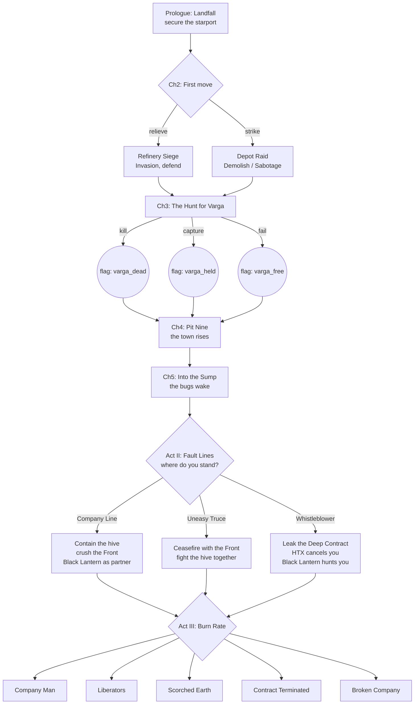

# Story mode: plan

A single-player campaign that tells a story. It is split into chapters, and each
chapter is a briefing, a choice of how to go about the job, a battle, and the
decisions that follow it. Choices and results move the story in two ways. In the
short term they shape the next battle: you scout first, go straight in, or call
an air strike. In the long term they shift standing, loyalty and the strength of
each enemy, and those decide which chapters come next and how the war ends.

It opens against an enemy you already know: the company is hired to put down a
rebellion. Later it fights the bugs the war wakes up, and then a rival PMC sent to
clean up after it. The Xenotripods are left out for now.

This is a plan, not a spec. Section 8 lists the decisions the owner needs to make
before work starts.

---

## 1. What it builds on

Most of what story mode needs already exists. The new work is a story layer on
top of the campaign dossier, plus a few hooks into battle setup.

| Need | Already there | Where |
|---|---|---|
| A company that carries over between battles (roster, EXP, trauma, honours, deaths by name, kUC) | The campaign dossier and its aftermath | `campaign.js`, `camp-aftermath.js`, `camp-company.js` |
| Spending between battles (recruiting, promotions, upgrades, doctrines) | The hub and roster screens | `dossier-hub.js`, `dossier-roster.js` |
| Enemy forces the AI can field and play | Unit profiles, army presets, the composition check | `data.js`, `rules.js` `checkArmy` |
| A battle set up from a contract (scenario, tier, PL, planet, world, roles) | The offer, which becomes `cfg` | `camp-rivals.js` `rollOffers`, `dossier-contract.js` |
| Small, asymmetric missions (raids, decapitation, VIP escort, evacuation, ambush) | The six solitaire scenarios, with the OpFor table running the enemy | `solitaire.js` |
| Rebel posture (Last Stand, Human Wave, Guerillas) | Rebel Tactics | `rules.js` `TACTICS`, `cfg.tactics` |
| Who attacks and who defends | Scenario roles and `cfg.attacker` | `scenarios.js` `rollRoles` |
| Fighting inside a compound | Close Encounters | `compound.js`, `ce_*` scenarios |
| Planet conditions | Other Worlds, `cfg.planet`, `cfg.world` | `rules.js` `rollWorld` |
| The result of a battle | `E.state.report` (winner, routed, casualties, units, stats) | `endphase.js` `battleReport` |
| Battles played out without a board (for testing and balancing) | `offtable.playNow` | `src/engine/offtable.js` |

What the story layer adds:

1. **A story graph:** chapters and the nodes inside them, written as data.
2. **Story state:** meters, flags, the current node, and a journal of what was chosen.
3. **Conditions and effects:** a small vocabulary that lets the data read and change story state and the dossier.
4. **Battle levers:** the hooks that let a story event change `cfg` and the opening of the battle (enemy list shown, strikes before turn 1, Readiness, allies…).
5. **Outcome grading:** a report turned into a grade (decisive, victory, draw, defeat, rout).
6. **Screens:** the chapter card, the briefing with its choices, the debrief, the journal.

A story campaign is an ordinary dossier with `mode: 'story'` and a `story` field.
The roster, the aftermath, saving, export and the hub keep working without change.

---

## 2. The story: *Deep Contract*

The setting is our own. It does not need to fit the PMC 2670 book's
background, only its tone and feel: corporate wars fought for profit, hired
guns, the frontier, rebels and bugs. Every name below is a placeholder.

### The setting

**Kessler's Reach** is a mining moon worked by the **Halvorsen-Tey Extraction
Consortium (HTX)**. Its miners have risen as the **Free Miners' Front**, led by
the former shift boss **Ada Varga**. HTX hires the player's company to restore
order, quickly and quietly.

The miners' grievance is real, and HTX is hiding why. HTX's "Deep Contract"
crews have been sent into a sealed lower level to strip biomass from a dormant
bug hive. Crews came back sick, or did not come back. The war and the heavy
blasting it brings wake the hive.

| Force | Army | Role in the story |
|---|---|---|
| The player's company | PMC | Hired guns, and the one force whose loyalty is not settled |
| Free Miners' Front | Rebels | The opening enemy: dug in, popular, outgunned |
| The Sump Hive | Space Bugs | Woken in Act I, the rising threat in Acts II and III |
| Black Lantern Security | PMC | HTX's second contractor: a rival in Act II, and possibly the last enemy |
| HTX | none on the table | The employer: pays, gives orders, and lies |

**Enemy forces are written for each battle.** They are not campaign rosters
kept from one battle to the next. Each battle has its own enemy force, and the
story's events, flags and meters change what is in it (section 4).

### Acts and chapters

There are three acts and about 12 chapters on any one path. Some chapters exist
only on one branch, so a single playthrough is 12 to 16 battles, plus any side
contracts the player takes.



**Act I: The Contract (chapters 1 to 5).** The rebellion as HTX describes it.
- **1. Landfall.** Secure the starport against a Front strike. It is a scripted
  Secure and control at Tier I and teaches the story screens. It cannot be lost
  outright: a defeat means "the port is held, at a cost", with Loyalty −1.
- **2. First move.** The briefing offers two jobs and the player picks one:
  relieve the besieged refinery (Invasion, defending), or raid the Front's supply
  depot (Demolish, or Sabotage as a commando). The job not taken happens anyway,
  off the table, and its result is rolled (section 4). A lost refinery adds
  *Retake the Refinery* to Act II. A depot left alone raises Rebel Strength.
- **3. The Hunt.** Decapitation, or Protecting the VIP turned around so the
  player snatches Varga. Killing her ends the hunt quickly, but she becomes a
  martyr. Capturing her is harder and opens the truce. Failing leaves her free.
- **4. Pit Nine.** A mining town rises. The choices here are about civilians:
  Evacuation (they are protected), Crushing the Resistance (they are not), or
  talking your way in (it needs Sentiment, or Varga held).
- **5. Into the Sump.** The Front falls back into the deep levels. The player
  follows, in Close Encounters, and meets bugs. A Deep Contract data core can be
  recovered here. It is the evidence the Whistleblower path needs, and HTX wants
  it back.

**Act II: Fault Lines (chapters 6 to 9).** The branch point opens at the start of
chapter 6. The paths on offer depend on what came before:

| Path | Open when | How it plays |
|---|---|---|
| **Company Line** | Always | Stay with HTX. Fight the bugs and the remaining Front. Black Lantern arrives as a "partner" whose orders come first. Pay is best and Sentiment falls. |
| **Uneasy Truce** | Varga held or free, and Sentiment ≥ 0 | A ceasefire with the Front against the hive. Some battles have rebel allies, as co-op allies run by the AI. HTX Standing drains every chapter. |
| **Whistleblower** | The data core recovered | Leak the Deep Contract. HTX cancels the contract, pay stops, and side contracts become the only income. Black Lantern is now the enemy. |

Each path has three or four chapters of its own, and Act II changes depending on
how the hunt went (*Retake the Refinery*, *Varga's Revenge* if she was killed, a
rebel splinter cell if she was held).

**Act III: Burn Rate (chapters 10 to 12).** The paths come back together around
two set pieces. Their order, and which side is fighting beside you, depend on
the path:
- **The Hive Heart:** a Close Encounters assault on the hive's core. Hive Growth
  sets the Tier and the number of bug waves.
- **The Black Lantern showdown:** PMC against PMC. Black Lantern's force is
  written for the battle, and changed by everything that has happened to them
  so far: sabotage, defections, and whether HTX trusts them over you.

**Endings**, chosen by meters and flags once the last battle is over:

| Ending | Roughly |
|---|---|
| **Company Man** | Company Line, hive contained, HTX Standing high. The company is rich and the moon is broken. |
| **Liberators** | Truce or Whistleblower, hive contained, Black Lantern beaten. The Front holds the moon. The company is poor, and loyal to its own. |
| **Scorched Earth** | Hive Growth gets away from everyone. HTX orders the moon sterilised from orbit, and the last battle is an evacuation. |
| **Contract Terminated** | Black Lantern wins the showdown, or HTX Standing hits the floor on the Company Line. The company is betrayed and runs. |
| **Broken Company** | Any time the company cannot field a Tier I army after its hub turn. |

Each ending has a short epilogue: what happened to the moon, to Varga, and to
each named unit that survived.

---

## 3. Decisions

### Every decision is a story event

The player never sees a standard menu of approaches or a standard debrief
checklist. **Every decision is a story event written for its place in the
story:** a situation, the people in it, and two to four things to do about it.
The air strike in chapter 3 is a particular strike on a particular target, with
a pilot who has an opinion. The prisoners in chapter 4 are particular prisoners,
and one of them has a name you will hear again.

Under the writing, each option is made from a small, shared **kit of effects**.
The kit is mechanical and reused. The events are not:

| Kit | Effects | Used by events such as |
|---|---|---|
| **Battle levers** (this battle only) | Show the enemy's list or tactic before mustering. Set the player's role or deployment edge. Strikes before turn 1 (Suppression, with a chance of a hit). Starting Suppression on your own units. Enemy Readiness. Swap the scenario. Shrink the force to a commando. Add allies. Turn limit, terrain, planet, world. Skip the battle. | Scouting, bribes, bombardments, sabotage, a guide who knows the tunnels, a traitor in the convoy |
| **State levers** (long term) | Meters, flags, kUC, EXP or Trauma for some or all units, recruit or lose a unit, a free upgrade, a flag that changes a later enemy force, a job settled off the table, a journal line | Prisoners, salvage, the fallen, reports to HTX, promises made to people |
| **Rolls** | A roll against a meter, Intel or a flag, with an effect on each result | A bluff, an interrogation, a plan that might not work |

**Readiness** is how prepared the enemy is for one battle. It starts at 0. Each
point gives the enemy something the event names, or something from a default
table: barricades, one extra unit, a forced Last Stand, or defender's choice of
deployment.

The rules for writing them:
- **No event is used twice.** Each one has its own id, and the validator refuses
  an id it has seen before. Within an act, no two events may offer the same set
  of levers (section 6).
- **Every event shows a trade-off** you can see in the writing: what it costs
  and who it hurts, even when the numbers are hidden.
- **Long-term choices come back.** A flag set by an event is read by a later one
  ("the prisoner you released is now the Front's sniper"). Every flag needs at
  least one later reader, and the validator checks this. That is what makes a
  decision feel long term.
- **Generic events are only for side contracts.** Side contracts are the
  repeatable money-earners between chapters. They draw from a small pool of
  short events with conditions, so they stay varied, and none of them sets a
  story flag.

### Before the battle (mostly short term)

One event before each battle. It shapes how the fight starts. It can also leave
a long-term mark. Act I, for example:

| Chapter | The event | Options (and the levers under them) |
|---|---|---|
| 1. Landfall | *The port master's offer.* The port's own security chief offers his men, if HTX pays them. | Take them (allies, kUC −). Send them home (nothing). Ask what they know (show the enemy list; the port master remembers you were rude: Sentiment −1). |
| 2. Refinery Siege | *The night shift.* Refinery workers are still inside, and the Front has offered them safe passage out. | Let them go (the enemy gets +1 Readiness, Sentiment +1, flag `nightshift_freed`). Keep them as a human shield (you choose the deployment, Sentiment −2, Loyalty −1). Get them to sabotage the Front's guns (roll on Intel: success is strikes before turn 1, failure is `nightshift_shot`). |
| 2. Depot Raid | *Truck 14.* A driver will sell you the depot's guard rota. | Pay (kUC −, show the list). Grab him and question him (Intel +1, Loyalty −1, flag `driver_taken`). Go in blind but now, before the rota changes (you attack, enemy Readiness 0). |
| 3. The Hunt | *Kill or capture.* HTX wants Varga dead. Your sergeant thinks she is worth more alive. | The HTX gunship (strikes before turn 1, HTX +1, `aim_kill`). A snatch team (swap to Decapitation, a commando only, `aim_capture`). Wait for her to move (Hive Growth +1, you pick the role). |
| 4. Pit Nine | *The schoolhouse.* The Front has fortified the town school, with children still in it. | Clear it room by room (Close Encounters, no strikes, Sentiment +2 if you win). Shell it (strikes, Sentiment −4, flag `pit9_shelled`, Loyalty −1). Talk to the teacher (needs `nightshift_freed` or `varga_held`: skip the battle, or face an ambush). |
| 5. Into the Sump | *The miners' map.* A captured miner offers a route through the old workings. | Trust him (the role is yours, but roll for a trap). Use HTX's surveys (the role is set, and HTX knows exactly where you are, flag `htx_tracking`). Blast a new way in (strikes, Hive Growth +2). |

### After the battle (mostly long term)

One or two events after each battle, chosen by the grade and the flags. They
decide what the fight meant. Act I, for example:

| After | The event | Options |
|---|---|---|
| 1. Landfall | *The dead at the gate.* Rebel dead, and civilians among them. | Bury them openly (Sentiment +1, HTX −1). Let HTX "process" them (HTX +1, flag `gate_cleared`: the town remembers). |
| 2. Refinery, won | *The ledger.* A rebel quartermaster's ledger shows where the Front gets its money. | Give it to HTX (HTX +1, Rebel Strength −2). Read it first (Intel +2, the first hint of the Deep Contract, flag `ledger_read`). Burn it, for a price the Front will pay (kUC +, Sentiment +1, `ledger_sold`). |
| 2. Refinery, lost | *The survivors.* HTX blames you for the refinery. | Take the blame (HTX −1, Loyalty +1). Blame the garrison (HTX +0, Loyalty −1, the garrison commander is now hostile). |
| 3. The Hunt, Varga held | *The cell.* Varga asks to talk to you, and only you. | Listen (Intel +1, flag `varga_talked`: opens the truce). Hand her straight to HTX (HTX +2, `varga_handed`, she may vanish). Hold her yourself as leverage (HTX −1, Rebel Strength −2, `varga_held`). |
| 4. Pit Nine | *Payroll.* The town's payroll safe survived the fight. | Keep it (kUC ++, Loyalty +1, Sentiment −2). Return it to the miners (Sentiment +2). Return it to HTX (HTX +1). |
| 5. Into the Sump | *The data core.* Your tech has it, and HTX asks for it on an open channel. | Hand it over (HTX +2). "Lost in the fighting" (`core_recovered`, `coverup`). Copy it, then hand it over (`core_recovered`, and a roll: HTX may notice). |

The Act II branch itself is an event too, at the start of chapter 6. Which
options it shows depends on the flags left by these Act I events.

### Success and failure

The report is graded:

| Grade | From the report |
|---|---|
| **Decisive** | Won, and the enemy routed or lost at least twice what you did (by composition points) |
| **Victory** | Won |
| **Draw** | No winner |
| **Defeat** | Lost, and you did not rout |
| **Rout** | Lost and routed |

A battle node branches on the grade, usually as success (Decisive or Victory)
and failure (the rest). Grades can also feed effects, for example a Decisive
win is +1 HTX. **Failure moves the story forward, it does not end it.** A lost
battle opens a harder chapter, takes away an option later, or changes an
ending, but the story only ends early when the company is broken. Authors must
give every battle a failure branch, and the validator checks that they have
(section 6).

---

## 4. The long-term state

### Meters

Each meter is an integer from −5 to +5, unless noted. **Some meters are
shown and some are hidden.** Each meter's entry in the story data says which:

- **Shown** (as a number in the journal, and as words in briefings, such as
  "HTX is uneasy"): HTX Standing, Loyalty and Intel. These are the company's own
  business, so the player knows them.
- **Hidden:** Sentiment, Rebel Strength, Hive Growth and Black Lantern
  Readiness. The player reads them only from the writing: the briefing's
  description of the enemy, what the locals say, how many tunnel mouths there
  are. An event can **reveal** a hidden meter for the rest of the story with
  `{ reveal: 'hive' }`. Examples: an informant in the Front shows Rebel
  Strength, and the data core shows Hive Growth.
- **The ending shows every meter**, with its history, so the player can see
  what their choices did.

Flags are never shown as flags. The journal tells them as prose.

| Meter | Goes up when | What it does |
|---|---|---|
| **HTX Standing** | Following orders, honest reports, decisive wins | Pay multiplier (×0.5 to ×1.5). Air strikes and supply drops (a free unit or upgrade each act). At −3 or lower, HTX starts to turn on you. |
| **Sentiment** (the locals) | Protecting civilians, releasing prisoners, sharing salvage | Bonus to recon rolls (the locals talk). Opens the truce and negotiations. Low Sentiment adds ambush events and Rebel Strength each chapter. |
| **Loyalty** (your troops) | Death benefits, winning, resting units | High: once a battle, a unit may re-roll a failed Morale or Rally. Low: units leave between chapters, and new Trauma comes more easily. |
| **Intel** (0 to 6) | Recon, interrogation, the data core | Spent on recon rolls, and on unlocking hidden options in briefings. |
| **Rebel Strength** (0 to 10) | Depots left alone, prisoners released, low Sentiment | How many of the optional units in a Front force turn up, and its Readiness. At 0 the Front is broken and its chapters change or drop out. |
| **Hive Growth** (0 to 10) | Every chapter that passes, blasting, time spent waiting | How big the bug forces are, and the number of waves in the Hive Heart. At 8 it forces Scorched Earth. |
| **Black Lantern Readiness** (0 to 10) | HTX trusting them over you, time | How many optional units Black Lantern brings, and their honours and upgrades. |

### Enemy forces

Each battle's enemy force is written for that battle, in three parts:

- **The core:** the units that are always there, as unit keys. Named enemies
  (Varga's bodyguard, Black Lantern's commander) are units in a core, with set
  names, honours and upgrades. They come back in later battles only because a
  later force names them again, and a flag decides whether they are alive to.
- **Optional units:** an ordered list. The battle's meter decides how many
  turn up. With Rebel Strength at 4 and a scale of 1 unit for each 2 points,
  the first two come.
- **Filler, to fit the player's company:** the player founds their own
  company, so the story can't know in advance how big it is. The battle node
  sets the Battle Tier and PL relative to the company (`tier: '+0'`). After the
  core, optional units and changes, the force is topped up from a `fill` list
  until it reaches a share of that battle's composition points (`to: 1.0` is an
  even fight). A meter can move the share. This is what keeps a written force
  fair against a company built in any way.
- **Changes:** what events and flags do to the force. Add or remove a unit,
  swap one unit for another, give a unit an honour or an upgrade, Suppression
  at the start, a forced Rebel Tactic, Readiness. For example: *Truck 14*'s
  driver taken means one fewer transport; the depot raided in chapter 2 means
  no heavy weapons in chapter 3; Varga killed adds a Determined unit of
  avengers.

```js
// unit keys are illustrative; the real ones are in data.js
enemy: {
  side: 'front', faction: 'rebel', tactics: 'laststand',
  core: ['reb_cmd', 'reb_militia', 'reb_militia', { key: 'reb_veterans', name: "Varga's Own", honours: [3] }],
  optional: { meter: 'rebels', per: 2, units: ['reb_militia', 'reb_technical', 'reb_mortar', 'reb_rpg'] },
  fill: { to: 0.9, from: ['reb_militia', 'reb_rpg'], meter: 'rebels', step: 0.05 },   // +5% a point of Rebel Strength
  changes: [
    { if: { flag: 'depot_raided' }, remove: 'reb_mortar' },
    { if: { flag: 'varga_dead' },   add: { key: 'reb_militia', name: 'The Avengers', rules: ['Determined'] } },
    { if: { flag: 'driver_taken' }, remove: 'reb_technical' }
  ]
}
```

The briefing describes the force from what you know, and an event can show it
in full. A story force does not have to pass the composition check, because the
writer sets its size. The validator checks that every unit key exists. The
Monte Carlo walk reports the smallest and largest version of each force, so the
range can be balanced.

### Flags

Named true or false facts: `varga_dead`, `varga_held`, `refinery_lost`,
`core_recovered`, `coverup`, `civilians_evacuated`, and so on. Conditions read
them. The ending table is mostly flags.

### Offscreen events

A job the player passes on is not lost. It happens anyway, off the table. Its
result is a roll changed by the meters and flags (Rebel Strength, what HTX sent
instead), and it sets a flag and moves a meter. The world moves on whatever the
player chooses.

### Interludes and side contracts

Between chapters the player is on the hub as now: recruiting, promotions,
honours, upgrades, doctrines. Story mode adds **side contracts**: a scenario from
`rollScenario`, against a force put together for the job from that enemy's
templates and scaled by its meter. Taking one earns kUC and EXP
but costs time: Hive Growth +1, and the meter the authored chapter names.
This is the money tap, and the only one on the Whistleblower path.

---

## 5. The design

### Scenarios: existing ones first, then custom ones

**Act I uses only the scenarios already in the game.** Every Act I mission is a
standard, solitaire or Close Encounters scenario, picked by id and given story
text. They are already tested and the AI already knows how to play them, so the
first playable slice (phase 4) needs no new rules.

| Chapter | Scenario | Source |
|---|---|---|
| 1. Landfall | Secure and control | `secure` |
| 2. Refinery Siege, or Depot Raid | Invasion as the defender; Demolish, or Sabotage as a commando | `invasion`, `demolish`, `s_sabotage` |
| 3. The Hunt | Decapitation, or Find and secure | `s_decap`, `find` |
| 4. Pit Nine | Evacuation, Crushing the Resistance, or Ambush! if negotiation fails | `s_evac`, `s_crush`, `s_ambush` |
| 5. Into the Sump | Clearing out, with bugs | `ce_clear` |
| Side contracts | Whatever `rollOffers` rolls | All of them |

A battle node can also adjust an existing scenario without a new one: its name
and blurb, the turn limit, the number of objectives, which side attacks, and the
compound's layout. This goes on the node as `variant: { turns: 12, name: 'Hold the Pass' }`,
and `scenarios.js` reads it from `cfg.story.variant` wherever it reads those
fields today.

**Acts II and III need custom scenarios.** These are new entries in `SCENARIOS`,
in the same shape as the existing ones (`deploy`, `reserves`, `zoneFor`,
`objectives`, `check`, `turns`, `hint`). They live in `src/story/scenarios-story.js`
and carry `story: true`, so the skirmish and campaign lists don't offer them. The
likely set:

| Scenario | Used for | What is new |
|---|---|---|
| **Hive Heart** | The Act III bug assault (Close Encounters) | Bugs come in waves from tunnel mouths each End phase; how many is set by Hive Growth. Brood chambers are objectives to destroy. You win when every chamber is gone. |
| **Convoy** | Act II on every path: moving HTX ore, rebel refugees or the data core | A vehicle group crosses the table from one edge to the other. The other side wins by stopping enough of it. |
| **Breakout / Extraction** | Scorched Earth's last battle, and the Whistleblower path's escape | An orbital countdown: from turn N, D3 table areas are destroyed each turn. Units leave by a landing zone. You score by what gets out. |
| **Hold the Line** | Truce chapters, where you hold a pass while rebel allies fall back | A defence against bug waves, with a timer. You win if you hold until turn N. |
| **Parley** | Negotiations that go wrong | Both sides start close together around a meeting point. Shooting is not allowed until a trigger: a roll, or the first shot. |
| **The Showdown** | Black Lantern, in Act III | Probably Hostile takeover or Secure and control with a variant. A custom scenario only if play-testing asks for one. |

Each custom scenario needs four things the existing ones already have:
- **AI support.** The planner and `ai.js` have to understand the scenario's goal.
  Existing flags such as `groundTaking` cover holding ground, but waves, convoys
  and evacuating units off the table are new goals for the AI. This is the main
  cost of every custom scenario, so each one should reuse an existing AI goal
  where it can.
- **Tests** in `test/unit`, matching `scenario*.js`: deployment, the victory check,
  and one whole battle played AI against AI.
- **A setup spike first.** Waves and the countdown are new kinds of event in the
  End phase. Build them first as plain options on an existing scenario, and only
  then put them in a named scenario.
- **Optional use outside the story.** Once they are stable, the good ones can be
  offered in skirmish and campaign as well (section 8).

### The story as data

A story is one file under `src/story/`, for example `src/story/deep-contract.js`.
It registers a plain object, like the scenarios and archetypes do:

```js
PMCStory.register({
  id: 'deep-contract', name: 'Deep Contract', version: 1,
  start: { faction: 'pmc', tier: 1, found: true },   // the player founds their own PMC company, as in a campaign
  meters: { htx: 1, sentiment: 0, loyalty: 1, intel: 1, rebels: 6, hive: 0, lantern: 2 },
  sides: {   // names and colours only; each battle writes its own force (section 4)
    front:   { faction: 'rebel', name: "Free Miners' Front" },
    hive:    { faction: 'bugs',  name: 'The Sump Hive' },
    lantern: { faction: 'pmc',   name: 'Black Lantern Security' }
  },
  chapters: [
    { id: 'c3', act: 1, title: 'The Hunt', intro: '…', nodes: [
      { id: 'c3.brief', type: 'brief', text: '…', next: 'c3.killorcapture' },
      { id: 'c3.killorcapture', type: 'event', title: 'Kill or capture', text: '…', options: [
        { id: 'gunship', text: 'Call in the HTX gunship.', if: { meter: 'htx', gte: 1 },
          battle: { strikes: 'D3+PL' }, effects: [{ meter: 'htx', add: 1 }, { flag: 'aim_kill', set: true }] },
        { id: 'snatch', text: 'Send the snatch team. Take her alive.',
          battle: { scenario: 's_decap', commando: true }, effects: [{ flag: 'aim_capture', set: true }] },
        { id: 'wait', text: 'Wait for her to move.',
          battle: { role: 'choose' }, effects: [{ meter: 'hive', add: 1 }] }
      ], next: 'c3.battle' },
      { id: 'c3.battle', type: 'battle', enemy: { side: 'front', core: [/* … */] }, scenario: 'secure', tier: '+0', pl: 1,
        planet: 'industrial', tactics: 'guerillas',
        on: {
          success: [{ if: { flag: 'aim_capture' }, effects: [{ flag: 'varga_held', set: true }], next: 'c3.held' },
                    { effects: [{ flag: 'varga_dead', set: true }, { meter: 'rebels', add: -2 }], next: 'c3.dead' }],
          failure: [{ effects: [{ flag: 'varga_free', set: true }, { meter: 'htx', add: -1 }], next: 'c3.free' }]
        } },
      { id: 'c3.held', type: 'debrief', text: '…', events: ['c3.thecell'], next: 'c4' }
    ] }
  ],
  endings: [ { id: 'liberators', if: { all: [{ flag: 'truce' }, { meter: 'hive', lt: 8 }] }, text: '…' } ]
});
```

**Node types:** `brief` (text, then next), `event` (a written situation with
options; an option's `battle` holds its battle levers and `effects` its state
levers), `battle`, `debrief` (text, then its events, picked by grade and flags),
`happening` (effects applied at once, with no choice; a roll is allowed), `interlude` (to the hub, with side contracts open),
`branch` (goes to the first `when` that holds), `ending`.

**Conditions:** `{ flag }`, `{ meter, gte|lte|lt|gt|eq }`, `{ grade }`,
`{ roster: 'size'|'tier', gte }`, `{ kUC, gte }`, `{ chance: 0.5 }`, and
`all` / `any` / `not`.

**Effects:** `{ meter, add|set }`, `{ flag, set }`, `{ kUC }`, `{ exp, to: 'all'|'fielded' }`,
`{ tp }`, `{ recruit: key, free }`, `{ upgrade: 'random' }`, `{ leave: n }`
(desertion), `{ offscreen: {...} }`,
`{ journal: 'text' }`. Each effect is one small function in the story engine, and
the validator knows every name.

Text can show state, for example `{name}`, `{enemy.front}` or
`{if varga_held}…{/if}`, so a briefing can mention what has happened without
being written twice.

Because the player founds their own company, the writing can't name its units
in advance. Tokens pick them from the roster: `{unit:command}` (the command
unit), `{unit:recon}`, `{unit:veteran}` (the unit with the most EXP),
`{unit:wounded}`, `{soldier:veteran}` (a named soldier from that unit). Each
token has a fallback if no unit fits, and once picked, a token keeps the same
unit for the rest of the chapter. "Your sergeant thinks she is worth more
alive" becomes "{soldier:veteran} thinks she is worth more alive".

### New modules

```
src/story/
  story.js          the engine: state, conditions, effects, walking the graph, grading (pure; runs in Node)
  levers.js         the battle levers: what each one does to cfg, and the rolls before the battle
  validate.js       checks a story's graph (also used by the tests)
  scenarios-story.js  the custom scenarios for Acts II and III (from phase 5)
  deep-contract.js  the campaign's content
src/view/
  story-screens.js  the chapter card, briefing, events, debrief, journal, ending
```

`story.js` follows the campaign files' conventions: no DOM, no storage, dice
through `R.d6`. It holds:

```
campaign.story = {
  id, version, node,            // where we are
  meters: {...}, flags: {...},
  journal: [ { chapter, node, choice, grade, effects, turn } ],
  pending: { event, option, readiness, levers }   // between the event and the battle
}
```

### Hooks into the battle

These are small, targeted changes. Each one is a field on `cfg.story` that is
read where the setting already lives:

| Hook | Where | Notes |
|---|---|---|
| Enemy list shown before mustering | `muster.js` | The view only. It shows B's picks. |
| Role and edge chosen by the player | `scenarios.js` `rollRoles` | Return the preset role instead of the roll. `cfg.attacker` exists already. |
| Rebel Tactic forced | `cfg.tactics` | Exists already |
| The story's enemy force | Where the AI's list is picked | Build the list from the battle's `enemy` (core, optional units, changes) instead of picking one. Readiness can add units from the force's optional list. |
| Barricades (Readiness) | Terrain setup | Reuse Last Stand's barricade placement. |
| Prelude strikes (air strike) | A new step after deployment, before turn 1 | Uses `shoot.js` to roll a hit and adds Suppression. The battle log shows it, so a replay replays it. |
| Starting Suppression on own units (failed recon) | The same prelude step | |
| Allies (truce) | Co-op machinery, side C | A third, AI-run side already exists for co-op and Besieged. Use it if it fits, or give the player rebel units under AI control. Needs a spike (phase 2). |
| Loyalty re-roll | Rally and Morale | One use per battle, shown on the command unit. |

Everything the battle does differently is stored in `cfg`, so saves, replays and
the AI (which plays copies of the battle) all see the same battle.

### Screens

1. **Main menu → Single player → Story**: new story, or continue. A new story
   founds the company with the campaign's existing founding screens
   (`dossier-found.js`): the name, colour, doctrine and starting units. The story
   sets the limits (a PMC company at Company Tier I).
2. **Chapter card:** act, chapter title, a short intro, the date on the moon.
3. **Briefing:** the story text, the enemy dossier (what you know of them), and
   the shown meters this chapter touches. Hidden meters come through only in
   the writing.
4. **The event before the battle:** the situation, then two to four options
   written as things to do. Each option says plainly what it risks. An option you
   can't take shows why ("You'd need the miners' trust").
   Then the existing muster.
5. **Battle:** unchanged, apart from the prelude.
6. **Debrief:** the grade, then the existing aftermath (pay, EXP, trauma,
   casualties by name), then the decisions.
7. **Journal:** the chapters so far, each choice and its result, the shown and
   revealed meters with their history, and the flags written as prose ("Varga is in an HTX cell.").
8. **Ending:** the epilogue, the company's record and its roll of honour.

---

## 6. Testing

- **`test/unit/story.js`:** conditions, effects, grading, save and load round trip.
- **`test/unit/storygraph.js`** (the validator, run on every story):
  - every node can be reached, and every `next` leads somewhere real;
  - every battle has a failure branch;
  - no state reachable by a walk leaves an event with zero options;
  - no event id is used twice, and no two events in an act offer the same set of levers;
  - every flag an event sets is read by something later (a later event, a branch, an ending);
  - every path ends at an ending, and every ending can be reached;
  - every scenario, faction, archetype, unit key and effect named exists.
- **A Monte Carlo walk** (`npm run story:sim`): ten thousand walks with random
  choices and random grades. It plays no battles. It reports how often each
  ending is reached, the range of each meter, and the chapters nobody reaches.
  This is the balance tool for the writing.
- **One full playthrough in `test:all`:** every battle played as a paper battle
  (`offtable.playNow`), through the real aftermath. It checks that the company
  stays legal from start to finish, and that every enemy force can be set up and played.
- **A browser test:** the screens from a new story to the end of chapter 1.

---

## 7. Plan

### Phase 0: the story bible
Settle the decisions in section 8. Write the chapter list for every path: each
event's situation and options in a line, each battle's scenario, enemy and Tier,
and the meters and flags each one moves.
Write no prose yet. Run it through the validator as soon as phase 1 exists.

### Phase 1: the story engine (Node only)
`story.js`, `validate.js`, the conditions and effects, grading, the story state
on the dossier, saving and loading. Tests. A tiny three-chapter test story
exercises every node type.

### Phase 2: the battle hooks
`levers.js`: every battle lever (enemy list shown, role, strikes, starting
Suppression, scenario swap, commando, allies, skip) as a change to `cfg`. Readiness. The prelude step. Building
enemy forces from the battle's core, optional units and changes. A spike on allies through side C. Tests for each
hook, through the engine.

### Phase 3: the screens
The story screens, the journal, the menu entry. Wired to the existing muster,
battle and aftermath. A browser test.

### Phase 4: Act I as a vertical slice
Chapters 1 to 5, written in full and playable. Play-test for pacing, how much
the events' choices matter, and difficulty.

### Phase 5: custom scenarios
Story scenario variants (`cfg.story.variant`). Then waves and the orbital
countdown as End-phase events, then Hive Heart, Convoy, Breakout, Hold the Line
and Parley, each with the AI support and tests it needs. Phase 5 can start while
phase 4 is still being play-tested.

### Phase 6: Acts II and III and the endings
The three paths, the set pieces, the epilogues. Balance with the Monte Carlo
walk and the paper-battle playthrough.

### Phase 7: polish
Portraits or emblems for the people in the story (in the iso style or as plain
emblems). Sound for the chapter cards. A second difficulty setting. Notes in the
README and the user guide.

Phases 1 and 2 can run side by side. Phase 4 is the point to stop and play it
before writing the rest.

---

## 8. Decisions for the owner

1. ~~**Setting and names.**~~ *Decided:* our own setting, matching the book
   only in tone and feel.
2. ~~**The starting company.**~~ *Decided:* the player founds their own.
   Enemy forces are topped up to fit the company (section 4), and the writing
   refers to the player's own units through text tokens (below).
3. ~~**How much to show.**~~ *Decided:* some meters are shown and some are
   hidden, set for each meter, and events can reveal a hidden one (section 4).
4. **Ironman.** One save, so choices and results can't be undone, or free
   reloads? The recommendation is an option at the start, ironman off by
   default.
5. **Length.** About 12 chapters a path, 12 to 16 battles. Shorter (8) for a
   first release?
6. **Side contracts.** Allowed throughout, as the money tap, at a time cost? Or
   only on the Whistleblower path?
7. **Allies on the table** (the truce path). Is a third, AI-run side worth
   building for, or should a truce change the briefings and battles without
   putting rebels on the table?
8. **Online.** Story mode is single player only. A co-op story (two companies,
   one story) is possible later, but it is not planned here.
9. **Custom scenarios outside the story.** Should the story scenarios (Hive
   Heart, Convoy and the rest) also be offered in skirmish and campaign once
   they are stable, or kept for the story?
10. **The Xenotripods.** Left out, as asked. The story graph leaves room for an
   Act IV, or a second story, that brings them in.
